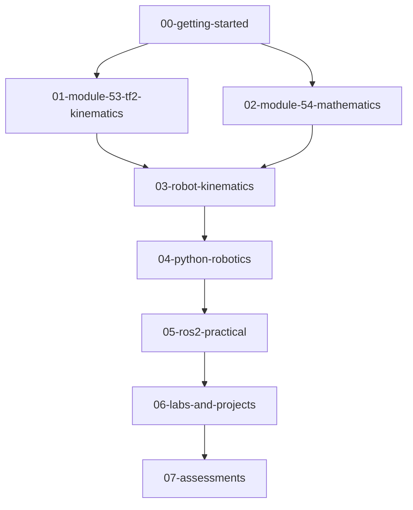

# 00 - Getting Started: Foundations of Robotics & AI

Welcome to the foundational entry point of the **Robotics & AI Student Notes** curriculum. Before diving into ROS 2 coordinate frames or complex multi-degree-of-freedom manipulator kinematics, every robotics engineer must master the shared physical vocabulary, coordinate conventions, and fundamental mathematical tools.

---

## Chapter Overview

1. [**Robotics Fundamentals**](robotics-fundamentals.md)
   - What defines a robot: Sense, Plan, Act.
   - Degrees of freedom (DoF) and Grubler's criterion.
   - Serial manipulators vs. mobile bases.
   - Coordinate frames and right-hand conventions (ISO 8855 / REP 103).
   - Real-world robotics lifecycle: from CAD to URDF to real-time control.

2. [**Mathematical Prerequisites**](mathematical-prerequisites.md)
   - Notation conventions: vectors $\mathbf{v}$, matrices $\mathbf{M}$, reference frames ${}^A\mathbf{p}$.
   - Linear algebra essentials: linear independence, span, basis vectors.
   - Trigonometry fundamentals: radian measure, law of cosines, unit circle.
   - Calculus essentials: limits, rate of change, Taylor series approximation.
   - Probability essentials: continuous random variables, variance, and noise models.

---

## Suggested Study Path

> [!TIP]
> Keep Python running in a terminal alongside these reading notes. Whenever an equation appears, open an interactive Python REPL or use the pre-built scripts in `04-python-robotics/` to test numerical examples with your own numbers.
