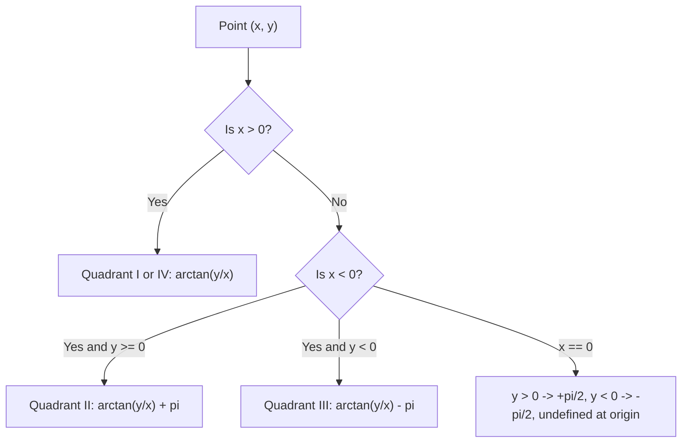

# Mathematical Prerequisites for Robotics & AI

## 1. Learning Objectives
By completing this chapter, you will be able to:
- Read and write standard robotics mathematical notation (leading superscripts and subscripts).
- Explain why `atan2(y, x)` is mandatory in robotics instead of standard $\arctan(y/x)$.
- Apply the Law of Cosines to planar kinematic triangles.
- Understand multivariate Taylor expansions and their role in Jacobian linearisation.
- Differentiate between scalar variance $\sigma^2$ and multivariate covariance $\mathbf{\Sigma}$.

---

## 2. Intuitive Explanation
Robotics mathematics bridges pure geometric reasoning and real-time computation. When a mobile robot or manipulator interacts with the world:
1. Coordinates are **relative**: There is no such thing as an absolute position without specifying *relative to which coordinate system*.
2. Angles wrap around circles: $359^\circ$ is only $2^\circ$ away from $1^\circ$, and dividing $y/x$ loses the sign quadrant.
3. Sensors are **noisy**: Every measurement is a probability distribution rather than a single exact number.

---

## 3. Mathematical Notation Conventions

In modern robotics engineering literature (Craig, Spong, Lynch & Park):

| Notation | Meaning | Example |
| :--- | :--- | :--- |
| ${}^A \mathbf{p}$ | Point $\mathbf{p}$ expressed in coordinate frame $\{A\}$ | ${}^{\text{base}}\mathbf{p} = [x, y, z]^T$ |
| ${}^A \mathbf{R}_B$ | Rotation matrix transforming vectors from frame $\{B\}$ to frame $\{A\}$ | ${}^A \mathbf{v} = {}^A \mathbf{R}_B \; {}^B \mathbf{v}$ |
| ${}^A \mathbf{T}_B$ | $4 \times 4$ Homogeneous transformation matrix from $\{B\}$ to $\{A\}$ | ${}^A \mathbf{p} = {}^A \mathbf{T}_B \; {}^B \mathbf{p}$ |
| $\mathbf{J}(\mathbf{q})$ | Manipulator Jacobian relating joint velocities $\mathbf{\dot{q}}$ to task velocity $\mathbf{v}$ | $\mathbf{v} = \mathbf{J}(\mathbf{q}) \mathbf{\dot{q}}$ |
| $\mathcal{N}(\boldsymbol{\mu}, \mathbf{\Sigma})$ | Gaussian probability distribution with mean $\boldsymbol{\mu}$ and covariance $\mathbf{\Sigma}$ | $\mathbf{x} \sim \mathcal{N}(\boldsymbol{\mu}, \mathbf{\Sigma})$ |

---

## 4. Trigonometric Prerequisite: Why `atan2(y, x)` is Crucial

In standard mathematics, the inverse tangent $\theta = \arctan(y / x)$ accepts a single scalar $y/x$.
However, the ratio:
$$\frac{+1}{-1} = -1 \quad \text{and} \quad \frac{-1}{+1} = -1$$
Both yield $\arctan(-1) = -45^\circ$, even though $(+1, -1)$ lies in Quadrant IV ($315^\circ$) while $(-1, +1)$ lies in Quadrant II ($135^\circ$).

In robotics, **`atan2(y, x)`** inspects the individual signs of both $y$ and $x$:
$$\text{atan2}(y, x) \in (-\pi, +\pi]$$



> [!CAUTION]
> Always use `math.atan2(y, x)` or `numpy.arctan2(y, x)`. Notice the parameter order: $y$ comes **first**, $x$ comes **second**.

---

## 5. Geometric Prerequisite: The Law of Cosines

For any triangle with sides $a$, $b$, and $c$, where angle $C$ is opposite to side $c$:
$$c^2 = a^2 + b^2 - 2ab \cos(C)$$

Solving for $\cos(C)$:
$$\cos(C) = \frac{a^2 + b^2 - c^2}{2ab}$$

In robot manipulator kinematics, side $a$ and $b$ are the rigid lengths of Link 1 and Link 2, while $c$ is the Euclidean distance from the shoulder to the wrist. This equation allows direct computation of the elbow joint angle.

---

## 6. Calculus Prerequisite: Taylor Series & Linearisation

Nonlinear functions $f(x)$ in robotics (such as trigonometric kinematics) are difficult to invert directly in real time. We approximate them locally using Taylor Series around an operating point $x_0$:

$$f(x) \approx f(x_0) + \left.\frac{df}{dx}\right|_{x_0} (x - x_0) + \frac{1}{2!} \left.\frac{d^2f}{dx^2}\right|_{x_0} (x - x_0)^2 + \dots$$

For small displacements $\Delta x = x - x_0$, discarding second-order and higher terms yields the linear model:
$$\Delta f \approx \left.\frac{df}{dx}\right|_{x_0} \Delta x$$

In multi-variable robotics systems $\mathbf{x} = \mathbf{f}(\mathbf{q})$, the collection of all first-order partial derivatives forms the **Jacobian Matrix**:
$$\Delta \mathbf{x} \approx \mathbf{J}(\mathbf{q}) \Delta \mathbf{q}$$

---

## 7. Probability Prerequisite: Expectation and Covariance

Sensors (wheel encoders, LiDAR, IMU) are corrupted by stochastic noise.
- **Expected value (Mean):**
  $$\boldsymbol{\mu} = \mathbb{E}[\mathbf{x}] = \int \mathbf{x} p(\mathbf{x}) d\mathbf{x}$$
- **Covariance Matrix:**
  $$\mathbf{\Sigma} = \text{Cov}(\mathbf{x}) = \mathbb{E}[(\mathbf{x} - \boldsymbol{\mu})(\mathbf{x} - \boldsymbol{\mu})^T]$$

For a 2D robot position $[x, y]^T$:
$$\mathbf{\Sigma} = \begin{bmatrix} \sigma_x^2 & \sigma_{xy} \\ \sigma_{yx} & \sigma_y^2 \end{bmatrix}$$
where $\sigma_x^2$ is the variance along $x$, and $\sigma_{xy} = \sigma_{yx}$ is the cross-covariance reflecting whether errors in $x$ correlate with errors in $y$.

---

## 8. Python Demonstration

```python
import numpy as np

# 1. atan2 demonstration
points = [(1, 1), (-1, 1), (-1, -1), (1, -1)]
for x, y in points:
    angle_deg = np.degrees(np.arctan2(y, x))
    print(f"Point ({x:+d}, {y:+d}) -> atan2 angle: {angle_deg:+6.1f} deg")

# 2. Covariance matrix of 2D noisy sensor data
np.random.seed(42)
true_pos = np.array([2.0, 3.0])
noise = np.random.multivariate_normal(
    mean=[0, 0],
    cov=[[0.04, 0.01], [0.01, 0.09]],
    size=1000
)
measurements = true_pos + noise
sample_cov = np.cov(measurements.T)
print("\nSample Covariance Matrix from 1000 LiDAR readings:")
print(np.round(sample_cov, 4))
```

---

## 9. Common Mistakes & Debugging Tips
1. **Reversing parameters in `atan2`:** Calling `atan2(x, y)` instead of `atan2(y, x)`.
2. **Clipping values before `arccos`:** Floating point inaccuracies can result in `cos_val = 1.00000000002`. Passing this to `np.arccos` produces `NaN`. Always use `np.clip(cos_val, -1.0, 1.0)`.
3. **Assuming independent sensor errors:** Real sensor errors are almost never independent; off-diagonal terms in covariance matrices are usually non-zero.

---

## 10. Exercises

### Beginner
1. Compute $\text{atan2}(0, -3)$ and $\text{atan2}(-3, 0)$ by hand in degrees.
2. Given a triangle with $a = 0.5\,\text{m}$, $b = 0.4\,\text{m}$, and $c = 0.7\,\text{m}$, compute the angle $C$ in degrees using the Law of Cosines.

### Intermediate
3. Explain why the covariance matrix $\mathbf{\Sigma}$ must always be symmetric positive semi-definite.
4. Linearise the function $f(\theta) = \sin(\theta)$ around $\theta_0 = 0$ and $\theta_0 = \pi/4$. Evaluate the approximation error for $\Delta \theta = 0.1\,\text{rad}$.

### Advanced
5. Given a 2D Gaussian distribution with mean $\boldsymbol{\mu} = [0, 0]^T$ and covariance $\mathbf{\Sigma} = \begin{bmatrix} 4 & 2 \\ 2 & 3 \end{bmatrix}$, calculate its eigenvalues and eigenvectors, and explain what they represent geometrically (error ellipse principal axes).

---

## 11. Summary & Next Steps
- Robotics uses specific frame notation (${}^A\mathbf{T}_B$) and quadrant-aware trigonometry (`atan2`).
- Taylor expansion provides the foundation for Jacobians and Extended Kalman Filters (EKF).
- Probability distributions and covariance matrices model physical sensor uncertainty.
- Ready to explore coordinate systems in real robot software? Proceed to [**01-module-53-tf2-kinematics**](../01-module-53-tf2-kinematics/README.md).
