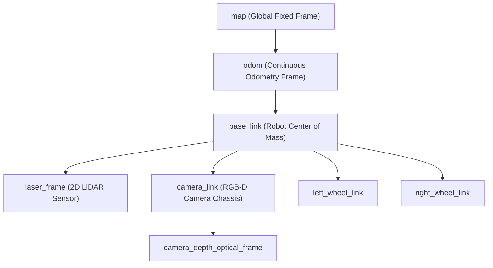
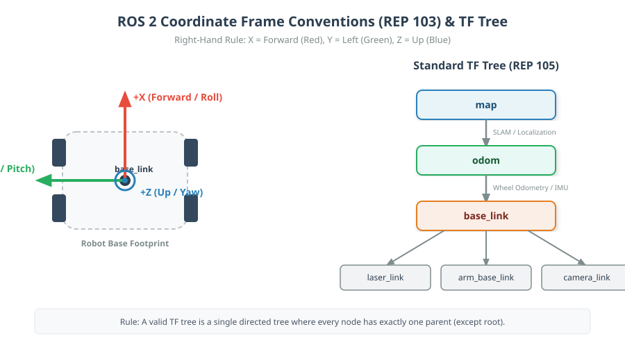

# 01: Coordinate Frames & The TF Tree in ROS 2

## 1. Learning Objectives
By completing this chapter, you will be able to:
- Explain what a coordinate frame represents physically and mathematically.
- Apply the **Directed Tree Property** of TF2 (single parent rule).
- Express transformations in standard mathematical notation: ${}^A \mathbf{T}_B$.
- Understand ROS **REP 105** (Coordinate Frames for Mobile Platforms).
- Identify and resolve cycles and disconnected branches in a TF tree.

---

## 2. Intuitive Explanation
Imagine standing in a room. You point at a coffee mug on a table.
- If you describe the mug's position from **your own eyes**, you might say: "0.8 metres forward, 0.2 metres right, 0.1 metres down."
- If someone at the **doorway** describes the same mug, they might say: "4.5 metres forward, 1.2 metres left, 0.7 metres up."

Both descriptions are 100% correct! They simply use different **coordinate frames**.

In robotics:
- A camera perceives obstacles in `camera_optical_frame`.
- A 2D LiDAR reports ranges in `laser_frame`.
- The robot chassis moves according to `base_link`.
- The global navigation map lives in `map`.

**TF2** acts as the automated universal translator that converts points, vectors, and poses seamlessly between any two frames in the system without requiring custom trigonometric code for every pair of sensors.






---

## 3. Mathematical Formulation

A coordinate frame $\{B\}$ is defined relative to reference frame $\{A\}$ by a **homogeneous transformation matrix** ${}^A \mathbf{T}_B \in SE(3)$:

$${}^A \mathbf{T}_B = \begin{bmatrix} {}^A \mathbf{R}_B & {}^A \mathbf{p}_B \\ \mathbf{0}_{1 \times 3} & 1 \end{bmatrix} = \begin{bmatrix} r_{11} & r_{12} & r_{13} & x \\ r_{21} & r_{22} & r_{23} & y \\ r_{31} & r_{32} & r_{33} & z \\ 0 & 0 & 0 & 1 \end{bmatrix}$$

### 4. Symbol Definitions
- $\{A\}$: The parent (reference) coordinate frame.
- $\{B\}$: The child coordinate frame.
- ${}^A \mathbf{R}_B \in SO(3)$: $3 \times 3$ orthonormal rotation matrix representing the orientation of $\{B\}$ relative to $\{A\}$.
- ${}^A \mathbf{p}_B \in \mathbb{R}^3$: $3 \times 1$ translation vector representing the origin of $\{B\}$ measured from $\{A\}$.
- ${}^B \mathbf{p}$: Coordinates of a physical point measured in frame $\{B\}$.
- ${}^A \mathbf{p}$: Coordinates of the same physical point expressed in frame $\{A\}$.

The fundamental mapping equation is:
$${}^A \mathbf{p} = {}^A \mathbf{T}_B \; {}^B \mathbf{p}$$

---

## 5. The Cardinal Rule of TF2: The Tree Property

In mathematics and graph theory, a **tree** is an undirected graph in which any two vertices are connected by exactly one path (acyclic, connected).

In TF2:
1. Every coordinate frame is a node in the tree.
2. Every published transform defines a directed edge from a **Parent Frame** to a **Child Frame**.
3. **The Single Parent Rule:** *Every child frame must have EXACTLY ONE parent frame.*
4. A frame can have multiple children, but **never** multiple parents.
5. There must be **no loops or cycles**.

> [!CAUTION]
> If two nodes attempt to publish different parents for the same child frame (for example, both `node_A` and `node_B` publish a transform to `base_link`), TF2 will fail with high-frequency jitter, warning logs:
> `TF_REPEATED_DATA` or `TF_MULTIPLE_PARENTS`.

---

## 6. Fully Worked Numerical Example

Suppose a 2D LiDAR is mounted on a mobile robot:
- Frame $\{A\}$ is `base_link` (robot center).
- Frame $\{B\}$ is `laser_frame` (LiDAR).
- The LiDAR is mounted $0.3\,\text{m}$ forward ($+X$) and $0.15\,\text{m}$ above ($+Z$) the robot center, with no rotation (${}^A \mathbf{R}_B = \mathbf{I}_{3\times3}$).
- The LiDAR detects an obstacle point ${}^B \mathbf{p} = [1.2, 0.5, 0.0]^T\,\text{m}$ in its own coordinate frame.

**Task:** Compute the position of the obstacle in `base_link` frame ${}^A \mathbf{p}$.

**Step-by-step calculation:**
1. Form the transformation matrix ${}^A \mathbf{T}_B$:
   $${}^A \mathbf{T}_B = \begin{bmatrix} 1 & 0 & 0 & 0.3 \\ 0 & 1 & 0 & 0.0 \\ 0 & 0 & 1 & 0.15 \\ 0 & 0 & 0 & 1 \end{bmatrix}$$
2. Express ${}^B \mathbf{p}$ in homogeneous coordinates:
   $${}^B \mathbf{p} = \begin{bmatrix} 1.2 \\ 0.5 \\ 0.0 \\ 1 \end{bmatrix}$$
3. Perform matrix multiplication:
   $${}^A \mathbf{p} = {}^A \mathbf{T}_B \; {}^B \mathbf{p} = \begin{bmatrix} 1(1.2) + 0(0.5) + 0(0.0) + 0.3(1) \\ 0(1.2) + 1(0.5) + 0(0.0) + 0.0(1) \\ 0(1.2) + 0(0.5) + 1(0.0) + 0.15(1) \\ 1 \end{bmatrix} = \begin{bmatrix} 1.5 \\ 0.5 \\ 0.15 \\ 1 \end{bmatrix}$$
4. **Result:** In the robot's `base_link` frame, the obstacle is at $x = 1.5\,\text{m}$ ahead, $y = 0.5\,\text{m}$ to the left, and $z = 0.15\,\text{m}$ above the ground center.

---

## 7. Robotics Application: Sensor Fusion
In autonomous cars and mobile manipulators, multiple sensors run at different update rates:
- Camera: 30 Hz
- LiDAR: 10 Hz
- Radar: 20 Hz
- IMU: 200 Hz

Because all sensors publish their spatial offsets relative to `base_link`, sensor fusion algorithms (such as extended Kalman filters or obstacle costmaps) can project all detections into a unified frame regardless of physical sensor mounting locations.

---

## 8. Python Demonstration

```python
import numpy as np

# Define transformation: translation [0.3, 0.0, 0.15], rotation Identity
T_base_laser = np.eye(4)
T_base_laser[0, 3] = 0.30
T_base_laser[2, 3] = 0.15

# Laser detection point in laser_frame
p_laser = np.array([1.2, 0.5, 0.0, 1.0])

# Transform to base_link
p_base = T_base_laser @ p_laser
print(f"Point in base_link: X={p_base[0]:.2f}m, Y={p_base[1]:.2f}m, Z={p_base[2]:.2f}m")
```

---

## 9. Common Mistakes & Debugging Tips
1. **Inverted Transform Direction:** Publishing child $\to$ parent instead of parent $\to$ child. In ROS 2, `TransformStamped.header.frame_id` is the **Parent**, and `TransformStamped.child_frame_id` is the **Child**.
2. **Circular Dependencies:** Connecting $A \to B \to C \to A$. This breaks TF2 tree resolution immediately.
3. **Missing Root Frame:** If `view_frames` generates two separate disconnected trees, RViz will display `No transform from [X] to [Fixed Frame]`.

---

## 10. Exercises

### Beginner
1. If frame $\{B\}$ is translated by $[2, 0, 0]$ relative to $\{A\}$, and point $\mathbf{p}$ is at $[1, 1, 0]$ in $\{B\}$, what is $\mathbf{p}$ in $\{A\}$?
2. In ROS 2, if `header.frame_id = "odom"` and `child_frame_id = "base_link"`, which frame is the parent and which is the child?

### Intermediate
3. Explain why the TF2 graph cannot allow cycles. What mathematical paradox would occur if ${}^A \mathbf{T}_B$ and ${}^B \mathbf{T}_A$ were published simultaneously without being exact mathematical inverses?
4. A camera is mounted upside-down on a robot ($180^\circ$ roll). Write the $3 \times 3$ rotation matrix ${}^{\text{base}}\mathbf{R}_{\text{cam}}$.

### Advanced
5. If frame $\{C\}$ is connected to $\{B\}$ via ${}^B \mathbf{T}_C$, and $\{B\}$ is connected to $\{A\}$ via ${}^A \mathbf{T}_B$, write the formula for transforming a point from $\{C\}$ directly to $\{A\}$. Prove why matrix multiplication preserves associativity: ${}^A \mathbf{T}_C = {}^A \mathbf{T}_B \; {}^B \mathbf{T}_C$.

---

## 11. Summary & Next Steps
- A coordinate frame defines an origin and orientation in space.
- TF2 models coordinate frames as a strict tree: every child has one parent.
- Next, learn how ROS 2 handles static hardware mountings versus moving joints in [**02: Static & Dynamic Transforms**](02-static-and-dynamic-transforms.md).
