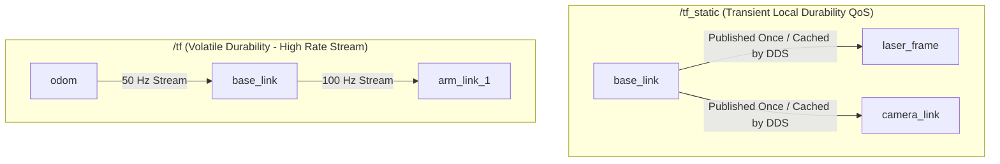
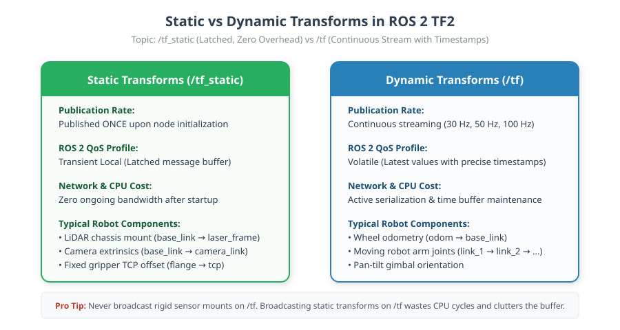

# 02: Static and Dynamic Transforms in ROS 2

## 1. Learning Objectives
By completing this chapter, you will be able to:
- Contrast the architecture and performance impact of `/tf` versus `/tf_static`.
- Configure proper Quality of Service (QoS) for transient local (latched) static transforms.
- Publish static transforms using both CLI (`static_transform_publisher`) and Python (`StaticTransformBroadcaster`).
- Broadcast high-frequency dynamic transforms for moving joints and robot odometry.
- Prevent network saturation and CPU starvation caused by misusing dynamic broadcasters for static links.

---

## 2. Intuitive Explanation
In any physical robot, relationships between components fall into two categories:
1. **Static Relationships (Rigidly Bolted):**
   - The LiDAR is bolted to the robot chassis.
   - The camera bracket is screwed to the mast.
   - The robot base footprint is centered between the wheels.
   *These physical distances NEVER change while the robot is running.*
2. **Dynamic Relationships (Moving in Time):**
   - The robot's position relative to the world changes as wheels turn.
   - An arm joint rotates around its motor shaft.
   - A pan-tilt camera head tracks an object.
   *These relationships change every few milliseconds.*

If we broadcasted static sensor brackets at 100 Hz over the network, we would waste significant CPU and wireless network bandwidth re-announcing something that never moves. ROS 2 solves this by splitting transforms into **`/tf_static`** (published once with DDS **Transient Local** durability QoS) and **`/tf`** (continuous, high-frequency stream with Volatile durability).






---

## 3. Architecture & QoS Comparison

| Feature | Dynamic Transforms (`/tf`) | Static Transforms (`/tf_static`) |
| :--- | :--- | :--- |
| **Topic Name** | `/tf` | `/tf_static` |
| **Typical Frequency** | 20 Hz – 200 Hz | Once at startup (or on topology change) |
| **ROS 2 Message Type** | `tf2_msgs/msg/TFMessage` | `tf2_msgs/msg/TFMessage` |
| **QoS Durability** | **Volatile** (no history; late joiners miss past messages) | **Transient Local** (DDS stores last message for late joiners) |
| **Network Cost** | Proportional to publish rate | Negligible |
| **Broadcaster Class** | `tf2_ros.TransformBroadcaster` | `tf2_ros.StaticTransformBroadcaster` |

> [!NOTE]
> **ROS 2 QoS vs. Legacy ROS 1 "Latched" Topics:**
> In ROS 1, `/tf_static` used a "latched" topic flag. In ROS 2, topic latching is replaced by DDS **Quality of Service (QoS) Durability**:
> - `Transient Local` durability directs the DDS middleware publisher to cache the last sent message. When a new node joins later, DDS automatically delivers the cached transform without requiring the publisher to rebroadcast.
> - The subscriber must also configure `durability=QoSInitialization(DurabilityPolicy.TRANSIENT_LOCAL)` (which `tf2_ros.Buffer` configures automatically).

---

## 4. Mathematical Representation over Time

A dynamic transformation is a time-parameterised mapping ${}^A \mathbf{T}_B(t)$:

$${}^A \mathbf{T}_B(t) = \begin{bmatrix} {}^A \mathbf{R}_B(t) & {}^A \mathbf{p}_B(t) \\ \mathbf{0}_{1 \times 3} & 1 \end{bmatrix}$$

For a static transformation, the time derivative is identically zero:
$$\frac{d}{dt} \left( {}^A \mathbf{T}_B \right) = \mathbf{0}_{4 \times 4} \quad \forall \; t \ge 0$$

In TF2's internal buffer:
- For `/tf`, transforms are stored in a ring buffer spanning a configurable duration (typically 10.0 seconds). Interpolation occurs between adjacent timestamps $t_1 \le t_{\text{query}} \le t_2$.
- For `/tf_static`, the transform is marked valid for all points in time from $t=0$ to $t=\infty$.

---

## 5. CLI Static Transform Publisher (ROS 2 Jazzy & Iron)

You can publish a static transform directly from the command line without writing code.

### Syntax (Translation + Euler RPY in radians):
```bash
ros2 run tf2_ros static_transform_publisher --x 0.25 --y 0.0 --z 0.40 --roll 0.0 --pitch 0.0 --yaw 0.0 --frame-id base_link --child-frame-id laser_frame
```

### Syntax (Translation + Quaternion $[x, y, z, w]$):
```bash
ros2 run tf2_ros static_transform_publisher --x 0.25 --y 0.0 --z 0.40 --qx 0.0 --qy 0.0 --qz 0.0 --qw 1.0 --frame-id base_link --child-frame-id laser_frame
```

> [!NOTE]
> In older ROS 2 distributions (Foxy / Galactic), the syntax used positional arguments:
> `ros2 run tf2_ros static_transform_publisher x y z yaw pitch roll frame_id child_frame_id`.
> Starting in ROS 2 Humble and standardized in Jazzy, named arguments (`--x`, `--frame-id`) are standard.

---

## 6. Fully Worked Numerical Example

A camera is mounted on a bracket $0.15\,\text{m}$ ahead of `base_link` and tilted downwards by $15^\circ$ (pitch $= +0.2618\,\text{rad}$ about the robot's $Y$-axis).

1. **Translation vector:**
   $${}^{\text{base}}\mathbf{p}_{\text{cam}} = \begin{bmatrix} 0.15 \\ 0.0 \\ 0.20 \end{bmatrix}\,\text{m}$$
2. **Rotation matrix (Pitch $\theta = +15^\circ$):**
   $${}^{\text{base}}\mathbf{R}_{\text{cam}} = \mathbf{R}_y(15^\circ) = \begin{bmatrix} \cos(15^\circ) & 0 & \sin(15^\circ) \\ 0 & 1 & 0 \\ -\sin(15^\circ) & 0 & \cos(15^\circ) \end{bmatrix} \approx \begin{bmatrix} 0.9659 & 0 & 0.2588 \\ 0 & 1 & 0 \\ -0.2588 & 0 & 0.9659 \end{bmatrix}$$
3. **Quaternion equivalent:**
   $$q = \left[ 0, \; \sin\left(\frac{15^\circ}{2}\right), \; 0, \; \cos\left(\frac{15^\circ}{2}\right) \right] = [0.0, \; 0.1305, \; 0.0, \; 0.9914]$$
4. **Publishing command:**
   ```bash
   ros2 run tf2_ros static_transform_publisher --x 0.15 --y 0.0 --z 0.20 --roll 0.0 --pitch 0.2618 --yaw 0.0 --frame-id base_link --child-frame-id camera_link
   ```

---

## 7. Python Implementation: `StaticTransformBroadcaster`

```python
import rclpy
from rclpy.node import Node
from geometry_msgs.msg import TransformStamped
from tf2_ros.static_transform_broadcaster import StaticTransformBroadcaster
import numpy as np

class SensorOffsetPublisher(Node):
    def __init__(self):
        super().__init__('sensor_offset_publisher')
        self.tf_static_broadcaster = StaticTransformBroadcaster(self)
        self.publish_sensor_transforms()

    def publish_sensor_transforms(self):
        t = TransformStamped()
        t.header.stamp = self.get_clock().now().to_msg()
        t.header.frame_id = 'base_link'
        t.child_frame_id = 'laser_frame'

        t.transform.translation.x = 0.25
        t.transform.translation.y = 0.0
        t.transform.translation.z = 0.40

        # Identity rotation (w=1.0)
        t.transform.rotation.x = 0.0
        t.transform.rotation.y = 0.0
        t.transform.rotation.z = 0.0
        t.transform.rotation.w = 1.0

        # Broadcast static transform (stored in latched topic)
        self.tf_static_broadcaster.sendTransform(t)
        self.get_logger().info('Broadcasted static transform base_link -> laser_frame')

def main():
    rclpy.init()
    node = SensorOffsetPublisher()
    try:
        rclpy.spin(node)
    except KeyboardInterrupt:
        pass
    node.destroy_node()
    rclpy.shutdown()

if __name__ == '__main__':
    main()
```

---

## 8. Common Mistakes & Debugging Tips
1. **Broadcasting Static Transforms in a High-Frequency Timer Loop:**
   Publishing to `StaticTransformBroadcaster` at 50 Hz causes TF2 subscribers to repeatedly rebuild the static transform cache, causing severe CPU spikes. Send it **once** at node startup.
2. **Missing `w = 1.0` in Unrotated Quaternions:**
   Leaving quaternion fields at their default values ($x=0, y=0, z=0, w=0$) produces a non-unit quaternion ($||q|| = 0$). TF2 will reject this transform with `Quaternion is not normalized`.
3. **Overwriting with Multiple Static Nodes:**
   If multiple nodes publish separate static transforms, ensure they send all transforms in a list `sendTransform([t1, t2])` or publish distinct child frames.

---

## 9. Exercises

### Beginner
1. What is the fundamental difference between `Transient Local` QoS and `Volatile` QoS in ROS 2?
2. Write the CLI command to publish a static transform between `base_link` and `imu_link` offset by $z = 0.05\,\text{m}$ with zero rotation.

### Intermediate
3. Suppose a camera is mounted tilted up by $30^\circ$ around the $Y$-axis. Calculate its unit quaternion components $(q_x, q_y, q_z, q_w)$.
4. Why does RViz display `No transform from [laser_frame] to [base_link]` if you start RViz *after* a static transform was published using standard volatile QoS?

### Advanced
5. Write a Python script that reads sensor offsets from a YAML configuration file and broadcasts multiple static transforms simultaneously using `StaticTransformBroadcaster.sendTransform(list_of_transforms)`.

---

## 10. Summary & Next Steps
- `/tf_static` handles rigid mechanical links using transient local QoS to minimize overhead.
- `/tf` handles moving frames (wheels, odometry, joints) using continuous streaming.
- Next, explore the foundational navigation hierarchy in [**03: The map -> odom -> base_link Hierarchy**](03-map-odom-base-link.md).
