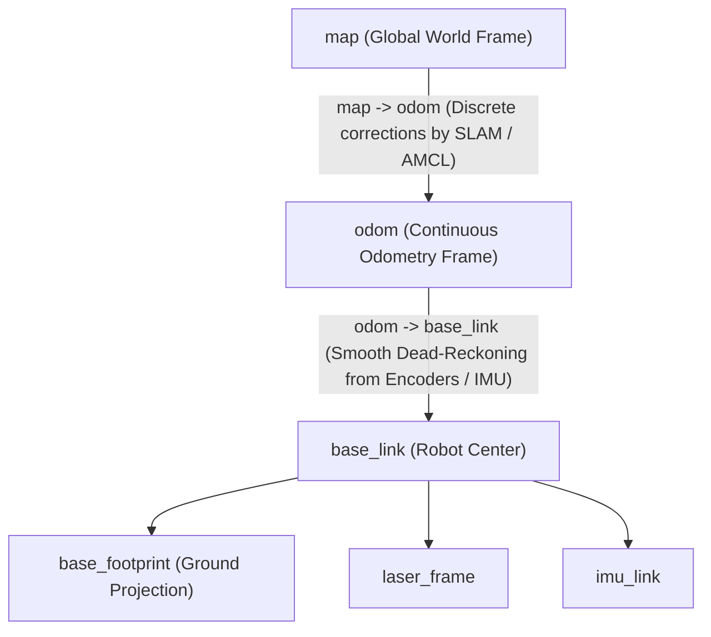

# 03: The map -> odom -> base_link Coordinate Frame Hierarchy

## 1. Learning Objectives
By completing this chapter, you will be able to:
- Articulate the specific roles of `map`, `odom`, and `base_link` as mandated by **ROS REP 105**.
- Explain why autonomous navigation requires two distinct world-fixed frames (`map` and `odom`).
- Describe how localization systems (AMCL, SLAM) adjust the `map -> odom` transform to correct for dead-reckoning drift without introducing step-discontinuities into motor controllers.
- Identify the parent-child relationships that maintain tree validity during navigation.

---

## 2. Intuitive Explanation: The Drifting Sailor and the Lighthouse

Imagine a ship sailing in the fog:
- **`base_link` (The Ship):** Attached to the physical center of the vessel. Everything on board (compass, radar, helm) moves with it.
- **`odom` (The Ship's Log / Dead Reckoning):** The helmsman measures how many times the propeller turned and the compass heading. By dead reckoning, they estimate where the ship is relative to where it departed. This estimate is **locally smooth and continuous**. However, ocean currents and wheel slip cause the estimated position to drift slowly over time.
- **`map` (The Lighthouse / Global Satellite Map):** Every 10 seconds, the lighthouse beam pierces the fog or GPS fixes the ship's true global position. Suddenly, the navigator realizes: *"We drifted 30 metres east of our dead reckoning!"*

Now comes the critical engineering question: **How do we apply this 30-metre correction?**
- If we jumped the ship's position directly on the motor controller (`odom -> base_link`), the controller would see a sudden infinite acceleration jump, causing the steering actuators to violently jerk!
- Instead, ROS 2 leaves the `odom -> base_link` transform continuous and smooth, and publishes the correction on **`map -> odom`**!



---

## 3. Detailed Frame Definitions (ROS REP 105)

### 3.1 `base_link`
- **Definition:** Rigidly attached to the mobile robot chassis. The origin is typically chosen at the robot's center of rotation (midpoint between drive wheels on differential-drive robots) or center of mass.
- **Property:** Moves dynamically through the environment.

### 3.2 `odom`
- **Definition:** A world-fixed reference frame. The transform `odom -> base_link` is calculated from dead-reckoning sensor sources (wheel encoders, visual odometry, IMU integration).
- **Key Guarantee:** The pose of `base_link` in `odom` is **guaranteed to be continuous** without discrete spatial jumps.
- **Limitation:** It drifts unbounded over long distances and time due to wheel slip, uneven terrain, and numerical integration errors.

### 3.3 `map`
- **Definition:** A world-fixed global reference frame (typically aligned with an occupancy grid map created by Cartographer, Nav2, or SLAM Toolbox).
- **Key Guarantee:** Globally consistent over time and space. The robot's estimated pose in `map` does not drift indefinitely.
- **Trade-off:** The transform `map -> base_link` may experience **discrete jumps** whenever a SLAM loop-closure occurs or AMCL relocalises against map features.

---

## 4. Mathematical Transformation Chain

The global pose of the robot in the map is ${}^{\text{map}}\mathbf{T}_{\text{base}}$:

$${}^{\text{map}}\mathbf{T}_{\text{base}} = {}^{\text{map}}\mathbf{T}_{\text{odom}} \; {}^{\text{odom}}\mathbf{T}_{\text{base}}$$

Inverting to solve for the required SLAM publisher transform:
$${}^{\text{map}}\mathbf{T}_{\text{odom}} = {}^{\text{map}}\mathbf{T}_{\text{base}} \left({}^{\text{odom}}\mathbf{T}_{\text{base}}\right)^{-1}$$

### Step-by-Step Mechanism:
1. Wheel encoders and IMU calculate high-rate (50 Hz), smooth ${}^{\text{odom}}\mathbf{T}_{\text{base}}$.
2. SLAM or AMCL matches LiDAR scans to the global map at lower rate (5–10 Hz) to estimate the true global pose ${}^{\text{map}}\mathbf{T}_{\text{base}}$.
3. The localization node computes ${}^{\text{map}}\mathbf{T}_{\text{odom}} = {}^{\text{map}}\mathbf{T}_{\text{base}} ({}^{\text{odom}}\mathbf{T}_{\text{base}})^{-1}$ and publishes it on `/tf`.
4. Anyone querying the TF tree for the robot's global position automatically gets ${}^{\text{map}}\mathbf{T}_{\text{base}} = {}^{\text{map}}\mathbf{T}_{\text{odom}} \; {}^{\text{odom}}\mathbf{T}_{\text{base}}$.

---

## 5. Fully Worked Numerical Example

Suppose a mobile robot departs origin $(0, 0)$.
1. **Odometry measurement after 2 minutes:**
   The wheel odometry node calculates that the robot has moved to:
   $${}^{\text{odom}}\mathbf{p}_{\text{base}} = \begin{bmatrix} 10.00 \\ 2.00 \\ 0.00 \end{bmatrix}\,\text{m}, \quad \theta_{\text{odom}} = 0^\circ$$
   So:
   $${}^{\text{odom}}\mathbf{T}_{\text{base}} = \begin{bmatrix} 1 & 0 & 0 & 10.0 \\ 0 & 1 & 0 & 2.0 \\ 0 & 0 & 1 & 0.0 \\ 0 & 0 & 0 & 1 \end{bmatrix}$$
2. **LiDAR SLAM scan-match detection:**
   The SLAM algorithm matches the LiDAR scan against the known global map and detects that the true robot pose is actually:
   $${}^{\text{map}}\mathbf{p}_{\text{base}} = \begin{bmatrix} 9.60 \\ 2.30 \\ 0.00 \end{bmatrix}\,\text{m}, \quad \theta_{\text{map}} = 0^\circ$$
   So:
   $${}^{\text{map}}\mathbf{T}_{\text{base}} = \begin{bmatrix} 1 & 0 & 0 & 9.6 \\ 0 & 1 & 0 & 2.3 \\ 0 & 0 & 1 & 0.0 \\ 0 & 0 & 0 & 1 \end{bmatrix}$$
3. **Compute the correction transform ${}^{\text{map}}\mathbf{T}_{\text{odom}}$:**
   First, invert ${}^{\text{odom}}\mathbf{T}_{\text{base}}$:
   $$\left({}^{\text{odom}}\mathbf{T}_{\text{base}}\right)^{-1} = \begin{bmatrix} 1 & 0 & 0 & -10.0 \\ 0 & 1 & 0 & -2.0 \\ 0 & 0 & 1 & 0.0 \\ 0 & 0 & 0 & 1 \end{bmatrix}$$
   Multiply:
   $${}^{\text{map}}\mathbf{T}_{\text{odom}} = {}^{\text{map}}\mathbf{T}_{\text{base}} \left({}^{\text{odom}}\mathbf{T}_{\text{base}}\right)^{-1} = \begin{bmatrix} 1 & 0 & 0 & 9.6 - 10.0 \\ 0 & 1 & 0 & 2.3 - 2.0 \\ 0 & 0 & 1 & 0.0 \\ 0 & 0 & 0 & 1 \end{bmatrix} = \begin{bmatrix} 1 & 0 & 0 & -0.40 \\ 0 & 1 & 0 & +0.30 \\ 0 & 0 & 1 & 0.00 \\ 0 & 0 & 0 & 1 \end{bmatrix}$$
4. **Conclusion:** The SLAM node broadcasts a static or low-frequency transform from `map` to `odom` with translation $[-0.40, +0.30, 0.00]\,\text{m}$.
   The robot controller listening to `odom -> base_link` experiences **zero discontinuity**, while global path planning uses `map -> base_link` which accurately lands at $(9.6, 2.3)\,\text{m}$.

---

## 6. Python Demonstration

```python
import numpy as np

def compute_map_to_odom(T_map_base: np.ndarray, T_odom_base: np.ndarray) -> np.ndarray:
    """Derive map -> odom transform given true pose and dead-reckoning pose."""
    R_ob = T_odom_base[:3, :3]
    p_ob = T_odom_base[:3, 3]
    
    # Fast analytical inverse of T_odom_base
    T_base_odom = np.eye(4)
    T_base_odom[:3, :3] = R_ob.T
    T_base_odom[:3, 3] = -R_ob.T @ p_ob
    
    T_map_odom = T_map_base @ T_base_odom
    return T_map_odom

# Numerical test
T_ob = np.eye(4); T_ob[:3, 3] = [10.0, 2.0, 0.0]
T_mb = np.eye(4); T_mb[:3, 3] = [9.6, 2.3, 0.0]

T_mo = compute_map_to_odom(T_mb, T_ob)
print("Computed map -> odom translation offset:")
print(f"X: {T_mo[0, 3]:.2f} m, Y: {T_mo[1, 3]:.2f} m")
```

---

## 7. Common Mistakes & Debugging Tips
1. **Publishing `map -> base_link` directly:**
   Never publish `map -> base_link` if an odometry node is already publishing `odom -> base_link`. Doing so violates the single parent rule (`base_link` would have two parents: `map` and `odom`), creating a fractured TF tree.
2. **Publishing `base_link -> odom` instead of `odom -> base_link`:**
   TF2 edge direction must always flow from reference frame to child: `odom` is the parent; `base_link` is the child.
3. **Using `map` for Trajectory Tracking Controllers:**
   Controllers such as Pure Pursuit or DWB should track waypoints in the `odom` frame to prevent trajectory tracking glitches when SLAM corrects drift.

---

## 8. Exercises

### Beginner
1. Which frame is guaranteed to be continuous without jumps: `map` or `odom`?
2. In the standard ROS navigation stack, what node typically publishes `odom -> base_link`, and what node publishes `map -> odom`?

### Intermediate
3. Suppose a robot encounters a severe wheel skid on a slick patch. Explain what happens to `odom -> base_link`, what happens to `map -> odom`, and what happens to `map -> base_link`.
4. Draw the Mermaid diagram showing the complete TF hierarchy for a robot equipped with a base chassis, wheel odometry, AMCL localization, an IMU, and a front LiDAR.

### Advanced
5. If both `odom -> base_link` and `map -> odom` include rotational components, derive the symbolic equation for the total robot orientation in the map $\theta_{\text{map}}$ in terms of $\theta_{\text{correction}}$ and $\theta_{\text{odometry}}$.

---

## 9. Summary & Next Steps
- `odom` provides locally smooth dead reckoning for motor control.
- `map` provides globally consistent localization for path planning.
- The `map -> odom` transform bridges the two without causing controller jerking.
- Learn how poses and quaternions are represented mathematically in [**04: Robot Pose, Quaternions & Timestamps**](04-robot-pose.md).
