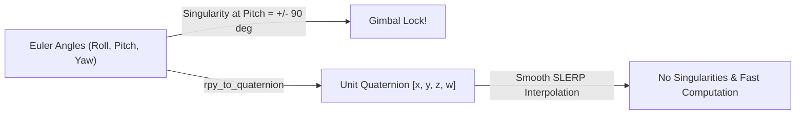
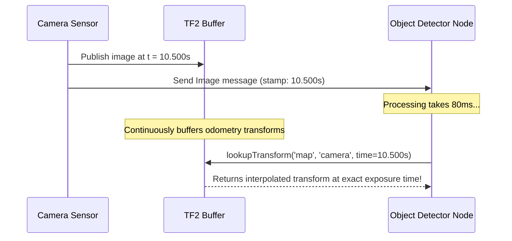

# 04: Robot Pose, Quaternions, and TF2 Timestamps

## 1. Learning Objectives
By completing this chapter, you will be able to:
- Define the 6-DoF spatial pose of a robot using Cartesian position and unit quaternions.
- Convert seamlessly between Euler angles (Roll, Pitch, Yaw) and ROS 2 quaternions $[x, y, z, w]$.
- Explain why quaternions avoid gimbal lock and trigonometric ambiguity.
- Understand the role of `header.stamp` in TF2's ring buffer.
- Query historical transforms at exact sensor capture times ("time travel").
- Diagnose and prevent `tf2::ExtrapolationException` and `tf2::LookupException`.

---

## 2. Intuitive Explanation
In three-dimensional space, stating where a robot is requires two things:
1. **Position:** A 3D vector $\mathbf{p} = [x, y, z]^T$.
2. **Orientation:** How the robot is turned relative to the reference axes.

Why not just use three angles $(\text{roll}, \text{pitch}, \text{yaw})$?
- When pitch reaches $\pm 90^\circ$, roll and yaw rotate around the exact same physical axis—a mathematical singularity known as **gimbal lock**.
- Angles wrap around $-\pi$ to $+\pi$, making interpolation (averaging orientations) extremely difficult and glitch-prone.

Robotics engineers solve this using **unit quaternions**: a four-dimensional hypercomplex number that parameterizes rotations smoothly without singularities.



---

## 3. Mathematical Formulation: Unit Quaternions

A quaternion $\mathbf{q}$ is defined as:
$$\mathbf{q} = w + x\mathbf{i} + y\mathbf{j} + z\mathbf{k} = [x, y, z, w]^T$$
where $\mathbf{i}^2 = \mathbf{j}^2 = \mathbf{k}^2 = \mathbf{i}\mathbf{j}\mathbf{k} = -1$.

> [!IMPORTANT]
> **ROS 2 Field Ordering:** In ROS 2 `geometry_msgs/msg/Quaternion`, the components are stored as:
> `x`, `y`, `z`, and `w` (scalar component last). In some pure mathematics textbooks, $w$ is written first. Always check the storage convention!

### 3.1 Unit Norm Condition
A valid 3D rotation quaternion must have unit length:
$$\|\mathbf{q}\| = \sqrt{x^2 + y^2 + z^2 + w^2} = 1.0$$

### 3.2 Axis-Angle to Quaternion
A rotation of angle $\theta$ about an arbitrary 3D unit axis $\mathbf{u} = [u_x, u_y, u_z]^T$:
$$\mathbf{q} = \begin{bmatrix} x \\ y \\ z \\ w \end{bmatrix} = \begin{bmatrix} u_x \sin(\theta / 2) \\ u_y \sin(\theta / 2) \\ u_z \sin(\theta / 2) \\ \cos(\theta / 2) \end{bmatrix}$$

### 3.3 Euler RPY to Quaternion
For sequential extrinsic rotations about $X$ (roll $\phi$), $Y$ (pitch $\theta$), and $Z$ (yaw $\psi$):
$$w = \cos(\phi/2)\cos(\theta/2)\cos(\psi/2) + \sin(\phi/2)\sin(\theta/2)\sin(\psi/2)$$
$$x = \sin(\phi/2)\cos(\theta/2)\cos(\psi/2) - \cos(\phi/2)\sin(\theta/2)\sin(\psi/2)$$
$$y = \cos(\phi/2)\sin(\theta/2)\cos(\psi/2) + \sin(\phi/2)\cos(\theta/2)\sin(\psi/2)$$
$$z = \cos(\phi/2)\cos(\theta/2)\sin(\psi/2) - \sin(\phi/2)\sin(\theta/2)\cos(\psi/2)$$

---

## 4. Timestamps and the TF2 Buffer Architecture

Every transform message in ROS 2 carries a `std_msgs/msg/Header`:
```python
header:
  stamp:
    sec: 1718000000
    nanosec: 250000000
  frame_id: "odom"
child_frame_id: "base_link"
```

### Why Timestamps Matter: The Moving Robot Problem
Imagine a robot driving at $2.0\,\text{m/s}$. A camera takes an image with an exposure timestamp of $t = 10.500\,\text{s}$.
By the time the deep-learning obstacle detector finishes processing the image and sends a bounding box, the current clock time is $t = 10.580\,\text{s}$ ($80\,\text{ms}$ later).

In that $80\,\text{ms}$, the robot has traveled:
$$\Delta x = 2.0\,\text{m/s} \times 0.080\,\text{s} = 0.16\,\text{m} = 16\,\text{cm}$$
If you transformed the obstacle using the *current* robot pose, the obstacle's location in the map would be off by $16\,\text{cm}$!

TF2 solves this through **Time Travel**:
- TF2 maintains a ring buffer of past transforms (typically 10.0 seconds).
- You request: *"Give me the transform ${}^{\text{map}}\mathbf{T}_{\text{cam}}$ at the exact timestamp $t = 10.500\,\text{s}$ when the photon hit the sensor."*
- TF2 linearly interpolates between the recorded transforms immediately before and after $10.500\,\text{s}$ using **SLERP** (Spherical Linear Interpolation) for orientation and linear interpolation for translation.



---

## 5. Fully Worked Numerical Example: Planar Yaw to Quaternion

A mobile robot is facing northeast: yaw $\psi = 45^\circ = \pi/4\,\text{rad}$. Roll $\phi = 0$, Pitch $\theta = 0$.

1. **Calculate half angle:**
   $$\frac{\psi}{2} = \frac{45^\circ}{2} = 22.5^\circ$$
2. **Apply axis-angle formula with rotation axis $\mathbf{u} = [0, 0, 1]^T$:**
   $$x = 0 \cdot \sin(22.5^\circ) = 0.0$$
   $$y = 0 \cdot \sin(22.5^\circ) = 0.0$$
   $$z = 1 \cdot \sin(22.5^\circ) = \sin(0.3927\,\text{rad}) \approx 0.3827$$
   $$w = \cos(22.5^\circ) = \cos(0.3927\,\text{rad}) \approx 0.9239$$
3. **Verify unit length:**
   $$\|\mathbf{q}\| = \sqrt{0^2 + 0^2 + (0.3827)^2 + (0.9239)^2} = \sqrt{0.1464 + 0.8536} = \sqrt{1.0000} = 1.0000$$
4. **Result:** The quaternion is $[0.0, \; 0.0, \; 0.3827, \; 0.9239]$.

---

## 6. Python Demonstration: Lookup with Timeout

```python
import rclpy
from rclpy.node import Node
from rclpy.duration import Duration
import tf2_ros

class PoseListener(Node):
    def __init__(self):
        super().__init__('pose_listener')
        self.tf_buffer = tf2_ros.Buffer()
        self.tf_listener = tf2_ros.TransformListener(self.tf_buffer, self)
        
        # Periodic timer
        self.timer = self.create_timer(0.5, self.get_robot_pose)

    def get_robot_pose(self):
        try:
            # Query the latest available transform with a 100ms timeout
            transform = self.tf_buffer.lookup_transform(
                target_frame='map',
                source_frame='base_link',
                time=rclpy.time.Time(), # Time(0) means "latest available"
                timeout=Duration(seconds=0.1)
            )
            
            p = transform.transform.translation
            q = transform.transform.rotation
            self.get_logger().info(
                f"Robot Pose in Map: pos=({p.x:.2f}, {p.y:.2f}, {p.z:.2f}) "
                f"quat=({q.x:.3f}, {q.y:.3f}, {q.z:.3f}, {q.w:.3f})"
            )
        except (tf2_ros.LookupException, tf2_ros.ExtrapolationException) as ex:
            self.get_logger().warn(f"TF lookup failed: {ex}")
```

---

## 7. Common Mistakes & Debugging Tips
1. **Calling `lookup_transform` with zero timeout in callbacks:**
   If you set `timeout=Duration(seconds=0.0)`, the call may fail immediately because the incoming network transform hasn't arrived at that microsecond. Always allow a small timeout (e.g., $50\,\text{ms}$ to $100\,\text{ms}$).
2. **`tf2::ExtrapolationException: Lookup would require extrapolation into the future`:**
   Caused when the query timestamp is slightly ahead of the latest received transform, often due to unsynchronized clocks between multiple computers on the robot. Run `chrony` or `ntp` across all onboard machines.
3. **Double Rotation Ambiguity ($\mathbf{q} \equiv -\mathbf{q}$):**
   Quaternions provide a 2-to-1 covering of $SO(3)$. Both $\mathbf{q}$ and $-\mathbf{q}$ represent the exact same 3D physical orientation. Do not check equality with `q1 == q2`; use the quaternion dot product $|\mathbf{q}_1 \cdot \mathbf{q}_2| \approx 1$.

---

## 8. Exercises

### Beginner
1. What 3D orientation is represented by the quaternion $[0.0, 0.0, 0.0, 1.0]$?
2. If a mobile robot turns $90^\circ$ counter-clockwise around its vertical $Z$-axis, compute its unit quaternion.

### Intermediate
3. Explain why `rclpy.time.Time()` (Time 0) in TF2 returns the *latest* available transform rather than the transform at Unix epoch (1970).
4. Prove that for any unit quaternion $\mathbf{q}$, the inverted rotation is represented by its conjugate $\mathbf{q}^* = [-x, -y, -z, w]^T$.

### Advanced
5. Derive the formula to convert a unit quaternion $[x, y, z, w]$ into the yaw angle $\psi = \text{atan2}(2(wy + xz), 1 - 2(y^2 + z^2))$ for a planar robot.

---

## 9. Summary & Next Steps
- Robot poses are represented by 3D position and a 4D unit quaternion $[x, y, z, w]$.
- Quaternions prevent gimbal lock and enable smooth interpolation (SLERP).
- TF2 buffers past transforms to enable accurate "time travel" coordinate lookups.
- Learn how to diagnose and visualize TF trees using command-line tools in [**05: TF2 Tools & RViz Inspection**](05-tf2-tools-and-rviz.md).
