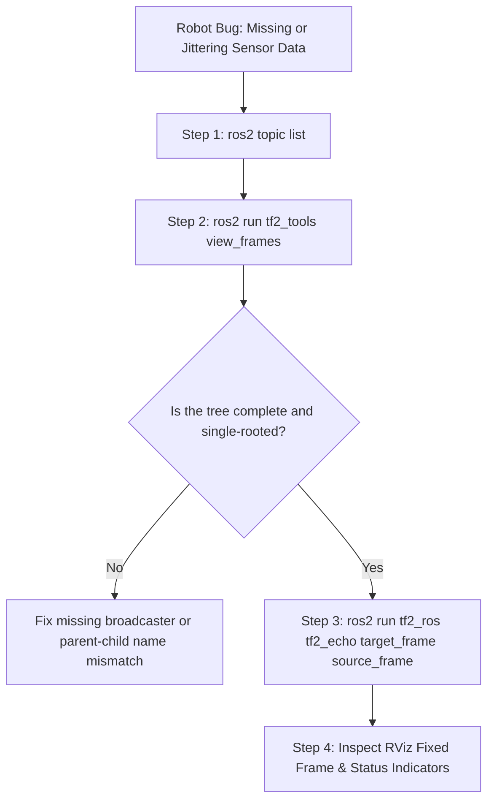

# 05: TF2 CLI Tools and RViz Visualisation

## 1. Learning Objectives
By completing this chapter, you will be able to:
- Inspect active coordinate frames and publish rates using standard ROS 2 CLI tools.
- Monitor real-time transform metrics between arbitrary frame pairs using `tf2_echo`.
- Generate and interpret structural TF tree diagrams using `view_frames`.
- Configure RViz Fixed Frame and TF displays for intuitive 3D debugging.
- Follow a systematic troubleshooting workflow to resolve broken trees, timestamp lag, and missing frames.

---

## 2. Intuitive Explanation
When a robot behaves erratically—such as spinning in circles, driving backwards, or showing obstacle clouds hovering inside its own chassis—the root cause is almost always a coordinate transformation error.

Rather than guessing, ROS 2 provides a diagnostic toolkit that lets you inspect every link in the transform chain:
- Is the sensor frame connected to the chassis?
- Is odometry publishing fast enough?
- What are the exact numerical $(x, y, z)$ and $(\text{roll}, \text{pitch}, \text{yaw})$ offsets?
- Does the TF tree have multiple parents or disconnected islands?



---

## 3. Essential TF2 Command-Line Tools

### 3.1 `ros2 topic list`
- **What it does:** Lists all active topics currently advertised in the ROS 2 DDS graph.
- **Prerequisites:** A running ROS 2 daemon or nodes.
- **Expected Output:**
  ```text
  /parameter_events
  /rosout
  /tf
  /tf_static
  ```
- **Interpretation:** If `/tf` is missing, no dynamic transforms are being published. If `/tf_static` is missing, no static URDF or sensor mount transforms have been latched.

---

### 3.2 `ros2 topic echo /tf` and `ros2 topic echo /tf_static`
- **What it does:** Prints raw `tf2_msgs/msg/TFMessage` payloads to the terminal.
- **Usage:**
  ```bash
  ros2 topic echo /tf --once
  ros2 topic echo /tf_static --qos-durability transient_local
  ```
  *(Note: For `/tf_static`, passing `--qos-durability transient_local` is mandatory in ROS 2 to read latched messages!)*

---

### 3.3 `ros2 run tf2_ros tf2_echo <target_frame> <source_frame>`
- **What it does:** Continuously queries and prints the transformation from `source_frame` to `target_frame` at regular intervals.
- **Syntax:**
  ```bash
  ros2 run tf2_ros tf2_echo map base_link
  ```
- **Sample Output:**
  ```text
  At time 1718000042.851240158
  - Translation: [1.452, 0.812, 0.000]
  - Rotation: in Quaternion [0.000, 0.000, 0.383, 0.924]
  - Rotation: in RPY (radian) [0.000, 0.000, 0.785]
  - Rotation: in RPY (degree) [0.000, 0.000, 45.000]
  - Matrix:
    0.707 -0.707  0.000  1.452
    0.707  0.707  0.000  0.812
    0.000  0.000  1.000  0.000
    0.000  0.000  0.000  1.000
  ```
- **Interpretation:**
  - The robot `base_link` is $1.452\,\text{m}$ along $X$, $0.812\,\text{m}$ along $Y$ relative to `map`.
  - It is yawed at $+45.0^\circ$.
  - The translation and rotation are updated in real time.

---

### 3.4 `ros2 run tf2_tools view_frames`
- **What it does:** Listens to `/tf` and `/tf_static` for 5 seconds, generates a comprehensive dependency tree, and renders it into a graphical PDF/SVG document (`frames.pdf`).
- **Command:**
  ```bash
  ros2 run tf2_tools view_frames
  ```
- **Generated File Content:**
  - Every coordinate frame as an ellipse.
  - Arrows showing parent $\to$ child direction.
  - The publishing node ID.
  - Average broadcast frequency (e.g., $50.2\,\text{Hz}$).
  - Oldest and newest transform timestamps in buffer.
  - Buffer length.

---

### 3.5 `ros2 run tf2_ros tf2_monitor`
- **What it does:** Monitors the latency, age, and update rates across all active frames in the TF tree.
- **Command:**
  ```bash
  ros2 run tf2_ros tf2_monitor
  ```
- **Output:**
  ```text
  RESULTS: for all Frames
  Frame: base_link published by /diff_drive_controller Average Delay: 0.004 Max Delay: 0.012
  Frame: laser_frame published by /robot_state_publisher Average Delay: 0.000 Max Delay: 0.000
  ```

---

## 4. RViz 3D Visualisation Configuration

RViz (ROS Visualization) relies entirely on TF2 to place 3D models, sensor point clouds, lasers, and camera frustums in the virtual world.

### Step 1: Set the "Fixed Frame"
In the RViz **Global Options** panel:
- **`Fixed Frame`:** Specifies the immovable world coordinate system used as the visual anchor.
- For global navigation: Set `Fixed Frame = map`.
- For odometry tuning: Set `Fixed Frame = odom`.
- For robot-centric visualization (without world drift): Set `Fixed Frame = base_link`.

> [!CAUTION]
> If the `Fixed Frame` is set to `map`, but your SLAM node is not running, RViz will display:
> `Global Status: Error - Fixed Frame [map] does not exist`.

### Step 2: Add the "TF" Display
1. Click **Add** (bottom left) $\to$ select **TF** $\to$ click **OK**.
2. Expand the **TF** display properties:
   - Check **Show Names**: Renders the text name of each frame above its origin.
   - Check **Show Axes**: Displays the RGB axes ($X$=Red, $Y$=Green, $Z$=Blue).
   - Adjust **Marker Scale**: Increase to $0.5$ or $1.0$ for large robots.
   - Expand **Frames** tree: Inspect individual parent-child checkboxes.

---

## 5. Systematic TF Troubleshooting Flowchart

| Symptom in RViz | Root Cause | Engineering Solution |
| :--- | :--- | :--- |
| `No transform from [laser_frame] to [map]` | Disconnected branch in TF tree | Run `view_frames`. Check if `laser_frame` connects to `base_link` and `base_link` connects to `odom`. |
| Robot jumping back and forth violently | Multiple nodes publishing same frame | Check `view_frames` for multiple broadcasters on `base_link` or duplicate static publishers. |
| PointCloud lagging behind robot movement | Time synchronization drift | Check system clocks on onboard robot computer vs desktop using `ntpstat` or `chrony`. |
| `TF_OLD_DATA` warning in terminal | Stale timestamps or clock reset | Restart nodes publishing simulated clock `/clock` or check bagfile playback `--clock` flag. |

---

## 6. Exercises

### Beginner
1. What command generates the visual `frames.pdf` diagram in ROS 2?
2. Which RGB color standardly corresponds to the $Z$-axis (Up) in RViz?

### Intermediate
3. You run `ros2 run tf2_ros tf2_echo odom base_link` and see:
   `Exception: "base_link" passed to lookupTransform argument source_frame does not exist`.
   List three distinct physical or software causes for this error.
4. Explain why you must supply `--qos-durability transient_local` when inspecting `/tf_static` with `ros2 topic echo`.

### Advanced
5. Write a shell script that runs `tf2_echo` between `map` and `base_link`, extracts the $X$ and $Y$ coordinates from stdout using `grep` or `awk`, and appends them to a CSV file every second.

---

## 7. Summary & Next Steps
- Command-line tools like `tf2_echo` and `view_frames` provide immediate visibility into coordinate relationships.
- RViz Fixed Frame dictates the visual reference frame for all 3D sensor displays.
- Next, learn how to transform raw sensor streams in [**06: Sensor Data Transformations**](06-sensor-transformations.md).
