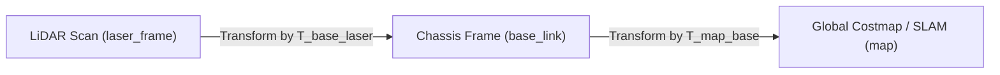
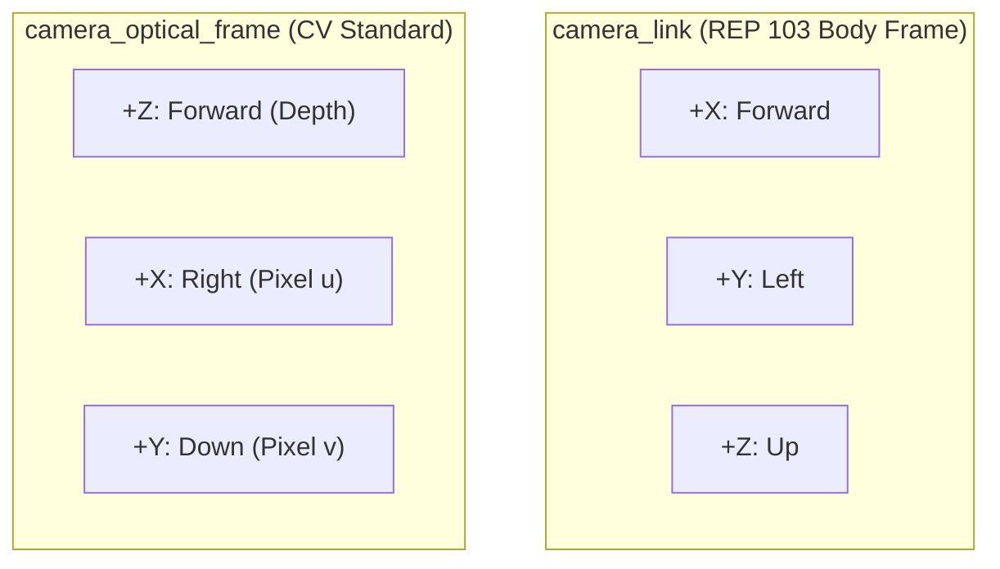
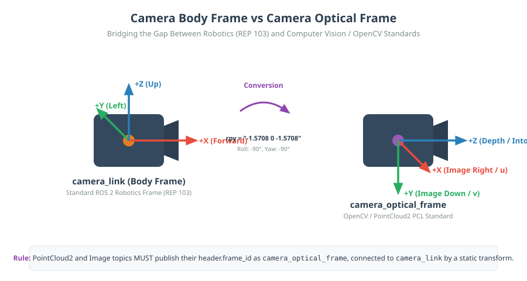

# 06: Transforming Sensor Data (PointClouds, Lasers, and Poses)

## 1. Learning Objectives
By completing this chapter, you will be able to:
- Transform geometric data (`PointStamped`, `PoseStamped`, `Vector3Stamped`) between arbitrary coordinate frames.
- Reconcile the standard robotics coordinate convention (REP 103: $X$-forward) with the optical camera convention (Optical: $Z$-forward).
- Use `tf2_geometry_msgs` and `tf2_sensor_msgs` in Python to project perception data into the global map frame.
- Account for sensor mounting offsets in obstacle avoidance algorithms.

---

## 2. Intuitive Explanation
A sensor has no concept of the outside world.
- A 2D LiDAR merely reports: *"An object reflected light at angle $\theta = 30^\circ$ at range $r = 2.5\,\text{m}$ from my lens."*
- An RGB-D depth camera reports: *"A cluster of pixels is at pixel $(u, v)$ with depth $d = 1.8\,\text{m}$."*

If the LiDAR is mounted at the front bumper tilted down $5^\circ$, and the robot base turns by $60^\circ$, where is that obstacle in the global building map?
You cannot simply feed raw sensor coordinates into a path planner or costmap. The sensor data must be **geometrically transformed** into `base_link` or `map` before calculating collisions.



---

## 3. The Camera Optical Frame Convention

One of the most frequent sources of confusion in robotics perception is the difference between standard robot frames and optical camera frames.

### Standard Body Frame (REP 103):
- $+X$: Forward
- $+Y$: Left
- $+Z$: Up

### Computer Vision Optical Frame (OpenCV / ROS Optical Convention):
- $+Z$: Forward (into the visual scene along the optical axis)
- $+X$: Right (along image width)
- $+Y$: Down (along image height)






### Static Transform between `camera_link` and `camera_optical_frame`:
To convert from the body frame to the optical frame, rotate $-90^\circ$ about the $Z$-axis, followed by $-90^\circ$ about the new $X$-axis:
$${}^{\text{link}}\mathbf{R}_{\text{optical}} = \begin{bmatrix} 0 & 0 & 1 \\ -1 & 0 & 0 \\ 0 & -1 & 0 \end{bmatrix}$$

---

## 4. Mathematical Transformation of a 3D Point

Given a 3D obstacle point ${}^B \mathbf{p} = [x_B, y_B, z_B]^T$ detected in sensor frame $\{B\}$, and a homogeneous transform from $\{B\}$ to reference frame $\{A\}$:

$${}^A \mathbf{T}_B = \begin{bmatrix} {}^A \mathbf{R}_B & {}^A \mathbf{p}_B \\ \mathbf{0} & 1 \end{bmatrix}$$

The point's coordinates in frame $\{A\}$ are:
$${}^A \mathbf{p} = {}^A \mathbf{R}_B \; {}^B \mathbf{p} + {}^A \mathbf{p}_B$$

---

## 5. Fully Worked Numerical Example: Converting Camera Optical to Base

Suppose a camera is mounted on a robot:
- `camera_link` is at $[0.2, 0.0, 0.8]^T\,\text{m}$ relative to `base_link` with zero rotation.
- An object detector identifies an obstacle in `camera_optical_frame` at:
  $${}^{\text{opt}}\mathbf{p} = \begin{bmatrix} x_{\text{opt}} \\ y_{\text{opt}} \\ z_{\text{opt}} \end{bmatrix} = \begin{bmatrix} +0.3\,\text{m (right)} \\ -0.1\,\text{m (above optical center)} \\ +1.5\,\text{m (depth forward)} \end{bmatrix}$$

**Step 1: Convert from `camera_optical_frame` to `camera_link`:**
Using ${}^{\text{link}}\mathbf{R}_{\text{optical}}$:
$${}^{\text{link}}\mathbf{p} = \begin{bmatrix} 0 & 0 & 1 \\ -1 & 0 & 0 \\ 0 & -1 & 0 \end{bmatrix} \begin{bmatrix} 0.3 \\ -0.1 \\ 1.5 \end{bmatrix} = \begin{bmatrix} 1.5 \\ -0.3 \\ +0.1 \end{bmatrix}\,\text{m}$$
Notice how:
- Depth ($+Z_{\text{opt}} = 1.5$) becomes Forward ($+X_{\text{link}} = 1.5$).
- Right ($+X_{\text{opt}} = 0.3$) becomes Right ($-Y_{\text{link}} = -0.3$).
- Up ($-Y_{\text{opt}} = -0.1$) becomes Up ($+Z_{\text{link}} = +0.1$).

**Step 2: Add `camera_link` offset relative to `base_link`:**
$${}^{\text{base}}\mathbf{p} = {}^{\text{link}}\mathbf{p} + \begin{bmatrix} 0.2 \\ 0.0 \\ 0.8 \end{bmatrix} = \begin{bmatrix} 1.5 + 0.2 \\ -0.3 + 0.0 \\ 0.1 + 0.8 \end{bmatrix} = \begin{bmatrix} 1.7\,\text{m forward} \\ -0.3\,\text{m right} \\ 0.9\,\text{m above ground} \end{bmatrix}$$

---

## 6. Python Implementation: Transforming a `PointStamped`

```python
import rclpy
from rclpy.node import Node
from geometry_msgs.msg import PointStamped
import tf2_ros
import tf2_geometry_msgs # Registers PointStamped with tf2

class ObstacleTransformer(Node):
    def __init__(self):
        super().__init__('obstacle_transformer')
        self.tf_buffer = tf2_ros.Buffer()
        self.tf_listener = tf2_ros.TransformListener(self.tf_buffer, self)
        
        # Subscribe to obstacle detection in camera frame
        self.sub = self.create_subscription(
            PointStamped, '/detected_target_camera', self.target_callback, 10
        )
        self.pub = self.create_publisher(PointStamped, '/target_map_frame', 10)

    def target_callback(self, msg: PointStamped):
        try:
            # Transform point directly from its native header.frame_id into 'map'
            point_in_map = self.tf_buffer.transform(
                point_or_pose=msg,
                target_frame='map',
                timeout=rclpy.duration.Duration(seconds=0.1)
            )
            self.pub.publish(point_in_map)
            self.get_logger().info(
                f"Target mapped: X={point_in_map.point.x:.2f}, "
                f"Y={point_in_map.point.y:.2f}, Z={point_in_map.point.z:.2f}"
            )
        except Exception as e:
            self.get_logger().error(f"Failed to transform obstacle: {e}")
```

---

## 7. Common Mistakes & Debugging Tips
1. **Forgetting to import `tf2_geometry_msgs`:**
   In Python, importing `tf2_geometry_msgs` attaches the necessary transform converters to `tf_buffer.transform()`. Without this import, Python throws `TypeException: Cannot transform type PointStamped`.
2. **Transforming laser scans using current time instead of scan time:**
   Always use the timestamp from the sensor message header (`msg.header.stamp`). Never replace it with `node.get_clock().now().to_msg()`, or the scan will be transformed with a delayed robot pose.
3. **Double Counting Base Offsets:**
   Ensure the sensor driver is not already applying an internal offset if your TF tree also publishes the transform.

---

## 8. Exercises

### Beginner
1. What coordinate axis corresponds to depth (distance away from the camera) in OpenCV optical frame convention?
2. If a point is at $(0, 0, 2)$ in optical frame, what are its coordinates in standard REP 103 body frame?

### Intermediate
3. Explain why applying a transform to a PointCloud2 message point-by-point in pure Python is computationally inefficient. What vectorized tool or C++ library is typically used instead?
4. A radar sensor is mounted at the rear bumper of an autonomous vehicle ($x = -1.2\,\text{m}$, $z = 0.4\,\text{m}$) facing backward ($180^\circ$ yaw). Derive the $4 \times 4$ transformation matrix ${}^{\text{base}}\mathbf{T}_{\text{radar}}$.

### Advanced
5. Write a complete Python node that subscribes to a `sensor_msgs/msg/LaserScan`, converts range-bearing pairs $(r_i, \theta_i)$ into Cartesian 3D points, and transforms each valid reading into the `map` frame using NumPy matrix multiplication.

---

## 9. Summary & Next Steps
- Perception sensors report coordinates in local, sensor-specific frames.
- Optical cameras use $Z$-forward; robotics uses $X$-forward.
- TF2 automates transforming points, poses, and point clouds across these frames.
- Now apply these concepts in a hands-on coding lab in [**07: ROS 2 Practical Lab**](07-ros2-practical-lab.md).
