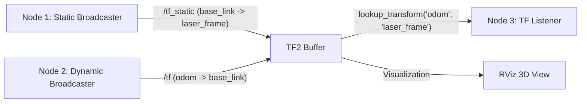

# 07: ROS 2 Practical Lab — TF2 Broadcasting and Listening

## 1. Learning Objectives
By completing this practical laboratory, you will be able to:
- Create a ROS 2 Python package with dependencies on `rclpy`, `tf2_ros`, and `geometry_msgs`.
- Implement a `StaticTransformBroadcaster` node that publishes sensor mounting geometry.
- Implement a dynamic `TransformBroadcaster` node that simulates a moving robot chassis.
- Implement a `TransformListener` node that continuously computes spatial offsets.
- Verify node execution using `ros2 run tf2_ros tf2_echo` and RViz.

---

## 2. Lab Architecture & Dataflow



---

## 3. Step 1: Package Creation (ROS 2 Jazzy / Iron / Humble)

Open a terminal in your ROS 2 workspace (`colcon_ws/src`):

```bash
mkdir -p ~/ros2_ws/src
cd ~/ros2_ws/src
ros2 pkg create --build-type ament_python tf2_practical_lab --dependencies rclpy tf2_ros geometry_msgs
```

---

## 4. Step 2: Implement the Static Broadcaster Node

Create `tf2_practical_lab/static_laser_broadcaster.py`:

```python
#!/usr/bin/env python3
"""
Node: static_laser_broadcaster
Publishes the static transform: base_link -> laser_frame
"""

import rclpy
from rclpy.node import Node
from geometry_msgs.msg import TransformStamped
from tf2_ros.static_transform_broadcaster import StaticTransformBroadcaster


class StaticLaserBroadcaster(Node):
    def __init__(self):
        super().__init__('static_laser_broadcaster')
        self._tf_broadcaster = StaticTransformBroadcaster(self)
        
        # Publish static transform once
        self.publish_static_transform()
        self.get_logger().info("Static transform 'base_link -> laser_frame' published successfully.")

    def publish_static_transform(self):
        t = TransformStamped()
        
        t.header.stamp = self.get_clock().now().to_msg()
        t.header.frame_id = 'base_link'
        t.child_frame_id = 'laser_frame'
        
        # Laser is 20 cm forward, 10 cm above base center
        t.transform.translation.x = 0.20
        t.transform.translation.y = 0.00
        t.transform.translation.z = 0.10
        
        # Zero rotation (Identity quaternion: w=1.0)
        t.transform.rotation.x = 0.0
        t.transform.rotation.y = 0.0
        t.transform.rotation.z = 0.0
        t.transform.rotation.w = 1.0
        
        self._tf_broadcaster.sendTransform(t)


def main(args=None):
    rclpy.init(args=args)
    node = StaticLaserBroadcaster()
    try:
        rclpy.spin(node)
    except KeyboardInterrupt:
        pass
    node.destroy_node()
    rclpy.shutdown()


if __name__ == '__main__':
    main()
```

---

## 5. Step 3: Implement the Dynamic Odometry Broadcaster

Create `tf2_practical_lab/dynamic_odom_broadcaster.py`:

```python
#!/usr/bin/env python3
"""
Node: dynamic_odom_broadcaster
Simulates a robot moving in a circle of radius R=1.0m and broadcasts: odom -> base_link
"""

import math
import numpy as np
import rclpy
from rclpy.node import Node
from geometry_msgs.msg import TransformStamped
from tf2_ros import TransformBroadcaster


class DynamicOdomBroadcaster(Node):
    def __init__(self):
        super().__init__('dynamic_odom_broadcaster')
        self._tf_broadcaster = TransformBroadcaster(self)
        
        self.radius = 1.0       # Circle radius in metres
        self.omega = 0.5        # Angular velocity in rad/sec
        self.time_elapsed = 0.0
        
        # Broadcast at 50 Hz
        self.timer = self.create_timer(0.02, self.broadcast_odom)
        self.get_logger().info("Dynamic odometry broadcaster started at 50 Hz.")

    def broadcast_odom(self):
        self.time_elapsed += 0.02
        
        # Calculate circular trajectory
        x = self.radius * math.cos(self.omega * self.time_elapsed)
        y = self.radius * math.sin(self.omega * self.time_elapsed)
        
        # Tangent heading angle
        yaw = self.omega * self.time_elapsed + (math.pi / 2.0)
        
        # Convert planar yaw to quaternion
        qz = math.sin(yaw / 2.0)
        qw = math.cos(yaw / 2.0)
        
        t = TransformStamped()
        t.header.stamp = self.get_clock().now().to_msg()
        t.header.frame_id = 'odom'
        t.child_frame_id = 'base_link'
        
        t.transform.translation.x = x
        t.transform.translation.y = y
        t.transform.translation.z = 0.0
        
        t.transform.rotation.x = 0.0
        t.transform.rotation.y = 0.0
        t.transform.rotation.z = qz
        t.transform.rotation.w = qw
        
        self._tf_broadcaster.sendTransform(t)


def main(args=None):
    rclpy.init(args=args)
    node = DynamicOdomBroadcaster()
    try:
        rclpy.spin(node)
    except KeyboardInterrupt:
        pass
    node.destroy_node()
    rclpy.shutdown()


if __name__ == '__main__':
    main()
```

---

## 6. Step 4: Implement the TF2 Listener Node

Create `tf2_practical_lab/laser_distance_listener.py`:

```python
#!/usr/bin/env python3
"""
Node: laser_distance_listener
Queries the transformation from odom to laser_frame and logs global sensor coordinates.
"""

import math
import rclpy
from rclpy.node import Node
from rclpy.duration import Duration
import tf2_ros


class LaserDistanceListener(Node):
    def __init__(self):
        super().__init__('laser_distance_listener')
        self._tf_buffer = tf2_ros.Buffer()
        self._tf_listener = tf2_ros.TransformListener(self._tf_buffer, self)
        
        # Query at 2 Hz
        self.timer = self.create_timer(0.5, self.query_transform)

    def query_transform(self):
        try:
            # Query transform from 'odom' (target) to 'laser_frame' (source)
            t = self._tf_buffer.lookup_transform(
                target_frame='odom',
                source_frame='laser_frame',
                time=rclpy.time.Time(),
                timeout=Duration(seconds=0.1)
            )
            
            p = t.transform.translation
            dist_from_origin = math.sqrt(p.x**2 + p.y**2)
            
            self.get_logger().info(
                f"[Laser in Odom] X={p.x:+.3f}m, Y={p.y:+.3f}m, "
                f"Dist to (0,0)={dist_from_origin:.3f}m"
            )
        except (tf2_ros.LookupException, tf2_ros.ConnectivityException,
                tf2_ros.ExtrapolationException) as ex:
            self.get_logger().warn(f"Waiting for transform: {ex}")


def main(args=None):
    rclpy.init(args=args)
    node = LaserDistanceListener()
    try:
        rclpy.spin(node)
    except KeyboardInterrupt:
        pass
    node.destroy_node()
    rclpy.shutdown()


if __name__ == '__main__':
    main()
```

---

## 7. Build, Execution, and Verification Steps

### 1. Register entry points in `setup.py`:
```python
entry_points={
    'console_scripts': [
        'static_laser_broadcaster = tf2_practical_lab.static_laser_broadcaster:main',
        'dynamic_odom_broadcaster = tf2_practical_lab.dynamic_odom_broadcaster:main',
        'laser_distance_listener = tf2_practical_lab.laser_distance_listener:main',
    ],
},
```

### 2. Build the workspace:
```bash
cd ~/ros2_ws
colcon build --packages-select tf2_practical_lab
source install/setup.bash
```

### 3. Launch the nodes across three terminals:
```bash
# Terminal 1: Static broadcaster
ros2 run tf2_practical_lab static_laser_broadcaster

# Terminal 2: Dynamic broadcaster
ros2 run tf2_practical_lab dynamic_odom_broadcaster

# Terminal 3: Distance listener
ros2 run tf2_practical_lab laser_distance_listener
```

### 4. Verify with CLI:
```bash
# Terminal 4: Inspect echo between odom and laser_frame
ros2 run tf2_ros tf2_echo odom laser_frame

# Inspect visual PDF diagram
ros2 run tf2_tools view_frames
```

### 5. Visualise in RViz:
```bash
rviz2
```
- Set `Global Options -> Fixed Frame` to `odom`.
- Click **Add** $\to$ **TF**.
- You will see the `base_link` frame smoothly orbiting $(0, 0)$ with `laser_frame` rigidly attached $0.2\,\text{m}$ in front!

---

## 8. Summary & Next Steps
- You have built and verified a complete, working multi-node TF2 system.
- To test your theoretical understanding, proceed to [**Module 53 Exercises**](exercises.md).
