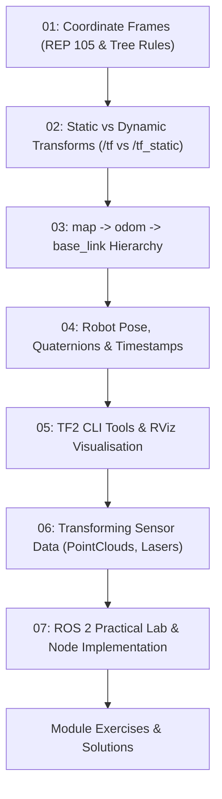

# Module 53: TF2 & Coordinate Frame Kinematics Core

Welcome to **Module 53: TF2 & Kinematics Core**. In modern robotics systems running on the Robot Operating System (ROS 2), managing spatial coordinate relationships over time is handled by **TF2** (Transform Library 2nd Generation).

Whether navigating an autonomous mobile robot through a warehouse or operating a 6-DoF robotic arm, a robot must track where its sensors, chassis, actuators, and the external world are located at every millisecond.

---

## Curriculum Structure

### Chapter Index
1. [**01: Coordinate Frames & Standards**](01-coordinate-frames.md): Definitions, REP 105 conventions, right-handed coordinates, and directed tree acyclic graph rules.
2. [**02: Static & Dynamic Transforms**](02-static-and-dynamic-transforms.md): Structural hardware geometry (`/tf_static` with Transient Local durability QoS) vs real-time state estimation (`/tf` high-frequency streams).
3. [**03: The map -> odom -> base_link Hierarchy**](03-map-odom-base-link.md): Why we need both `map` and `odom`, continuous vs discrete jumps, drift compensation, and SLAM/AMCL interaction.
4. [**04: Robot Pose, Quaternions & Timestamps**](04-robot-pose.md): 3D pose representation, Hamilton quaternions $[x, y, z, w]$, TF lookup buffers, extrapolation, and time travel.
5. [**05: TF2 Tools & RViz Inspection**](05-tf2-tools-and-rviz.md): In-depth walkthrough of `tf2_echo`, `view_frames`, `tf2_monitor`, RViz Fixed Frame setup, and debugging broken trees.
6. [**06: Sensor Data Transformations**](06-sensor-transformations.md): Converting raw LaserScans and PointClouds into `base_link` or `map` frames for obstacle avoidance and mapping.
7. [**07: ROS 2 Practical Lab**](07-ros2-practical-lab.md): Complete, runnable Python nodes for broadcasting static transforms, publishing odometry, and listening to transforms.
8. [**Exercises**](exercises.md) & [**Solutions**](solutions.md): Graduated theoretical and practical problems with verified answer keys.

---

## Primary Reference Environment

- **ROS 2 Distribution:** **ROS 2 Jazzy Jalisco** (Primary LTS on Ubuntu 24.04). **ROS 2 Humble Hawksbill** (Ubuntu 22.04) supported as legacy reference. *(Note: ROS 2 Iron is non-LTS/EOL and is not supported).*
- **Middleware:** FastDDS / CycloneDDS.
- **Build System:** `colcon`.
- **Python Interface:** `rclpy`, `tf2_ros`, `geometry_msgs`.
