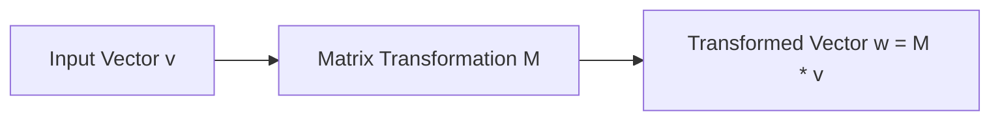

# 02: Matrices, Determinants, and Matrix Inverses

## 1. Learning Objectives
By completing this chapter, you will be able to:
- Interpret a matrix physically as a linear operator that rotates, scales, or shears vectors.
- Perform matrix addition, scalar multiplication, and matrix-matrix multiplication.
- Explain why matrix multiplication is associative but strictly **non-commutative** ($AB \ne BA$).
- Compute the transpose, trace, and determinant of $2 \times 2$ and $3 \times 3$ matrices.
- Compute the inverse of a non-singular matrix and explain condition numbers.

---

## 2. Intuitive Explanation
A matrix is more than just a 2D grid of numbers: **a matrix is a machine that transforms vectors**.
When you multiply a matrix $\mathbf{M}$ by a vector $\mathbf{v}$:
$$\mathbf{w} = \mathbf{M} \mathbf{v}$$
The columns of $\mathbf{M}$ tell you where the original coordinate axes land after the transformation!
- If $\mathbf{M}$ is an orthogonal matrix, it rotates the space without stretching.
- If $\det(\mathbf{M}) = 0$, the matrix squashes an entire dimension flat (e.g. collapses 3D space into a 2D plane or line). Once a dimension is squashed flat, information is destroyed and the operation **cannot be reversed** (the matrix has no inverse).



---

## 3. Mathematical Operations

### 3.1 Matrix Multiplication
If $\mathbf{A}$ has shape $(m \times k)$ and $\mathbf{B}$ has shape $(k \times p)$, their product $\mathbf{C} = \mathbf{AB}$ has shape $(m \times p)$:

$$C_{ij} = \sum_{r=1}^{k} A_{ir} B_{rj}$$

> [!CAUTION]
> **Order Matters!** In general, $\mathbf{AB} \ne \mathbf{BA}$. Rotating $90^\circ$ about $X$ then $90^\circ$ about $Y$ does NOT put the robot in the same orientation as rotating $90^\circ$ about $Y$ then $90^\circ$ about $X$!

### 3.2 Transpose
Reflecting a matrix across its main diagonal swaps rows and columns:
$$(\mathbf{A}^T)_{ij} = A_{ji}$$

**Fundamental Properties:**
- $(\mathbf{A}^T)^T = \mathbf{A}$
- $(\mathbf{A} + \mathbf{B})^T = \mathbf{A}^T + \mathbf{B}^T$
- **Reverse Order Law:** $(\mathbf{AB})^T = \mathbf{B}^T \mathbf{A}^T$

---

## 4. Determinant $\det(\mathbf{A})$

The determinant is a scalar value that measures the **scaling factor of volume** applied by the matrix transformation.

### 4.1 $2 \times 2$ Determinant
$$\det\begin{pmatrix} a & b \\ c & d \end{pmatrix} = ad - bc$$

### 4.2 $3 \times 3$ Determinant (Cofactor Expansion)
$$\det\begin{pmatrix} a & b & c \\ d & e & f \\ g & h & i \end{pmatrix} = a(ei - fh) - b(di - fg) + c(dh - eg)$$

**Robotics Interpretation of Determinants:**
- $\det(\mathbf{M}) > 0$: Preserves orientation (right-handed frame remains right-handed).
- $\det(\mathbf{M}) < 0$: Inverts orientation (reflection / left-handed frame).
- $\det(\mathbf{M}) = 0$: Singular! The mechanism is in a **kinematic singularity**, losing one or more degrees of freedom.

---

## 5. Matrix Inverse $\mathbf{A}^{-1}$

For a square matrix $\mathbf{A} \in \mathbb{R}^{n \times n}$, the inverse $\mathbf{A}^{-1}$ satisfies:
$$\mathbf{A} \mathbf{A}^{-1} = \mathbf{A}^{-1} \mathbf{A} = \mathbf{I}_n$$

A matrix possesses an inverse if and only if:
$$\det(\mathbf{A}) \ne 0$$

### 5.1 Analytical $2 \times 2$ Inverse Formula
$$\mathbf{A}^{-1} = \frac{1}{\det(\mathbf{A})} \begin{bmatrix} d & -b \\ -c & a \end{bmatrix} = \frac{1}{ad - bc} \begin{bmatrix} d & -b \\ -c & a \end{bmatrix}$$

---

## 6. Fully Worked Numerical Example

Consider the $2 \times 2$ matrix:
$$\mathbf{A} = \begin{bmatrix} 3.0 & 1.0 \\ 2.0 & 4.0 \end{bmatrix}$$

1. **Calculate the determinant:**
   $$\det(\mathbf{A}) = (3.0)(4.0) - (1.0)(2.0) = 12.0 - 2.0 = 10.0$$
   Since $\det(\mathbf{A}) = 10.0 \ne 0$, $\mathbf{A}$ is non-singular and invertible.
2. **Compute the analytical inverse:**
   $$\mathbf{A}^{-1} = \frac{1}{10.0} \begin{bmatrix} 4.0 & -1.0 \\ -2.0 & 3.0 \end{bmatrix} = \begin{bmatrix} 0.40 & -0.10 \\ -0.20 & 0.30 \end{bmatrix}$$
3. **Verify by multiplication:**
   $$\mathbf{A} \mathbf{A}^{-1} = \begin{bmatrix} 3 & 1 \\ 2 & 4 \end{bmatrix} \begin{bmatrix} 0.4 & -0.1 \\ -0.2 & 0.3 \end{bmatrix} = \begin{bmatrix} 3(0.4) + 1(-0.2) & 3(-0.1) + 1(0.3) \\ 2(0.4) + 4(-0.2) & 2(-0.1) + 4(0.3) \end{bmatrix} = \begin{bmatrix} 1.0 & 0.0 \\ 0.0 & 1.0 \end{bmatrix} = \mathbf{I}_2$$

---

## 7. Robotics Application: Solving Joint Velocities

In manipulator kinematics, the task-space velocity $\mathbf{v} \in \mathbb{R}^6$ is related to joint velocities $\mathbf{\dot{q}} \in \mathbb{R}^6$ via the square Jacobian matrix $\mathbf{J}$:
$$\mathbf{v} = \mathbf{J}(\mathbf{q}) \mathbf{\dot{q}}$$

To determine the motor velocities required to achieve a desired tool speed, we invert the Jacobian:
$$\mathbf{\dot{q}} = \mathbf{J}^{-1}(\mathbf{q}) \mathbf{v}$$

If the robot approaches a singularity ($\det(\mathbf{J}) \approx 0$), the entries of $\mathbf{J}^{-1}$ explode toward infinity, commanding impossible motor speeds and tripping safety brakes.

---

## 8. Python Demonstration

Tested using `04-python-robotics/vectors_matrices.py`:

```python
import numpy as np

A = np.array([
    [3.0, 1.0],
    [2.0, 4.0]
])

det_A = np.linalg.det(A)
inv_A = np.linalg.inv(A)

print(f"Matrix A:\n{A}")
print(f"Determinant: {det_A:.2f}")
print(f"Inverse A^-1:\n{inv_A}")
print(f"Verification A @ A^-1:\n{np.round(A @ inv_A, 4)}")
```

---

## 9. Common Mistakes & Debugging Tips
1. **Element-wise Multiplication vs Matrix Multiplication in Python:**
   Writing `A * B` in NumPy computes the Hadamard element-by-element product ($A_{ij} \times B_{ij}$). To perform linear algebra matrix multiplication, you **must use `@`** (`A @ B`) or `np.matmul(A, B)`.
2. **Inverting Nearly-Singular Matrices Directly:**
   If $\det(\mathbf{A}) = 10^{-14}$, standard `np.linalg.inv` will yield wild numbers due to floating-point truncation. Always check the **condition number** `np.linalg.cond(A)`. If $\kappa > 10^4$, use damped pseudoinverse (Levenberg-Marquardt).
3. **Assuming Inverses Exist for Non-Square Matrices:**
   Only square matrices ($n \times n$) have true two-sided inverses. For rectangular matrices ($m \times n$), use the Moore-Penrose Pseudoinverse $\mathbf{A}^\dagger$.

---

## 10. Exercises

### Beginner
1. Multiply the matrices $\mathbf{A} = \begin{bmatrix} 1 & 2 \\ 3 & 4 \end{bmatrix}$ and $\mathbf{B} = \begin{bmatrix} 2 & 0 \\ 1 & 3 \end{bmatrix}$. Compute both $\mathbf{AB}$ and $\mathbf{BA}$ and verify they are not equal.
2. Calculate the determinant of $\mathbf{M} = \begin{bmatrix} 5 & 2 \\ 2 & 1 \end{bmatrix}$.

### Intermediate
3. Compute the inverse of the matrix $\mathbf{M} = \begin{bmatrix} 5 & 2 \\ 2 & 1 \end{bmatrix}$ by hand.
4. An orthogonal matrix $\mathbf{R}$ satisfies $\mathbf{R}^T \mathbf{R} = \mathbf{I}$. Prove that for any orthogonal matrix, its determinant must be either $+1$ or $-1$. What is the physical difference between $\det(\mathbf{R}) = +1$ and $\det(\mathbf{R}) = -1$?

### Advanced
5. Derive the formula for the inverse of a $2 \times 2$ block matrix:
   $$\begin{bmatrix} \mathbf{A} & \mathbf{0} \\ \mathbf{C} & \mathbf{D} \end{bmatrix}^{-1}$$
   where $\mathbf{A}$ and $\mathbf{D}$ are invertible square blocks.

---

## 11. Summary & Next Steps
- Matrices represent linear maps. Matrix multiplication is non-commutative.
- A zero determinant signals a singular state where dimensionality is lost.
- Next, explore directional projections and orthogonal cross products in [**03: Dot & Cross Products**](03-dot-and-cross-products.md).
