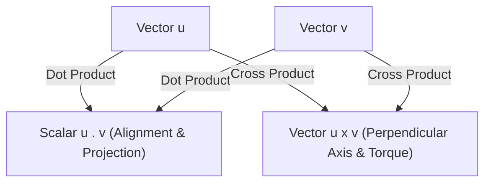

# 03: Dot and Cross Products in Robotics

## 1. Learning Objectives
By completing this chapter, you will be able to:
- Compute the dot product algebraically ($\mathbf{u}^T \mathbf{v}$) and geometrically ($\|\mathbf{u}\|\|\mathbf{v}\|\cos\theta$).
- Project robot sensor beams or velocities onto surfaces using vector projections.
- Compute the 3D cross product and explain its anti-commutative nature ($\mathbf{u} \times \mathbf{v} = -\mathbf{v} \times \mathbf{u}$).
- Construct the $3 \times 3$ skew-symmetric cross-product matrix $[\mathbf{v}]_\times$.
- Apply cross products to calculate mechanical torque ($\boldsymbol{\tau} = \mathbf{r} \times \mathbf{F}$) and angular velocity induced velocities ($\mathbf{v} = \boldsymbol{\omega} \times \mathbf{r}$).

---

## 2. Intuitive Explanation
In robotics, spatial reasoning frequently requires answering two geometric questions:
1. **"How aligned are these two vectors?" $\to$ The Dot Product ($\mathbf{u} \cdot \mathbf{v}$)**
   - Returns a single **scalar number**.
   - If positive: they point generally in the same direction.
   - If zero: they are strictly **perpendicular (orthogonal)**.
   - If negative: they point in opposing directions.
2. **"What axis is perpendicular to both vectors?" $\to$ The Cross Product ($\mathbf{u} \times \mathbf{v}$)**
   - Returns a new **3D vector**.
   - The resulting vector is strictly orthogonal to both original vectors, following the right-hand rule.
   - Its magnitude equals the area of the parallelogram spanned by the two vectors.



---

## 3. Mathematical Formulation

### 3.1 The Dot (Scalar) Product
For vectors $\mathbf{u}, \mathbf{v} \in \mathbb{R}^n$:
$$\mathbf{u} \cdot \mathbf{v} = \mathbf{u}^T \mathbf{v} = \sum_{i=1}^{n} u_i v_i$$

**Geometric Formula:**
$$\mathbf{u} \cdot \mathbf{v} = \|\mathbf{u}\| \|\mathbf{v}\| \cos(\theta)$$
where $\theta \in [0, \pi]$ is the angle between the vectors.

#### Angle Between Two Vectors:
$$\theta = \arccos\left( \frac{\mathbf{u} \cdot \mathbf{v}}{\|\mathbf{u}\| \|\mathbf{v}\|} \right)$$

#### Vector Projection:
The orthogonal vector projection of $\mathbf{u}$ onto direction $\mathbf{v}$ is:
$$\text{proj}_{\mathbf{v}}(\mathbf{u}) = \left(\frac{\mathbf{u} \cdot \mathbf{v}}{\|\mathbf{v}\|^2}\right) \mathbf{v}$$

---

### 3.2 The Cross (Vector) Product
The cross product is defined exclusively for three-dimensional vectors $\mathbf{u}, \mathbf{v} \in \mathbb{R}^3$:

$$\mathbf{u} \times \mathbf{v} = \det\begin{bmatrix} \mathbf{\hat{i}} & \mathbf{\hat{j}} & \mathbf{\hat{k}} \\ u_x & u_y & u_z \\ v_x & v_y & v_z \end{bmatrix} = \begin{bmatrix} u_y v_z - u_z v_y \\ u_z v_x - u_x v_z \\ u_x v_y - u_y v_x \end{bmatrix}$$

**Geometric Magnitude:**
$$\|\mathbf{u} \times \mathbf{v}\| = \|\mathbf{u}\| \|\mathbf{v}\| \sin(\theta)$$

**Key Properties:**
- **Anti-commutativity:** $\mathbf{u} \times \mathbf{v} = -(\mathbf{v} \times \mathbf{u})$
- **Self-Cross Product:** $\mathbf{u} \times \mathbf{u} = \mathbf{0}$
- **Parallel Vectors:** If $\mathbf{u} \parallel \mathbf{v}$, then $\mathbf{u} \times \mathbf{v} = \mathbf{0}$.

---

## 4. The Skew-Symmetric Matrix $[\mathbf{v}]_\times$

In matrix mechanics, we frequently need to express the vector cross product $\mathbf{u} \times \mathbf{v}$ as a linear matrix multiplication.
We define the **skew-symmetric matrix** $[\mathbf{u}]_\times$ (also denoted $\mathbf{S}(\mathbf{u})$):

$$[\mathbf{u}]_\times = \begin{bmatrix} 0 & -u_z & u_y \\ u_z & 0 & -u_x \\ -u_y & u_x & 0 \end{bmatrix}$$

Then:
$$\mathbf{u} \times \mathbf{v} = [\mathbf{u}]_\times \mathbf{v}$$

**Properties of $[\mathbf{u}]_\times$:**
- Anti-symmetric: $[\mathbf{u}]_\times^T = -[\mathbf{u}]_\times$
- Trace is always zero: $\text{tr}([\mathbf{u}]_\times) = 0$
- Central to Rodrigues' rotation formula and the spatial manipulator Jacobian!

---

## 5. Fully Worked Numerical Example

### Problem:
A robot arm joint axis points vertically along the unit vector $\mathbf{z} = [0, 0, 1]^T$.
A mechanical link extends from this joint to an end-effector located at $\mathbf{r} = [0.8, 0.6, 0.0]^T\,\text{m}$.
If the joint rotates at angular velocity $\omega = 2.0\,\text{rad/s}$ (vector $\boldsymbol{\omega} = [0, 0, 2.0]^T\,\text{rad/s}$), what is the instantaneous linear velocity $\mathbf{v}$ of the end-effector?

### Step-by-Step Solution:
The velocity of a point undergoing rigid body rotation is given by:
$$\mathbf{v} = \boldsymbol{\omega} \times \mathbf{r}$$

1. **Write the components:**
   $$\boldsymbol{\omega} = \begin{bmatrix} 0.0 \\ 0.0 \\ 2.0 \end{bmatrix}\,\text{rad/s}, \quad \mathbf{r} = \begin{bmatrix} 0.8 \\ 0.6 \\ 0.0 \end{bmatrix}\,\text{m}$$
2. **Form the skew-symmetric matrix $[\boldsymbol{\omega}]_\times$:**
   $$[\boldsymbol{\omega}]_\times = \begin{bmatrix} 0 & -2.0 & 0 \\ 2.0 & 0 & 0 \\ 0 & 0 & 0 \end{bmatrix}$$
3. **Multiply by position vector $\mathbf{r}$:**
   $$\mathbf{v} = [\boldsymbol{\omega}]_\times \mathbf{r} = \begin{bmatrix} 0 & -2.0 & 0 \\ 2.0 & 0 & 0 \\ 0 & 0 & 0 \end{bmatrix} \begin{bmatrix} 0.8 \\ 0.6 \\ 0.0 \end{bmatrix} = \begin{bmatrix} 0(0.8) - 2.0(0.6) + 0 \\ 2.0(0.8) + 0(0.6) + 0 \\ 0 \end{bmatrix} = \begin{bmatrix} -1.20 \\ +1.60 \\ 0.00 \end{bmatrix}\,\text{m/s}$$
4. **Verify magnitude:**
   $$\|\mathbf{v}\| = \sqrt{(-1.2)^2 + (1.6)^2} = \sqrt{1.44 + 2.56} = \sqrt{4.00} = 2.00\,\text{m/s}$$
   Notice that $\|\mathbf{v}\| = \|\boldsymbol{\omega}\| \|\mathbf{r}\| = 2.0 \times \sqrt{0.8^2 + 0.6^2} = 2.0 \times 1.0 = 2.0\,\text{m/s}$. The direction $[-1.2, 1.6, 0]^T$ is strictly perpendicular to radius $\mathbf{r}$ ($\mathbf{v} \cdot \mathbf{r} = -1.2(0.8) + 1.6(0.6) = -0.96 + 0.96 = 0$).

---

## 6. Python Demonstration

Tested using `04-python-robotics/vectors_matrices.py`:

```python
import numpy as np
from vectors_matrices import cross_product, skew_symmetric_matrix, dot_product

omega = np.array([0.0, 0.0, 2.0])
r = np.array([0.8, 0.6, 0.0])

# Using vector cross product
v_cross = cross_product(omega, r)

# Using skew-symmetric matrix
S_omega = skew_symmetric_matrix(omega)
v_skew = S_omega @ r

print(f"Velocity via cross product: {v_cross} m/s")
print(f"Velocity via skew matrix:   {v_skew} m/s")
print(f"Are they identical? {np.allclose(v_cross, v_skew)}")
print(f"Orthogonality check (v . r): {dot_product(v_cross, r):.4f}")
```

---

## 7. Common Mistakes & Debugging Tips
1. **Violating the Right-Hand Rule in Cross Products:**
   Remember that $\mathbf{X} \times \mathbf{Y} = +\mathbf{Z}$. Reversing the arguments gives $\mathbf{Y} \times \mathbf{X} = -\mathbf{Z}$.
2. **Attempting Cross Products on 2D Vectors:**
   The cross product is strictly a 3D operation. For 2D vectors $[u_x, u_y]$, embed them in 3D by appending $z=0$: $[u_x, u_y, 0]^T$. The resulting cross product will point along $+Z$ with magnitude $u_x v_y - u_y v_x$ (the 2D perpendicular dot product).
3. **Assuming $(\mathbf{u} \times \mathbf{v}) \times \mathbf{w} = \mathbf{u} \times (\mathbf{v} \times \mathbf{w})$:**
   The cross product is **not associative**! Use the vector triple product identity: $\mathbf{a} \times (\mathbf{b} \times \mathbf{c}) = (\mathbf{a} \cdot \mathbf{c})\mathbf{b} - (\mathbf{a} \cdot \mathbf{b})\mathbf{c}$ (the "BAC-CAB" rule).

---

## 8. Exercises

### Beginner
1. Compute the dot product of $\mathbf{u} = [1, 2, 3]^T$ and $\mathbf{v} = [4, -2, 0]^T$. Are these vectors orthogonal?
2. Compute the cross product $\mathbf{\hat{i}} \times \mathbf{\hat{k}}$ by hand.

### Intermediate
3. A force $\mathbf{F} = [0, 50, -20]^T\,\text{N}$ is applied at the end of a robot arm link at position $\mathbf{r} = [0.4, 0.1, 0.0]^T\,\text{m}$ relative to the motor axis. Calculate the resulting mechanical torque vector $\boldsymbol{\tau} = \mathbf{r} \times \mathbf{F}$.
4. Prove that for any 3D vector $\mathbf{v}$, the matrix $[\mathbf{v}]_\times$ satisfies $[\mathbf{v}]_\times \mathbf{v} = \mathbf{0}$.

### Advanced
5. Derive Rodrigues' rotation formula using the skew-symmetric matrix:
   $$\mathbf{R}(\mathbf{k}, \theta) = \mathbf{I} + \sin(\theta)[\mathbf{k}]_\times + (1 - \cos(\theta))[\mathbf{k}]_\times^2$$
   Prove that $[\mathbf{k}]_\times^3 = -[\mathbf{k}]_\times$ for any unit vector $\mathbf{k}$.

---

## 9. Summary & Next Steps
- The dot product measures alignment and performs vector projections.
- The cross product computes orthogonal axes, torques, and rotational velocities.
- Skew-symmetric matrices bridge cross products into standard linear algebra.
- Next, combine rotations and translations into unified $4 \times 4$ matrices in [**04: Homogeneous Transformations**](04-homogeneous-transformations.md).
