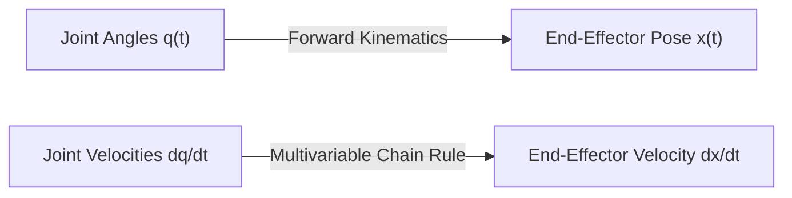

# 05: Derivatives, Partial Derivatives, and Calculus for Robotics

## 1. Learning Objectives
By completing this chapter, you will be able to:
- Compute ordinary and partial derivatives of multivariable robotic kinematics functions.
- Apply the multivariable Chain Rule to calculate end-effector velocities from joint velocities.
- Formulate 1st- and 2nd-order Taylor series approximations to linearise non-linear robot systems.
- Construct the gradient vector $\nabla f(\mathbf{x})$ and explain its role in potential-field path planning and cost minimization.

---

## 2. Intuitive Explanation
In robotics, systems are constantly in motion:
- A joint position $\theta(t)$ changes over time $\to$ its derivative $\dot{\theta}(t) = \frac{d\theta}{dt}$ is the **joint velocity**.
- A joint velocity changes over time $\to$ its second derivative $\ddot{\theta}(t) = \frac{d^2\theta}{dt^2}$ is the **joint acceleration** (which dictates motor torque via $F = ma$).

Furthermore, because a robot end-effector position $x = f(\theta_1, \theta_2, \dots, \theta_n)$ depends on *multiple joints simultaneously*, we use **partial derivatives** ($\frac{\partial x}{\partial \theta_1}$) to answer:
*"If I move Joint 1 by a tiny nudge $d\theta_1$ while holding all other joints locked, how much does the tool tip move along $X$?"*



---

## 3. Mathematical Formulation

### 3.1 Partial Derivatives
For a scalar function $f(x_1, x_2, \dots, x_n)$ of $n$ independent variables, the partial derivative with respect to $x_i$ is defined as:

$$\frac{\partial f}{\partial x_i} = \lim_{h \to 0} \frac{f(x_1, \dots, x_i + h, \dots, x_n) - f(x_1, \dots, x_i, \dots, x_n)}{h}$$

To compute $\frac{\partial f}{\partial x_i}$, treat all other variables $x_j$ ($j \ne i$) as fixed constants and differentiate with respect to $x_i$ using standard rules.

### 3.2 The Multivariable Chain Rule
If a robot's Cartesian coordinate $x$ is a function of joint angles $q_1(t), q_2(t), \dots, q_n(t)$, then its instantaneous velocity $\dot{x} = \frac{dx}{dt}$ is given by the total time derivative:

$$\dot{x} = \frac{dx}{dt} = \frac{\partial x}{\partial q_1}\frac{dq_1}{dt} + \frac{\partial x}{\partial q_2}\frac{dq_2}{dt} + \dots + \frac{\partial x}{\partial q_n}\frac{dq_n}{dt} = \sum_{i=1}^{n} \frac{\partial x}{\partial q_i} \dot{q}_i$$

In vector notation:
$$\dot{x} = \begin{bmatrix} \frac{\partial x}{\partial q_1} & \frac{\partial x}{\partial q_2} & \dots & \frac{\partial x}{\partial q_n} \end{bmatrix} \begin{bmatrix} \dot{q}_1 \\ \dot{q}_2 \\ \vdots \\ \dot{q}_n \end{bmatrix}$$

This row vector of partial derivatives is the top row of the robot's **Jacobian Matrix**!

---

## 4. Taylor Series Linearisation

Real robot kinematics functions (containing sines and cosines) are highly non-linear. To design linear feedback controllers (PID, LQR, Kalman Filters), we linearise the system around an operating point $\mathbf{x}_0$:

$$f(\mathbf{x}) \approx f(\mathbf{x}_0) + \nabla f(\mathbf{x}_0)^T (\mathbf{x} - \mathbf{x}_0) + \frac{1}{2} (\mathbf{x} - \mathbf{x}_0)^T \mathbf{H}(\mathbf{x}_0) (\mathbf{x} - \mathbf{x}_0) + \dots$$

where:
- $\nabla f(\mathbf{x}_0)$ is the **Gradient Vector** of first partial derivatives:
  $$\nabla f = \begin{bmatrix} \frac{\partial f}{\partial x_1} \\ \frac{\partial f}{\partial x_2} \\ \vdots \\ \frac{\partial f}{\partial x_n} \end{bmatrix}$$
- $\mathbf{H}(\mathbf{x}_0)$ is the **Hessian Matrix** of second partial derivatives:
  $$H_{ij} = \frac{\partial^2 f}{\partial x_i \partial x_j}$$

For small perturbations $\Delta \mathbf{x} = \mathbf{x} - \mathbf{x}_0$, the 1st-order linear approximation is:
$$\Delta f \approx \nabla f(\mathbf{x}_0)^T \Delta \mathbf{x}$$

---

## 5. Fully Worked Numerical Example

Consider a 2-link planar arm with link lengths $l_1 = 1.0\,\text{m}$ and $l_2 = 0.5\,\text{m}$.
The forward kinematics for the $X$-coordinate is:
$$x(\theta_1, \theta_2) = l_1 \cos(\theta_1) + l_2 \cos(\theta_1 + \theta_2)$$

### Step 1: Compute partial derivatives
1. With respect to $\theta_1$:
   $$\frac{\partial x}{\partial \theta_1} = -l_1 \sin(\theta_1) - l_2 \sin(\theta_1 + \theta_2)$$
2. With respect to $\theta_2$:
   $$\frac{\partial x}{\partial \theta_2} = -l_2 \sin(\theta_1 + \theta_2)$$

### Step 2: Evaluate at operating point $\theta_1 = 0^\circ$, $\theta_2 = 90^\circ$ ($\pi/2\,\text{rad}$)
$$\sin(\theta_1) = \sin(0) = 0, \quad \sin(\theta_1 + \theta_2) = \sin(\pi/2) = 1.0$$
$$\frac{\partial x}{\partial \theta_1} = -1.0(0) - 0.5(1.0) = -0.50\,\text{m/rad}$$
$$\frac{\partial x}{\partial \theta_2} = -0.5(1.0) = -0.50\,\text{m/rad}$$

### Step 3: Compute Cartesian tool velocity $\dot{x}$
If Joint 1 rotates at $\dot{\theta}_1 = +0.4\,\text{rad/s}$ and Joint 2 rotates at $\dot{\theta}_2 = -0.2\,\text{rad/s}$:
$$\dot{x} = \frac{\partial x}{\partial \theta_1}\dot{\theta}_1 + \frac{\partial x}{\partial \theta_2}\dot{\theta}_2 = (-0.50)(+0.4) + (-0.50)(-0.2) = -0.20 + 0.10 = -0.10\,\text{m/s}$$
**Result:** The tool tip is moving in the $-X$ direction at $0.10\,\text{m/s}$ ($10\,\text{cm/s}$).

---

## 6. Python Demonstration

```python
import numpy as np

def planar_x_partial_derivatives(l1, l2, th1, th2):
    """Compute analytical partial derivatives dx/dth1 and dx/dth2."""
    dx_dth1 = -l1 * np.sin(th1) - l2 * np.sin(th1 + th2)
    dx_dth2 = -l2 * np.sin(th1 + th2)
    return np.array([dx_dth1, dx_dth2])

l1, l2 = 1.0, 0.5
th1, th2 = 0.0, np.pi / 2
q_dot = np.array([0.4, -0.2])

grad_x = planar_x_partial_derivatives(l1, l2, th1, th2)
x_dot = grad_x @ q_dot

print(f"Gradient dx/dq: {grad_x}")
print(f"Cartesian x velocity: {x_dot:.4f} m/s")

# Numerical finite difference check:
delta = 1e-6
x_orig = l1 * np.cos(th1) + l2 * np.cos(th1 + th2)
x_new = l1 * np.cos(th1 + delta*q_dot[0]) + l2 * np.cos((th1 + delta*q_dot[0]) + (th2 + delta*q_dot[1]))
x_dot_num = (x_new - x_orig) / delta
print(f"Numerical finite difference: {x_dot_num:.4f} m/s")
print(f"Analytical matches numerical? {np.isclose(x_dot, x_dot_num, atol=1e-5)}")
```

---

## 7. Common Mistakes & Debugging Tips
1. **Forgetting Inner Derivative in Chain Rule:**
   When differentiating $\cos(\theta_1 + \theta_2)$ with respect to $\theta_1$, students sometimes forget that $\frac{\partial}{\partial \theta_1}(\theta_1 + \theta_2) = 1$. If there is a gear ratio $N$ inside, you must multiply by $N$!
2. **Treating Time as an Explicit Variable:**
   In robot kinematics, Cartesian position $x = f(\mathbf{q})$ does not depend explicitly on time $t$; it depends on time only through joint angles $\mathbf{q}(t)$. Therefore, $\frac{\partial f}{\partial t} = 0$, and the total derivative is entirely composed of chain-rule terms.
3. **Evaluating Derivatives Before Differentiating:**
   Always compute symbolic algebraic derivatives first, and only plug in numerical values ($\theta_1 = 0$) afterwards!

---

## 8. Exercises

### Beginner
1. Given $f(x, y) = 3x^2 y + \sin(y)$, compute $\frac{\partial f}{\partial x}$ and $\frac{\partial f}{\partial y}$.
2. If $y(\theta) = l_1 \sin(\theta_1) + l_2 \sin(\theta_1 + \theta_2)$, compute $\frac{\partial y}{\partial \theta_1}$ and $\frac{\partial y}{\partial \theta_2}$.

### Intermediate
3. For the 2-link arm with $l_1 = 1.0\,\text{m}, l_2 = 0.8\,\text{m}$ at configuration $\theta_1 = 45^\circ, \theta_2 = 45^\circ$:
   Compute both $\dot{x}$ and $\dot{y}$ when $\dot{\theta}_1 = 1.0\,\text{rad/s}$ and $\dot{\theta}_2 = 0.5\,\text{rad/s}$.
4. Construct the linear Taylor approximation of $g(x) = \cos(x)$ around $x_0 = 0$. Compare the true value of $\cos(0.2)$ with the linear approximation.

### Advanced
5. Derive the Hessian matrix $\mathbf{H}$ of the objective function $J(x, y) = (x - x_d)^2 + (y - y_d)^2$. Prove that $\mathbf{H}$ is strictly positive-definite everywhere, confirming that $(x_d, y_d)$ is a global minimum.

---

## 9. Summary & Next Steps
- Partial derivatives quantify how changes in individual joints affect end-effector coordinates.
- The multivariable chain rule relates joint velocities to Cartesian velocities.
- Next, combine these partial derivative rows into the complete [**06: Jacobians & Gradient Descent**](06-jacobians.md).
