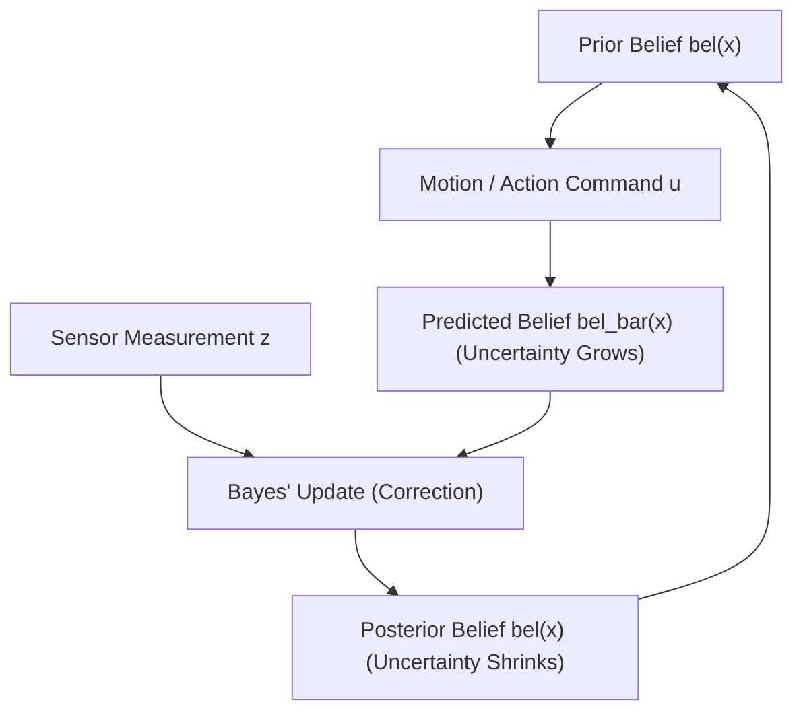

# 07: Probability and Bayes' Theorem for Robotics

## 1. Learning Objectives
By completing this chapter, you will be able to:
- State the fundamental Kolmogorov axioms of probability and probability density functions.
- Compute marginal, joint, and conditional probabilities.
- Apply the Law of Total Probability to model state transitions.
- Derive and implement Bayes' Theorem to fuse noisy sensor measurements into robot belief states.
- Explain the recursive Bayes Filter loop (Prediction $\to$ Correction) that underpins AMCL and SLAM.

---

## 2. Intuitive Explanation: The Robot That Never Knows for Sure
In textbook computer science, a variable is either `True` or `False`.
In real physical robotics:
- A wheel encoder slips on a tile floor.
- A sonar sensor bounces off a smooth wall at an angle and misses.
- A camera suffers from motion blur or sudden glare.

Because physical sensors and motors are inherently stochastic (noisy and unpredictable), a robot **never knows its exact true state**.
Instead, the robot maintains a **Belief State**—a probability distribution over all possible states:
$$\text{bel}(x_t) = p(x_t \mid z_{1:t}, u_{1:t})$$
Every time the robot drives forward (actuation $u$), uncertainty spreads out. Every time the robot takes a sensor scan (measurement $z$), **Bayes' Rule** sharpens the belief distribution.



---

## 3. Mathematical Foundations

### 3.1 Kolmogorov Axioms
For any events $A, B$ in sample space $\Omega$:
1. **Non-negativity:** $P(A) \ge 0$
2. **Total Probability of Space:** $P(\Omega) = 1.0$
3. **Additivity of Disjoint Events:** If $A \cap B = \emptyset$, then $P(A \cup B) = P(A) + P(B)$

### 3.2 Conditional Probability
The probability that event $A$ occurs given that event $B$ has already occurred (with $P(B) > 0$):

$$P(A \mid B) = \frac{P(A \cap B)}{P(B)}$$

### 3.3 Law of Total Probability
If the events $\{B_1, B_2, \dots, B_k\}$ form a mutually exclusive and exhaustive partition of $\Omega$:

$$P(A) = \sum_{i=1}^{k} P(A \mid B_i) P(B_i)$$

---

## 4. Bayes' Theorem

Rearranging conditional probability yields the cornerstone equation of autonomous robotics:

$$P(X \mid Z) = \frac{P(Z \mid X) P(X)}{P(Z)} = \frac{P(Z \mid X) P(X)}{\sum_{x'} P(Z \mid x') P(x')}$$

### Symbol Definitions:
- $X$: The unknown physical state (e.g., true robot location, door open vs closed).
- $Z$: The sensor measurement received.
- $P(X)$: **Prior Probability** (the robot's belief before taking the new measurement).
- $P(Z \mid X)$: **Measurement Likelihood** (the sensor model: how probable is this reading if the true state is $X$?).
- $P(Z)$: **Marginal Evidence** (normalization factor $\eta = \frac{1}{P(Z)}$ guaranteeing probabilities sum to $1.0$).
- $P(X \mid Z)$: **Posterior Probability** (the updated belief after incorporating measurement $Z$).

In compact robotics notation:
$$\text{bel}(X) = \eta \; P(Z \mid X) \; \text{bel}^-(X)$$

---

## 5. Fully Worked Numerical Example: Door State Detection

A service robot approaches an office door. Let the state be $D \in \{\text{Open}, \text{Closed}\}$.
1. **Prior belief:** The robot knows doors in this hallway are usually closed:
   $$P(\text{Open}) = 0.20, \quad P(\text{Closed}) = 0.80$$
2. **Sensor model (Laser distance sensor):**
   The laser is imperfect:
   - If the door is Open, it detects "Open" with $80\%$ probability:
     $$P(\text{Scan=Open} \mid \text{Open}) = 0.80, \quad P(\text{Scan=Closed} \mid \text{Open}) = 0.20$$
   - If the door is Closed, it detects "Closed" with $90\%$ probability (false open rate $10\%$):
     $$P(\text{Scan=Open} \mid \text{Closed}) = 0.10, \quad P(\text{Scan=Closed} \mid \text{Closed}) = 0.90$$
3. **The Event:** The robot takes a scan and receives reading $Z = \text{"Open"}$.
4. **Calculate Posterior Probability $P(\text{Open} \mid \text{Scan=Open})$:**
   - Unnormalized posterior for Open:
     $$\text{num}(\text{Open}) = P(\text{Scan=Open} \mid \text{Open}) P(\text{Open}) = (0.80)(0.20) = 0.160$$
   - Unnormalized posterior for Closed:
     $$\text{num}(\text{Closed}) = P(\text{Scan=Open} \mid \text{Closed}) P(\text{Closed}) = (0.10)(0.80) = 0.080$$
   - Total evidence $P(\text{Scan=Open})$:
     $$P(Z) = 0.160 + 0.080 = 0.240$$
   - Normalized Posteriors:
     $$P(\text{Open} \mid Z) = \frac{0.160}{0.240} = \frac{2}{3} \approx 66.7\%$$
     $$P(\text{Closed} \mid Z) = \frac{0.080}{0.240} = \frac{1}{3} \approx 33.3\%$$

**Interpretation:** Even though the sensor reported "Open", the strong prior that doors are usually closed kept the posterior at $66.7\%$, preventing a false-positive collision! A second scan confirming "Open" will push the belief above $95\%$.

---

## 6. Python Demonstration: Recursive Bayes Filter

```python
import numpy as np

class DiscreteBayesFilter:
    def __init__(self, prior: dict):
        self.belief = prior

    def update(self, measurement: str, sensor_model: dict):
        """Apply Bayes' Rule update: bel(x) = eta * P(z|x) * bel_prior(x)"""
        unnormalized = {}
        for state, prior_prob in self.belief.items():
            likelihood = sensor_model[state][measurement]
            unnormalized[state] = likelihood * prior_prob

        # Normalization constant eta
        total_evidence = sum(unnormalized.values())
        for state in self.belief:
            self.belief[state] = unnormalized[state] / total_evidence

# Setup
prior = {"Open": 0.20, "Closed": 0.80}
sensor_model = {
    "Open":   {"Scan=Open": 0.80, "Scan=Closed": 0.20},
    "Closed": {"Scan=Open": 0.10, "Scan=Closed": 0.90}
}

filter = DiscreteBayesFilter(prior)
print(f"Initial Prior Belief: {filter.belief}")

# First Scan: Open
filter.update("Scan=Open", sensor_model)
print(f"After 1st 'Scan=Open': { {k: round(v, 4) for k, v in filter.belief.items()} }")

# Second Scan: Open
filter.update("Scan=Open", sensor_model)
print(f"After 2nd 'Scan=Open': { {k: round(v, 4) for k, v in filter.belief.items()} }")
```

---

## 7. Common Mistakes & Debugging Tips
1. **Confusing $P(A \mid B)$ with $P(B \mid A)$ (The Base Rate Fallacy):**
   $P(\text{Detection} \mid \text{Obstacle})$ is NOT the same as $P(\text{Obstacle} \mid \text{Detection})$. The likelihood comes from sensor bench-testing; the posterior depends on how rare the obstacle is in the room.
2. **Forgetting to Normalize:**
   If $\sum_x \text{bel}(x) \ne 1.0$, the belief will exponentially decay to zero or blow up to infinity after a few iterations.
3. **Zero Probabilities Lock States Forever:**
   If $\text{bel}(x_0) = 0$, no amount of sensory evidence can ever restore belief in $x_0$ because multiplying by zero always yields zero. Initialize impossible states with a tiny epsilon ($10^{-6}$) rather than strict zero.

---

## 8. Exercises

### Beginner
1. If $P(A) = 0.4$ and $P(B \mid A) = 0.5$, calculate the joint probability $P(A \cap B)$.
2. Explain the difference between prior probability and posterior probability in the context of robot localization.

### Intermediate
3. A mobile robot is in a circular corridor with 3 identical doors located at positions $x=2$, $x=4$, and $x=7$. All 10 locations in the corridor have equal prior probability $P(x) = 0.10$. A door detector sensor triggers. If $P(\text{Door} \mid \text{at door}) = 0.8$ and $P(\text{Door} \mid \text{no door}) = 0.2$, calculate the posterior probability distribution across all 10 locations.
4. What is the **Markov Assumption** in robotics state estimation, and why does it make real-time computation tractable?

### Advanced
5. Derive the continuous recursive Bayes Filter equation:
   $$p(x_t \mid z_{1:t}, u_{1:t}) = \eta \; p(z_t \mid x_t) \int p(x_t \mid u_t, x_{t-1}) \; p(x_{t-1} \mid z_{1:t-1}, u_{1:t-1}) \; dx_{t-1}$$
   Identify the **Motion Prediction Step** (Chapman-Kolmogorov integral) and the **Measurement Correction Step**.

---

## 9. Summary & Next Steps
- Robots use probability to reason under sensor noise and actuator uncertainty.
- Bayes' Theorem updates prior beliefs with new sensor evidence.
- To handle continuous physical variables (positions and angles), proceed to [**08: Gaussian Distributions**](08-gaussian-distributions.md).
