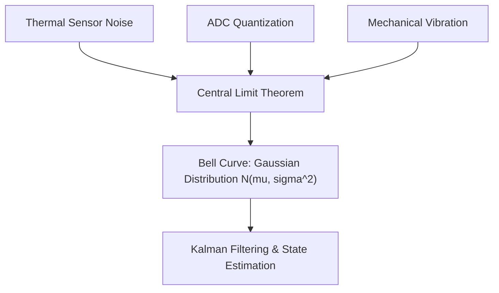

# 08: Continuous Random Variables and Gaussian Distributions

## 1. Learning Objectives
By completing this chapter, you will be able to:
- Distinguish between discrete probability mass functions (PMF) and continuous probability density functions (PDF).
- Compute expected value (mean $\mu$), variance $\sigma^2$, and standard deviation $\sigma$.
- Strictly differentiate between variance $\sigma^2$ (units squared) and standard deviation $\sigma$ (physical units).
- Formulate the 1D Gaussian Probability Density Function $\mathcal{N}(\mu, \sigma^2)$.
- Apply the Central Limit Theorem to explain sensor noise.
- Derive the product of two 1D Gaussians (the mathematical foundation of the 1D Kalman Filter).

---

## 2. Intuitive Explanation
In the previous chapter, our robot considered discrete states (door open vs closed).
However, a robot's physical position $x$ is not an integer—it is a **continuous real number** on the real line: $x \in \mathbb{R}$.

If you ask: *"What is the exact probability that the robot is at exactly $x = 1.4589234891\dots\,\text{m}$?"*
The probability is mathematically **zero** ($P(X = x) = 0$), because there are infinitely many points on the real line!
Instead, we use a **Probability Density Function (PDF)** $p(x)$, where the probability of finding the robot in an interval $[a, b]$ is the **area under the curve**:
$$P(a \le x \le b) = \int_{a}^{b} p(x) dx$$

The most ubiquitous distribution in engineering is the **Gaussian (Normal) Distribution**, forming the classic bell curve.



---

## 3. Mathematical Formulation

### 3.1 Expected Value (Mean $\mu$)
The expected value represents the probability-weighted center of gravity of the distribution:
$$\mu = \mathbb{E}[x] = \int_{-\infty}^{+\infty} x p(x) dx$$

### 3.2 Variance $\sigma^2$ vs Standard Deviation $\sigma$

> [!IMPORTANT]
> **Units Matter!**
> - **Variance $\sigma^2$:** Measures average squared dispersion from the mean:
>   $$\sigma^2 = \text{Var}(x) = \mathbb{E}[(x - \mu)^2] = \int_{-\infty}^{+\infty} (x - \mu)^2 p(x) dx$$
>   *Units:* If $x$ is measured in metres ($\text{m}$), variance is in **$\text{m}^2$**!
> - **Standard Deviation $\sigma = \sqrt{\sigma^2}$:** The square root of variance.
>   *Units:* Shares the **exact same physical units** as the state variable ($\text{m}$).

### 3.3 The 1D Gaussian PDF
A continuous random variable $x \sim \mathcal{N}(\mu, \sigma^2)$ has the probability density function:

$$p(x) = \frac{1}{\sigma \sqrt{2\pi}} \exp\left( -\frac{(x - \mu)^2}{2\sigma^2} \right)$$

### Key Properties:
1. **Symmetry:** Centered symmetrically at $x = \mu$.
2. **Total Area:** $\int_{-\infty}^{+\infty} p(x) dx = 1.0$.
3. **The 68–95–99.7 Empirical Rule:**
   - $\approx 68.27\%$ of readings lie within $[\mu - 1\sigma, \; \mu + 1\sigma]$
   - $\approx 95.45\%$ of readings lie within $[\mu - 2\sigma, \; \mu + 2\sigma]$
   - $\approx 99.73\%$ of readings lie within $[\mu - 3\sigma, \; \mu + 3\sigma]$ (commonly taken as the maximum physical error bound in robotics).

---

## 4. The Central Limit Theorem (CLT)

Why is the Gaussian distribution used everywhere in robotics?
The **Central Limit Theorem** proves that when you add together many independent random variables (regardless of their individual original distributions), their normalized sum approaches a **Gaussian distribution** as the number of variables grows.

In a physical LiDAR or wheel encoder:
- Silicon thermal noise
- Minor gear tooth backlash
- Ground surface roughness
- Microcontroller voltage fluctuations
All these microscopic independent noise sources add up. Consequently, the net sensor error is almost perfectly Gaussian!

---

## 5. Fusion: Product of Two 1D Gaussians

Suppose a robot has a prior belief from wheel odometry:
$$x_1 \sim \mathcal{N}(\mu_1, \sigma_1^2)$$
It then receives a new GPS measurement:
$$x_2 \sim \mathcal{N}(\mu_2, \sigma_2^2)$$

Multiplying the two Gaussian PDFs and completing the square yields a **new single Gaussian** $\mathcal{N}(\mu', \sigma'^2)$:

$$\mu' = \frac{\sigma_2^2 \mu_1 + \sigma_1^2 \mu_2}{\sigma_1^2 + \sigma_2^2} = \mu_1 + K(\mu_2 - \mu_1)$$
$$\sigma'^2 = \frac{\sigma_1^2 \sigma_2^2}{\sigma_1^2 + \sigma_2^2} = (1 - K)\sigma_1^2$$
where $K = \frac{\sigma_1^2}{\sigma_1^2 + \sigma_2^2}$ is the **Kalman Gain**!

### Key Engineering Insights:
1. The fused mean $\mu'$ is a weighted average: the sensor with smaller variance (higher certainty) receives more weight.
2. The fused variance $\sigma'^2$ is **strictly smaller than both individual variances** ($\sigma'^2 < \min(\sigma_1^2, \sigma_2^2)$). Fusing two noisy sensors always produces an estimate more certain than either sensor alone!

---

## 6. Fully Worked Numerical Example

### Scenario:
A warehouse AGV estimates its position along an aisle:
- **Prior (Odometry):** $\mu_1 = 10.0\,\text{m}$, standard deviation $\sigma_1 = 0.4\,\text{m}$ (variance $\sigma_1^2 = 0.16\,\text{m}^2$).
- **Measurement (Ultra-Wideband Beacon):** $\mu_2 = 10.6\,\text{m}$, standard deviation $\sigma_2 = 0.2\,\text{m}$ (variance $\sigma_2^2 = 0.04\,\text{m}^2$).

### Step 1: Compute Kalman Gain $K$
$$K = \frac{\sigma_1^2}{\sigma_1^2 + \sigma_2^2} = \frac{0.16}{0.16 + 0.04} = \frac{0.16}{0.20} = 0.80$$

### Step 2: Compute Updated Mean $\mu'$
$$\mu' = \mu_1 + K(\mu_2 - \mu_1) = 10.0 + 0.80(10.6 - 10.0) = 10.0 + 0.80(0.60) = 10.48\,\text{m}$$

### Step 3: Compute Updated Variance $\sigma'^2$ and Standard Deviation $\sigma'$
$$\sigma'^2 = (1 - K)\sigma_1^2 = (1 - 0.80)(0.16) = 0.20 \times 0.16 = 0.032\,\text{m}^2$$
$$\sigma' = \sqrt{0.032} \approx 0.179\,\text{m} = 17.9\,\text{cm}$$

**Result:**
- The updated estimate moves closer to the more accurate beacon ($10.48\,\text{m}$).
- The uncertainty drops from $\pm 40\,\text{cm}$ and $\pm 20\,\text{cm}$ down to $\pm 17.9\,\text{cm}$!

---

## 7. Python Demonstration

```python
import numpy as np

def fuse_1d_gaussians(mu1, var1, mu2, var2):
    """Compute exact Kalman fusion of two 1D Gaussian distributions."""
    K = var1 / (var1 + var2)
    mu_fused = mu1 + K * (mu2 - mu1)
    var_fused = (1.0 - K) * var1
    return mu_fused, var_fused, K

mu_odom, var_odom = 10.0, 0.4**2
mu_uwb, var_uwb = 10.6, 0.2**2

mu_new, var_new, K = fuse_1d_gaussians(mu_odom, var_odom, mu_uwb, var_uwb)
std_new = np.sqrt(var_new)

print(f"Kalman Gain K: {K:.4f}")
print(f"Fused Mean: {mu_new:.3f} m")
print(f"Fused Variance: {var_new:.4f} m^2 (Std Dev: {std_new*100:.1f} cm)")
print(f"Is fused uncertainty smaller than both? {var_new < min(var_odom, var_uwb)}")
```

---

## 8. Common Mistakes & Debugging Tips
1. **Adding Standard Deviations Instead of Variances:**
   When adding independent random variables ($Z = X + Y$), their **variances add** ($\sigma_Z^2 = \sigma_X^2 + \sigma_Y^2$). Never add standard deviations directly ($\sigma_Z \ne \sigma_X + \sigma_Y$)!
2. **Confusing PDF Height with Probability:**
   For a very precise sensor ($\sigma = 0.01$), the peak height $p(\mu) = \frac{1}{\sigma \sqrt{2\pi}} \approx 39.9$. Beginners panic because they think a probability cannot exceed $1.0$. Remember: $p(x)$ is a **probability density**, not a discrete probability. Only the integrated area $\int p(x)dx$ cannot exceed $1.0$.
3. **Assuming Gaussianity for Multi-Modal Distributions:**
   A standard Kalman Filter assumes unimodal Gaussian noise. If a robot is in a corridor with two identical doors and has no idea which door it is at, the true belief is **bimodal**. Fitting a single Gaussian will average the two peaks and place the estimated robot in the solid wall between the doors! For multi-modal beliefs, use Particle Filters (Monte Carlo Localization).

---

## 9. Exercises

### Beginner
1. If an ultrasonic rangefinder has mean $\mu = 2.0\,\text{m}$ and standard deviation $\sigma = 0.05\,\text{m}$, what are the $1\sigma$, $2\sigma$, and $3\sigma$ confidence bounds?
2. A sensor specification reports accuracy as a variance of $\sigma^2 = 0.09\,\text{rad}^2$. What is the standard deviation in radians and in degrees?

### Intermediate
3. A mobile robot takes 100 independent distance measurements of a fixed wall. The sample mean is $3.20\,\text{m}$ and sample variance is $0.04\,\text{m}^2$. Calculate the standard error of the mean $\sigma_{\bar{x}} = \sigma / \sqrt{N}$.
4. If two sensors measure the same distance with identical variances $\sigma_1^2 = \sigma_2^2 = \sigma^2$, prove that the fused variance is exactly half the original variance: $\sigma'^2 = \sigma^2 / 2$.

### Advanced
5. Derive the formula for the product of two Gaussian PDFs $p_1(x) = \mathcal{N}(\mu_1, \sigma_1^2)$ and $p_2(x) = \mathcal{N}(\mu_2, \sigma_2^2)$ by completing the square in the exponent of $\exp\left(-\frac{(x - \mu_1)^2}{2\sigma_1^2} - \frac{(x - \mu_2)^2}{2\sigma_2^2}\right)$.

---

## 10. Summary & Next Steps
- Continuous uncertainty is modeled by Gaussian probability density functions.
- Fusing independent Gaussian measurements sharpens uncertainty via Kalman updates.
- To handle multi-dimensional states ($[x, y, z, \text{yaw}]$), proceed to [**09: Covariance Matrices**](09-covariance-matrices.md).
