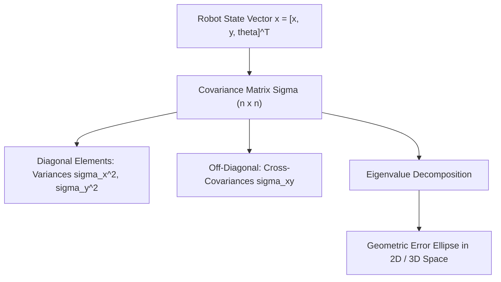

# 09: Covariance Matrices and Multivariable Sensor Uncertainty

## 1. Learning Objectives
By completing this chapter, you will be able to:
- Construct the $n \times n$ covariance matrix $\mathbf{\Sigma}$ for a multivariable robot state vector.
- Differentiate rigorously between variance, covariance, and the Pearson correlation coefficient $\rho$.
- Formulate the multivariate Gaussian Probability Density Function.
- Extract the geometric error ellipse (orientation and axis lengths) from $\mathbf{\Sigma}$ using Eigenvalue Decomposition.
- Compute the Mahalanobis distance to reject sensor outliers in data association.

---

## 2. Intuitive Explanation
A robot does not move along a single line; it moves in a 2D plane ($x, y, \theta$) or 3D space ($x, y, z, \phi, \theta, \psi$).
If a robot drives forward along a road:
- Position error along the direction of travel ($X$) grows quickly due to wheel slip.
- Lateral position error perpendicular to travel ($Y$) grows much more slowly.
- Furthermore, if the heading angle $\theta$ drifts left, errors in $X$ and $Y$ become **coupled**.

A single scalar variance cannot capture this shape. We need a **Covariance Matrix $\mathbf{\Sigma}$**:
- The **diagonal elements** describe the uncertainty along each individual coordinate axis.
- The **off-diagonal elements** describe the **correlation** between axes—how an error in one coordinate predicts an error in another!



---

## 3. Mathematical Formulation

For an $n$-dimensional random state vector $\mathbf{x} = [x_1, x_2, \dots, x_n]^T \in \mathbb{R}^n$ with mean vector $\boldsymbol{\mu} = \mathbb{E}[\mathbf{x}]$:

The **Covariance Matrix** $\mathbf{\Sigma} \in \mathbb{R}^{n \times n}$ is defined as:

$$\mathbf{\Sigma} = \text{Cov}(\mathbf{x}) = \mathbb{E}\left[ (\mathbf{x} - \boldsymbol{\mu})(\mathbf{x} - \boldsymbol{\mu})^T \right] = \begin{bmatrix}
\sigma_1^2 & \sigma_{12} & \dots & \sigma_{1n} \\
\sigma_{21} & \sigma_2^2 & \dots & \sigma_{2n} \\
\vdots & \vdots & \ddots & \vdots \\
\sigma_{n1} & \sigma_{n2} & \dots & \sigma_n^2
\end{bmatrix}$$

### 3.1 Individual Variance (Diagonal)
$$\sigma_i^2 = \text{Var}(x_i) = \mathbb{E}[(x_i - \mu_i)^2]$$

### 3.2 Cross-Covariance (Off-Diagonal)
$$\sigma_{ij} = \text{Cov}(x_i, x_j) = \mathbb{E}[(x_i - \mu_i)(x_j - \mu_j)]$$

### 3.3 Fundamental Properties of $\mathbf{\Sigma}$
1. **Symmetry:** $\sigma_{ij} = \sigma_{ji} \implies \mathbf{\Sigma} = \mathbf{\Sigma}^T$.
2. **Positive Semi-Definiteness:** For any non-zero vector $\mathbf{v} \in \mathbb{R}^n$:
   $$\mathbf{v}^T \mathbf{\Sigma} \mathbf{v} \ge 0$$
   All eigenvalues of $\mathbf{\Sigma}$ are real and non-negative: $\lambda_i \ge 0$.

---

## 4. Covariance vs Correlation Coefficient $\rho$

> [!IMPORTANT]
> **Crucial Difference:**
> - **Covariance $\sigma_{xy}$:** Has physical units equal to $\text{unit}(x) \times \text{unit}(y)$ (e.g. $\text{m} \cdot \text{rad}$). Its numerical magnitude depends on the scale of measurement.
> - **Correlation Coefficient $\rho_{xy}$:** A dimensionless, normalized metric bounded in $[-1.0, +1.0]$:
>   $$\rho_{xy} = \frac{\sigma_{xy}}{\sigma_x \sigma_y} \in [-1.0, +1.0]$$
>   - $\rho = +1.0$: Perfect positive linear correlation.
>   - $\rho = 0.0$: Variables are linearly uncorrelated.
>   - $\rho = -1.0$: Perfect negative linear correlation.

---

## 5. The Multivariate Gaussian PDF

The joint probability density function of an $n$-dimensional Gaussian distribution $\mathbf{x} \sim \mathcal{N}(\boldsymbol{\mu}, \mathbf{\Sigma})$ is:

$$p(\mathbf{x}) = \frac{1}{\sqrt{(2\pi)^n \det(\mathbf{\Sigma})}} \exp\left( -\frac{1}{2} (\mathbf{x} - \boldsymbol{\mu})^T \mathbf{\Sigma}^{-1} (\mathbf{x} - \boldsymbol{\mu}) \right)$$

### The Mahalanobis Distance:
The quadratic term in the exponent:
$$d_M(\mathbf{x}, \boldsymbol{\mu}) = \sqrt{(\mathbf{x} - \boldsymbol{\mu})^T \mathbf{\Sigma}^{-1} (\mathbf{x} - \boldsymbol{\mu})}$$
is the **Mahalanobis Distance**. It measures the statistical distance of a point $\mathbf{x}$ from the mean $\boldsymbol{\mu}$, weighted by directional uncertainty. In robotics, LiDAR scan matchers use $d_M < 3.0$ to reject spurious outlier reflections.

---

## 6. Geometry of Uncertainty: Error Ellipses

In 2D space, the contours of equal probability density $p(\mathbf{x}) = \text{const}$ form an **Error Ellipse**:
$$(\mathbf{x} - \boldsymbol{\mu})^T \mathbf{\Sigma}^{-1} (\mathbf{x} - \boldsymbol{\mu}) = c^2$$

Through **Eigenvalue Decomposition** $\mathbf{\Sigma} = \mathbf{V} \mathbf{\Lambda} \mathbf{V}^T$:
- **Eigenvalues ($\lambda_1, \lambda_2$):** The lengths of the principal semi-axes are:
  $$a = s \sqrt{\lambda_1}, \quad b = s \sqrt{\lambda_2}$$
  where scale factor $s = \sqrt{\chi_2^2(p)}$ (for a $95\%$ confidence ellipse, $s = \sqrt{5.991} \approx 2.447$).
- **Eigenvectors ($\mathbf{v}_1, \mathbf{v}_2$):** The unit eigenvectors point in the directions of the ellipse's principal axes!
  $$\theta_{\text{tilt}} = \text{atan2}(v_{1, y}, \; v_{1, x})$$

```mermaid
graph LR
    Sigma["Covariance Matrix Sigma"] -->|eig(Sigma)| EigVals["Eigenvalues lambda_1, lambda_2 (Axis lengths)"]
    Sigma -->|eig(Sigma)| EigVecs["Eigenvectors v_1, v_2 (Orientation angle)"]
    EigVals & EigVecs --> Visual["2D / 3D Error Ellipse in RViz"]
```

---

## 7. Fully Worked Numerical Example

Suppose a mobile robot pose estimator yields the 2D position covariance:
$$\mathbf{\Sigma} = \begin{bmatrix} 0.25 & 0.15 \\ 0.15 & 0.25 \end{bmatrix}\,\text{m}^2$$

1. **Extract individual standard deviations:**
   $$\sigma_x = \sqrt{0.25} = 0.50\,\text{m}, \quad \sigma_y = \sqrt{0.25} = 0.50\,\text{m}$$
2. **Compute correlation coefficient $\rho_{xy}$:**
   $$\rho_{xy} = \frac{0.15}{\sigma_x \sigma_y} = \frac{0.15}{(0.5)(0.5)} = \frac{0.15}{0.25} = +0.60$$
   *(Strong positive correlation: if the robot is displaced in $+X$, it is statistically likely to also be displaced in $+Y$.)*
3. **Compute Eigenvalues of $\mathbf{\Sigma}$:**
   Characteristic equation $\det(\mathbf{\Sigma} - \lambda \mathbf{I}) = 0$:
   $$(0.25 - \lambda)^2 - (0.15)^2 = 0 \implies 0.25 - \lambda = \pm 0.15$$
   $$\lambda_1 = 0.25 + 0.15 = 0.40\,\text{m}^2$$
   $$\lambda_2 = 0.25 - 0.15 = 0.10\,\text{m}^2$$
4. **Compute Eigenvectors:**
   For $\lambda_1 = 0.40$:
   $$\begin{bmatrix} 0.25 - 0.40 & 0.15 \\ 0.15 & 0.25 - 0.40 \end{bmatrix} \begin{bmatrix} v_x \\ v_y \end{bmatrix} = \begin{bmatrix} -0.15 & 0.15 \\ 0.15 & -0.15 \end{bmatrix} \begin{bmatrix} v_x \\ v_y \end{bmatrix} = \mathbf{0} \implies v_x = v_y$$
   Unit eigenvector:
   $$\mathbf{v}_1 = \frac{1}{\sqrt{2}} \begin{bmatrix} 1 \\ 1 \end{bmatrix} \implies \theta = \text{atan2}(1, 1) = 45^\circ$$
5. **Conclusion:**
   The error ellipse is tilted at an angle of $+45^\circ$ with semi-major axis $\sqrt{0.40} \approx 0.632\,\text{m}$ and semi-minor axis $\sqrt{0.10} \approx 0.316\,\text{m}$.

---

## 8. Python Demonstration

```python
import numpy as np

Sigma = np.array([
    [0.25, 0.15],
    [0.15, 0.25]
])

# Eigenvalue decomposition
eigenvalues, eigenvectors = np.linalg.eigh(Sigma)

# Sort descending
idx = np.argsort(eigenvalues)[::-1]
eigenvalues = eigenvalues[idx]
eigenvectors = eigenvectors[:, idx]

semi_major = np.sqrt(eigenvalues[0])
semi_minor = np.sqrt(eigenvalues[1])
tilt_angle_deg = np.degrees(np.arctan2(eigenvectors[1, 0], eigenvectors[0, 0]))

print("Covariance Matrix Sigma:\n", Sigma)
print(f"Eigenvalues: {eigenvalues}")
print(f"Semi-Major Axis: {semi_major:.3f} m")
print(f"Semi-Minor Axis: {semi_minor:.3f} m")
print(f"Ellipse Tilt Angle: {tilt_angle_deg:.1f} degrees")
```

---

## 9. Common Mistakes & Debugging Tips
1. **Asymmetric Covariance Matrices Due to Numerical Rounding:**
   In Kalman filter update steps ($\mathbf{P}_{k+1} = (\mathbf{I} - \mathbf{KH})\mathbf{P}_k$), floating-point errors can cause $\mathbf{P}$ to become slightly asymmetric. Always enforce symmetry after every filter update:
   $$\mathbf{P} \leftarrow \frac{1}{2}(\mathbf{P} + \mathbf{P}^T)$$
2. **Negative Eigenvalues Due to Numerical Drift:**
   A covariance matrix cannot have negative eigenvalues. If numerical truncation produces $\lambda = -10^{-8}$, the Cholesky decomposition or inversion will crash with `Matrix not positive definite`. Clip small negative eigenvalues to zero or add a small regularization term $\epsilon \mathbf{I}$.
3. **Ignoring Off-Diagonal Terms:**
   Assuming a diagonal covariance matrix when strong cross-correlations exist causes the Kalman Filter to become overconfident and diverge.

---

## 10. Exercises

### Beginner
1. Given a covariance matrix $\mathbf{\Sigma} = \begin{bmatrix} 0.04 & 0.0 \\ 0.0 & 0.16 \end{bmatrix}$, what are the standard deviations $\sigma_x$ and $\sigma_y$? What is the correlation $\rho_{xy}$?
2. If $\sigma_x = 0.3\,\text{m}, \sigma_y = 0.4\,\text{m}$, and cross-covariance $\sigma_{xy} = -0.06\,\text{m}^2$, compute the correlation coefficient $\rho_{xy}$.

### Intermediate
3. Compute the eigenvalues and eigenvectors of $\mathbf{\Sigma} = \begin{bmatrix} 4 & 2 \\ 2 & 1 \end{bmatrix}$. Is this matrix positive-definite or positive-semi-definite? What is its geometric interpretation?
4. Explain how the Mahalanobis distance differs from standard Euclidean distance when comparing sensor observations against predicted landmark locations.

### Advanced
5. Derive the covariance propagation formula: If $\mathbf{y} = \mathbf{A}\mathbf{x} + \mathbf{b}$ is an affine transformation of random vector $\mathbf{x} \sim \mathcal{N}(\boldsymbol{\mu}_x, \mathbf{\Sigma}_x)$, prove that $\mathbf{\Sigma}_y = \mathbf{A} \mathbf{\Sigma}_x \mathbf{A}^T$. Why does translation $\mathbf{b}$ have no effect on $\mathbf{\Sigma}_y$?

---

## 11. Summary & Next Steps
- The covariance matrix $\mathbf{\Sigma}$ captures multi-dimensional uncertainty and cross-correlations.
- Eigenvalue decomposition directly defines the orientation and shape of error ellipses.
- You have completed the mathematics core! Now put these tools into practice with articulated robot geometry in [**Module 03: Robot Kinematics**](../03-robot-kinematics/README.md).
