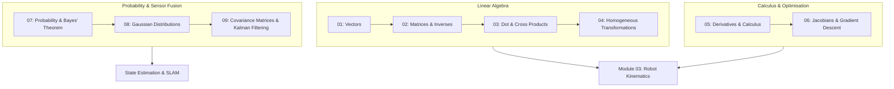

# Module 54: Mathematics for Robotics & AI

Welcome to **Module 54: Mathematics for Robotics**. Robotics is applied mathematics in physical action. To design, program, and control robots, you do not need to memorize abstract theorems; you need to understand how vectors represent positions, how matrices represent rotations, how derivatives compute velocities, and how probability distributions filter sensor noise.

---

## Curriculum Structure

### Chapter Index
1. [**01: Vectors**](01-vectors.md): Definitions, column representations, vector spaces, Euclidean norms, unit vectors, and basis vectors.
2. [**02: Matrices**](02-matrices.md): Matrix operations, matrix multiplication, transpose, trace, determinant, and matrix inversion.
3. [**03: Dot and Cross Products**](03-dot-and-cross-products.md): Projections, orthogonality, normal vectors, torque, angular velocity, and skew-symmetric cross-product matrices.
4. [**04: Homogeneous Transformations**](04-homogeneous-transformations.md): Projective coordinates, Special Euclidean Group $SE(3)$, rigid body transformation composition, and fast analytical inversion.
5. [**05: Derivatives and Calculus**](05-derivatives-and-calculus.md): Rates of change, partial derivatives, chain rule, multivariate Taylor series, and gradient vectors.
6. [**06: Jacobians & Gradient Descent**](06-jacobians.md): The multi-input multi-output sensitivity matrix, velocity kinematics, and gradient descent optimization.
7. [**07: Probability & Bayes' Theorem**](07-probability.md): Probability axioms, conditional probability, law of total probability, and Bayes' rule for robot belief updates.
8. [**08: Gaussian Distributions**](08-gaussian-distributions.md): 1D and Multivariate Normal PDFs, the central limit theorem, and variance vs standard deviation.
9. [**09: Covariance Matrices**](09-covariance-matrices.md): Covariance vs correlation, error ellipses, eigenvalue decomposition, and sensor fusion.
10. [**Exercises**](exercises.md) & [**Solutions**](solutions.md): Comprehensive worked problems and answer keys.

---

## Python Verification Environment
All linear algebra, calculus, and probability concepts in this module are implemented and tested in pure Python with NumPy in [`04-python-robotics/`](../04-python-robotics/).
