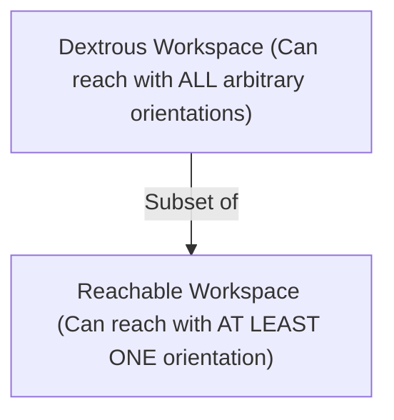

# 01: Introduction to Serial Manipulator Kinematics

## 1. Learning Objectives
By completing this chapter, you will be able to:
- Define a serial kinematic chain composed of rigid links and kinematic pairs (joints).
- Contrast Joint Space $\mathcal{Q} \subset \mathbb{R}^n$ with Operational Task Space $\mathcal{X} \subset SE(3)$.
- Distinguish between Forward Kinematics (FK: unique mapping) and Inverse Kinematics (IK: non-linear, multi-solution).
- Identify the topological characteristics of robot workspaces (reachable vs dextrous workspace).
- Formulate the fundamental kinematic mapping equations.

---

## 2. Intuitive Explanation
A human arm consists of a shoulder, an upper arm, an elbow, a forearm, a wrist, and a hand.
In robotics, this mechanical structure is called a **Serial Manipulator**:
- Each bone is modeled as a **rigid link**.
- Each articulation is a **joint** (actuated by an electric motor, gearbox, and encoder).
- The hand or gripper is the **End-Effector**.

Kinematics is the geometric study of this motion **without regard to the forces or masses** that cause it.

```mermaid
graph LR
    JointSpace["Joint Space q = [theta_1, ..., theta_n]^T (Motor Encoders)"] -->|Forward Kinematics (Unique & Direct)| TaskSpace["Task Space x = [X, Y, Z, RPY]^T (World Pose)"]
    TaskSpace -->|Inverse Kinematics (Complex & Multiple Solutions)| JointSpace
```

---

## 3. Mathematical Spaces in Robotics

### 3.1 Joint Space (Configuration Space $\mathcal{Q}$)
The state of the robot's actuators is described by an $n$-dimensional vector of joint variables:
$$\mathbf{q} = \begin{bmatrix} q_1 \\ q_2 \\ \vdots \\ q_n \end{bmatrix} \in \mathcal{Q} \subseteq \mathbb{R}^n$$
- For a **Revolute Joint ($R$)**: $q_i = \theta_i$ (angle in radians, typically bounded by physical hardstops $[\theta_{i,\min}, \theta_{i,\max}]$).
- For a **Prismatic Joint ($P$)**: $q_i = d_i$ (linear displacement along the joint slide in metres).

### 3.2 Task Space (Operational Space $\mathcal{X}$)
The position and orientation of the end-effector in Cartesian space is described by an element of the Special Euclidean Group:
$$\mathbf{x} = \begin{bmatrix} \mathbf{p} \\ \mathbf{\phi} \end{bmatrix} \in \mathbb{R}^6 \quad \text{or} \quad \mathbf{T} \in SE(3)$$
where $\mathbf{p} = [x, y, z]^T \in \mathbb{R}^3$ represents Cartesian position, and $\mathbf{\phi} = [\text{roll}, \text{pitch}, \text{yaw}]^T$ (or a unit quaternion $\mathbf{q}$) represents 3D spatial orientation.

---

## 4. The Two Fundamental Kinematic Problems

### 4.1 Forward Kinematics (FK)
$$\mathbf{x} = \mathbf{f}(\mathbf{q})$$
- **Input:** Known joint angles $[q_1, q_2, \dots, q_n]^T$ from motor encoders.
- **Output:** End-effector pose in the base coordinate frame.
- **Properties:** Always yields a **unique, closed-form analytical solution** via straightforward matrix multiplications.

### 4.2 Inverse Kinematics (IK)
$$\mathbf{q} = \mathbf{f}^{-1}(\mathbf{x}_d)$$
- **Input:** Desired tool pose $\mathbf{x}_d$ (e.g., location of a part on a conveyor belt).
- **Output:** Joint angles $[q_1, \dots, q_n]^T$ required to achieve that pose.
- **Properties:**
  1. **Non-linear:** Involves coupled transcendental trigonometric equations.
  2. **Multiple Solutions:** There can be multiple configurations (e.g., elbow-up vs elbow-down) that achieve the exact same tool pose.
  3. **No Solution:** If the target lies outside the mechanical reach or violates joint limits.
  4. **Singularities:** Infinite solutions may exist when joint axes align.

---

## 5. Robot Workspaces

The **Workspace** is the volume of 3D space that the robot end-effector can physically access.



1. **Reachable Workspace:** The set of all Cartesian points $\mathbf{p} \in \mathbb{R}^3$ that the tool tip can touch with *at least one* orientation.
2. **Dextrous Workspace:** The subset of points that the tool tip can reach in *any arbitrary 3D orientation*. The dextrous workspace is strictly smaller than the reachable workspace.

---

## 6. Fully Worked Numerical Example: 1-Link Polar Arm

Consider a simple single-link arm of length $L = 1.2\,\text{m}$ rotating about a base pin in a 2D plane.
- Joint variable: $q_1 = \theta \in [0^\circ, 180^\circ]$.
- Link length: $L = 1.2\,\text{m}$.

1. **Forward Kinematics Equation:**
   $$x = L \cos(\theta), \quad y = L \sin(\theta)$$
   If the motor encoder reads $\theta = 60^\circ$ ($\pi/3\,\text{rad}$):
   $$x = 1.2 \cos(60^\circ) = 1.2(0.5) = 0.60\,\text{m}$$
   $$y = 1.2 \sin(60^\circ) = 1.2(0.8660) = 1.039\,\text{m}$$
   **FK result:** Unique point $(0.60, 1.039)\,\text{m}$.

2. **Inverse Kinematics Query:**
   Suppose we command the robot to reach $(x_d = 0.60\,\text{m}, y_d = 1.039\,\text{m})$.
   - First check reachability: $r = \sqrt{x_d^2 + y_d^2} = \sqrt{0.6^2 + 1.039^2} = \sqrt{0.36 + 1.08} = \sqrt{1.44} = 1.2\,\text{m}$. Target lies on the circle of radius $L$.
   - Solve for angle using `atan2`:
     $$\theta = \text{atan2}(y_d, x_d) = \text{atan2}(1.039, 0.60) = 60.0^\circ$$
   - Suppose the user commands an unreachable target $(x=2.0, y=0.0)$:
     $$r = \sqrt{2.0^2 + 0.0^2} = 2.0\,\text{m} > L$$
     The target is beyond reach; no physical solution exists.

---

## 7. Python Demonstration

```python
import numpy as np

def one_link_fk(theta_rad, L=1.2):
    return np.array([L * np.cos(theta_rad), L * np.sin(theta_rad)])

def one_link_ik(target_x, target_y, L=1.2):
    dist = np.sqrt(target_x**2 + target_y**2)
    if not np.isclose(dist, L, atol=1e-4):
        return None # Unreachable
    return np.arctan2(target_y, target_x)

# Forward
q = np.deg2rad(60.0)
pos = one_link_fk(q)
print(f"FK for theta=60 deg: ({pos[0]:.3f}, {pos[1]:.3f}) m")

# Inverse
solved_q = one_link_ik(pos[0], pos[1])
print(f"IK recovered angle: {np.rad2deg(solved_q):.1f} deg")

# Unreachable test
print("IK for (2.0, 0.0):", one_link_ik(2.0, 0.0))
```

---

## 8. Common Mistakes & Debugging Tips
1. **Assuming IK Always Has a Single Unique Answer:**
   Beginners often write an IK function that returns one number, ignoring the fact that a 6-DoF arm can reach a single point with up to 8 distinct configurations!
2. **Ignoring Joint Limits:**
   A mathematical equation might give $\theta_2 = 195^\circ$, but if the motor's mechanical hardstop is at $180^\circ$, commanding that angle will burn the motor or snap wiring cables.
3. **Equating Reachable Workspace with Dextrous Workspace:**
   Just because a welding torch can reach the surface of a workpiece does not mean it can achieve the required $45^\circ$ welding nozzle angle.

---

## 9. Exercises

### Beginner
1. A 2-link planar arm has link lengths $l_1 = 1.0\,\text{m}$ and $l_2 = 0.5\,\text{m}$. What is the maximum reach of the robot? What is the minimum reach?
2. If joint angle $\theta_1$ rotates in the range $[-90^\circ, +90^\circ]$, what geometric shape does Link 1 trace in the workspace?

### Intermediate
3. Explain why forward kinematics is computationally simple while inverse kinematics can be mathematically difficult or unsolvable in closed form.
4. What is the difference between an open kinematic chain and a closed kinematic chain? Give one real-world robotics example of each.

### Advanced
5. State **Pieper's Criterion** for the existence of closed-form analytical inverse kinematics solutions in 6-DoF serial manipulators.

---

## 10. Summary & Next Steps
- Forward Kinematics maps joint space $\mathcal{Q} \to$ task space $\mathcal{X}$.
- Inverse Kinematics maps task space $\mathcal{X} \to$ joint space $\mathcal{Q}$.
- Next, learn how coordinate frames are attached to links in [**02: Coordinate Frames for Serial Chains**](02-coordinate-frames.md).
