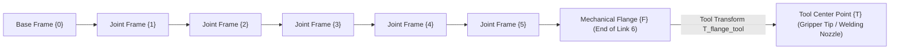

# 02: Coordinate Frames for Serial Manipulators

## 1. Learning Objectives
By completing this chapter, you will be able to:
- Distinguish between the Base Frame $\{0\}$, Link Frames $\{1 \dots n\}$, Flange Frame $\{F\}$, and Tool Frame $\{T\}$.
- Explain the role of the Tool Center Point (TCP) in manufacturing and robotic manipulation.
- Separate robot kinematics (${}^0 \mathbf{T}_F$) from end-effector tooling offsets (${}^F \mathbf{T}_T$).
- Apply standard right-handed frame conventions to serial kinematic chains.

---

## 2. Intuitive Explanation
When programming an industrial robot, you do not want the robot's mechanical wrist plate to touch the workpiece; you want the **tip of the tool** (e.g., the nozzle of a glue dispenser, the welding wire, or the suction cup center) to touch the workpiece.

This requires a clear hierarchy of coordinate frames:
1. **Base Frame $\{0\}$:** Bolted to the factory floor. The reference origin for the entire workcell.
2. **Joint Frames $\{1 \dots 5\}$:** Assigned along the rotating axes of each joint motor.
3. **Flange Frame $\{F\}$:** Fixed to the machined metal mounting plate at the end of Link 6. This is the physical boundary of the robot arm provided by the manufacturer.
4. **Tool Frame $\{T\}$ (TCP):** Defined at the functional tip of the attached tool.

When you unbolt a mechanical gripper and screw on a spot welding gun, the **robot arm does not change**! Only the small static transform ${}^F \mathbf{T}_T$ changes.



---

## 3. Mathematical Chain of Frames

The total transformation from the robot base $\{0\}$ to the Tool Center Point $\{T\}$ is decomposed as:

$${}^0 \mathbf{T}_T(\mathbf{q}) = {}^0 \mathbf{T}_F(\mathbf{q}) \; {}^F \mathbf{T}_T$$

### Components:
- ${}^0 \mathbf{T}_F(\mathbf{q}) \in SE(3)$: The **Arm Kinematics Function**. It depends dynamically on the 6 joint variables $\mathbf{q} = [\theta_1, \dots, \theta_6]^T$:
  $${}^0 \mathbf{T}_F(\mathbf{q}) = \mathbf{A}_1(q_1) \mathbf{A}_2(q_2) \mathbf{A}_3(q_3) \mathbf{A}_4(q_4) \mathbf{A}_5(q_5) \mathbf{A}_6(q_6)$$
- ${}^F \mathbf{T}_T \in SE(3)$: The **Static Tool Calibration Transform** (TCP offset). It is completely independent of joint angles and depends solely on the physical geometry of the attached end-effector:
  $${}^F \mathbf{T}_T = \begin{bmatrix} {}^F \mathbf{R}_T & {}^F \mathbf{p}_T \\ \mathbf{0}_{1 \times 3} & 1 \end{bmatrix}$$

---

## 4. Fully Worked Numerical Example: Tool Offset Calibration

Suppose a 6-DoF robot is in a configuration where its mechanical flange frame $\{F\}$ is at position:
$${}^0 \mathbf{p}_F = [0.60, 0.00, 0.50]^T\,\text{m}$$
with orientation $\mathbf{R}_0 = \mathbf{I}_{3 \times 3}$ (aligned with base axes).
A welding torch is bolted to the flange. The torch nozzle tip (TCP) extends:
- $0.15\,\text{m}$ forward along the tool axis ($+Z_F$).
- $0.05\,\text{m}$ downward along $+X_F$.
- No rotation (${}^F \mathbf{R}_T = \mathbf{I}_{3 \times 3}$).

1. **Form the Tool Transform ${}^F \mathbf{T}_T$:**
   $${}^F \mathbf{T}_T = \begin{bmatrix} 1 & 0 & 0 & 0.05 \\ 0 & 1 & 0 & 0.00 \\ 0 & 0 & 1 & 0.15 \\ 0 & 0 & 0 & 1 \end{bmatrix}$$
2. **Form the Arm Flange Transform ${}^0 \mathbf{T}_F$:**
   $${}^0 \mathbf{T}_F = \begin{bmatrix} 1 & 0 & 0 & 0.60 \\ 0 & 1 & 0 & 0.00 \\ 0 & 0 & 1 & 0.50 \\ 0 & 0 & 0 & 1 \end{bmatrix}$$
3. **Compute the global Tool Center Point pose ${}^0 \mathbf{T}_T$:**
   $${}^0 \mathbf{T}_T = {}^0 \mathbf{T}_F \; {}^F \mathbf{T}_T = \begin{bmatrix} 1 & 0 & 0 & 0.60 + 0.05 \\ 0 & 1 & 0 & 0.00 + 0.00 \\ 0 & 0 & 1 & 0.50 + 0.15 \\ 0 & 0 & 0 & 1 \end{bmatrix} = \begin{bmatrix} 1 & 0 & 0 & 0.65 \\ 0 & 1 & 0 & 0.00 \\ 0 & 0 & 1 & 0.65 \\ 0 & 0 & 0 & 1 \end{bmatrix}$$
4. **Result:** The welding wire tip is at $(x = 0.65\,\text{m}, y = 0.00\,\text{m}, z = 0.65\,\text{m})$ in the base frame.

---

## 5. Python Demonstration

```python
import numpy as np
from dh_transform import create_homogeneous_matrix

# Flange pose from forward kinematics
R_flange = np.eye(3)
p_flange = np.array([0.60, 0.00, 0.50])
T_0_F = create_homogeneous_matrix(R_flange, p_flange)

# Tool TCP offset
R_tool = np.eye(3)
p_tool = np.array([0.05, 0.00, 0.15])
T_F_T = create_homogeneous_matrix(R_tool, p_tool)

# Combined TCP pose in base frame
T_0_T = T_0_F @ T_F_T
print("TCP Position in Base Frame:", T_0_T[:3, 3])
```

---

## 6. Common Mistakes & Debugging Tips
1. **Teaching Waypoints in Flange Frame Instead of TCP Frame:**
   If you teach robot waypoints using the flange coordinates, whenever a damaged tool is replaced with one of slightly different length, every single taught point must be reprogrammed. If you teach waypoints in TCP frame, you only update the TCP offset once.
2. **Confusing Tool Coordinate Axes with Base Coordinate Axes:**
   In manual robot jogging, jogging in "Tool Mode" moves along the nozzle axis ($Z_T$), whereas jogging in "World/Base Mode" moves along the factory floor axes.

---

## 7. Exercises

### Beginner
1. Name the four major coordinate frames used in robotic manipulator workcells.
2. What does the acronym TCP stand for?

### Intermediate
3. Suppose a vacuum gripper of length $0.12\,\text{m}$ along $+Z$ is replaced by a parallel jaw gripper of length $0.22\,\text{m}$ along $+Z$. If the robot is at a fixed joint configuration $\mathbf{q}$, calculate the change in end-effector Cartesian position $\Delta \mathbf{p}$ in base frame.
4. Draw the Mermaid diagram showing how an external camera inspecting the robot workpiece connects into the coordinate tree.

### Advanced
5. Derive the transformation matrix required to invert a TCP measurement: Given desired tool pose ${}^0 \mathbf{T}_T$ and calibrated tool offset ${}^F \mathbf{T}_T$, derive the required flange target pose ${}^0 \mathbf{T}_F$ that must be passed to the robot arm's inverse kinematics solver.

---

## 8. Summary & Next Steps
- Modular separation between arm kinematics (${}^0 \mathbf{T}_F$) and tool offsets (${}^F \mathbf{T}_T$) is standard industrial practice.
- Next, review 3D spatial rotation representations in [**03: 3D Rotation Matrices & Parameterizations**](03-rotation-matrices.md).
