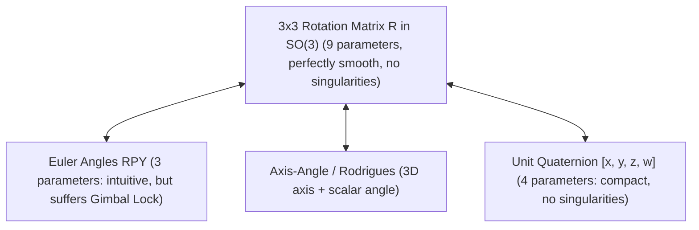

# 03: 3D Rotation Matrices & Spatial Representations

## 1. Learning Objectives
By completing this chapter, you will be able to:
- Formulate the Special Orthogonal group $SO(3)$ and its defining mathematical properties.
- Construct the 3 elementary 3D rotation matrices ($\mathbf{R}_x, \mathbf{R}_y, \mathbf{R}_z$).
- Derive Roll-Pitch-Yaw (ZYX Euler angles) and extract angles from any rotation matrix.
- Explain the physical and mathematical mechanism of **Gimbal Lock**.
- Convert rotations between Matrix, Euler, Axis-Angle (Rodrigues), and Unit Quaternion representations.

---

## 2. Intuitive Explanation
In 2D space, rotating an object requires only one number: an angle $\theta$.
In 3D space, rotation is vastly richer:
- You can turn your head left or right (Yaw).
- You can tilt your head up or down (Pitch).
- You can tilt your ear toward your shoulder (Roll).

A **Rotation Matrix $\mathbf{R} \in SO(3)$** is a $3 \times 3$ grid whose three columns represent the unit vectors of the rotated $X, Y,$ and $Z$ axes expressed in the reference frame.



---

## 3. The Special Orthogonal Group $SO(3)$

A matrix $\mathbf{R} \in \mathbb{R}^{3 \times 3}$ is a valid rotation matrix if and only if it belongs to $SO(3)$:

$$\mathbf{R} = \begin{bmatrix} \mathbf{n} & \mathbf{s} & \mathbf{a} \end{bmatrix} = \begin{bmatrix} r_{11} & r_{12} & r_{13} \\ r_{21} & r_{22} & r_{23} \\ r_{31} & r_{32} & r_{33} \end{bmatrix}$$

where:
1. **Orthonormality:** $\mathbf{R}^T \mathbf{R} = \mathbf{R} \mathbf{R}^T = \mathbf{I}_3$
   - Column vectors $\mathbf{n}, \mathbf{s}, \mathbf{a}$ are mutually perpendicular unit vectors:
     $$\mathbf{n} \cdot \mathbf{s} = 0, \quad \mathbf{s} \cdot \mathbf{a} = 0, \quad \mathbf{n} \cdot \mathbf{a} = 0$$
     $$\|\mathbf{n}\| = \|\mathbf{s}\| = \|\mathbf{a}\| = 1.0$$
2. **Proper Rotation (Right-Handed):**
   $$\det(\mathbf{R}) = +1.0$$
   *(If $\det(\mathbf{R}) = -1.0$, the matrix represents a reflection rather than a pure physical rotation!)*

---

## 4. Elementary Rotation Matrices

Rotations about the principal Cartesian axes by angle $\alpha$:

### Rotation about the $X$-axis by Roll angle $\phi$:
$$\mathbf{R}_x(\phi) = \begin{bmatrix} 1 & 0 & 0 \\ 0 & \cos(\phi) & -\sin(\phi) \\ 0 & \sin(\phi) & \cos(\phi) \end{bmatrix}$$

### Rotation about the $Y$-axis by Pitch angle $\theta$:
$$\mathbf{R}_y(\theta) = \begin{bmatrix} \cos(\theta) & 0 & \sin(\theta) \\ 0 & 1 & 0 \\ -\sin(\theta) & 0 & \cos(\theta) \end{bmatrix}$$

### Rotation about the $Z$-axis by Yaw angle $\psi$:
$$\mathbf{R}_z(\psi) = \begin{bmatrix} \cos(\psi) & -\sin(\psi) & 0 \\ \sin(\psi) & \cos(\psi) & 0 \\ 0 & 0 & 1 \end{bmatrix}$$

---

## 5. Roll-Pitch-Yaw (ZYX Euler Angles)

In the standard robotics convention (extrinsic $X$-$Y$-$Z$ or intrinsic $Z$-$Y$-$X$):
$$\mathbf{R}_{ZYX}(\text{roll } \phi, \text{pitch } \theta, \text{yaw } \psi) = \mathbf{R}_z(\psi) \mathbf{R}_y(\theta) \mathbf{R}_x(\phi)$$

Multiplying the elementary matrices yields:
$$\mathbf{R} = \begin{bmatrix}
c_\psi c_\theta & c_\psi s_\theta s_\phi - s_\psi c_\phi & c_\psi s_\theta c_\phi + s_\psi s_\phi \\
s_\psi c_\theta & s_\psi s_\theta s_\phi + c_\psi c_\phi & s_\psi s_\theta c_\phi - c_\psi s_\phi \\
-s_\theta & c_\theta s_\phi & c_\theta c_\phi
\end{bmatrix}$$
where $c_\theta = \cos(\theta)$ and $s_\theta = \sin(\theta)$.

### 5.1 Extracting Angles from a Matrix
Given a numerical rotation matrix $\mathbf{R}$:
1. **Pitch:**
   $$\theta = \arcsin(-r_{31}) = \text{atan2}\left(-r_{31}, \; \sqrt{r_{11}^2 + r_{21}^2}\right)$$
2. **If $c_\theta \ne 0$ (Away from Gimbal Lock):**
   $$\phi = \text{atan2}(r_{32}, \; r_{33}) \quad (\text{Roll})$$
   $$\psi = \text{atan2}(r_{21}, \; r_{11}) \quad (\text{Yaw})$$

### 5.2 Gimbal Lock Singularity ($\theta = \pm 90^\circ$)
When pitch $\theta = +90^\circ$ ($\pi/2$), $c_\theta = 0$, so $r_{31} = -1.0$.
The matrix simplifies to:
$$\mathbf{R} = \begin{bmatrix} 0 & \sin(\phi - \psi) & \cos(\phi - \psi) \\ 0 & \cos(\phi - \psi) & -\sin(\phi - \psi) \\ -1 & 0 & 0 \end{bmatrix}$$
Notice that roll $\phi$ and yaw $\psi$ appear exclusively as the difference $(\phi - \psi)$. The system loses one rotational degree of freedom; infinitely many pairs $(\phi, \psi)$ produce the identical rotation.

---

## 6. Fully Worked Numerical Example

Construct the rotation matrix for a robot wrist oriented with:
- Roll $\phi = 0^\circ$
- Pitch $\theta = 45^\circ$ ($\pi/4\,\text{rad}$)
- Yaw $\psi = 90^\circ$ ($\pi/2\,\text{rad}$)

1. **Evaluate elementary matrices:**
   - $\cos(90^\circ) = 0, \sin(90^\circ) = 1$
   - $\cos(45^\circ) = \frac{\sqrt{2}}{2} \approx 0.7071, \sin(45^\circ) = 0.7071$
   - $\cos(0) = 1, \sin(0) = 0$
2. **Compute product $\mathbf{R} = \mathbf{R}_z(90^\circ) \mathbf{R}_y(45^\circ) \mathbf{R}_x(0^\circ)$:**
   $$\mathbf{R}_z(90^\circ) = \begin{bmatrix} 0 & -1 & 0 \\ 1 & 0 & 0 \\ 0 & 0 & 1 \end{bmatrix}, \quad \mathbf{R}_y(45^\circ) = \begin{bmatrix} 0.7071 & 0 & 0.7071 \\ 0 & 1 & 0 \\ -0.7071 & 0 & 0.7071 \end{bmatrix}, \quad \mathbf{R}_x(0^\circ) = \mathbf{I}_3$$
   $$\mathbf{R} = \begin{bmatrix} 0 & -1 & 0 \\ 1 & 0 & 0 \\ 0 & 0 & 1 \end{bmatrix} \begin{bmatrix} 0.7071 & 0 & 0.7071 \\ 0 & 1 & 0 \\ -0.7071 & 0 & 0.7071 \end{bmatrix} = \begin{bmatrix} 0 & -1 & 0 \\ 0.7071 & 0 & 0.7071 \\ -0.7071 & 0 & 0.7071 \end{bmatrix}$$
3. **Verify properties:**
   - $\mathbf{R}^T \mathbf{R} = \begin{bmatrix} 0 & 0.7071 & -0.7071 \\ -1 & 0 & 0 \\ 0 & 0.7071 & 0.7071 \end{bmatrix} \begin{bmatrix} 0 & -1 & 0 \\ 0.7071 & 0 & 0.7071 \\ -0.7071 & 0 & 0.7071 \end{bmatrix} = \begin{bmatrix} 1 & 0 & 0 \\ 0 & 1 & 0 \\ 0 & 0 & 1 \end{bmatrix}$ (Orthonormal)
   - $\det(\mathbf{R}) = -(-1)[(0.7071)(0.7071) - (0.7071)(-0.7071)] = 1(0.5 + 0.5) = +1.0$ (Proper rotation)

---

## 7. Python Demonstration

Tested using `04-python-robotics/rotation_matrices.py`:

```python
import numpy as np
from rotation_matrices import rpy_to_matrix, matrix_to_rpy, is_rotation_matrix

roll, pitch, yaw = 0.0, np.deg2rad(45.0), np.deg2rad(90.0)
R = rpy_to_matrix(roll, pitch, yaw)

print("Constructed Rotation Matrix R:\n", np.round(R, 4))
print(f"Is valid SO(3)? {is_rotation_matrix(R)}")

rec_r, rec_p, rec_y = matrix_to_rpy(R)
print(f"Recovered angles (deg): Roll={np.rad2deg(rec_r):.1f}, "
      f"Pitch={np.rad2deg(rec_p):.1f}, Yaw={np.rad2deg(rec_y):.1f}")
```

---

## 8. Common Mistakes & Debugging Tips
1. **Assuming $\mathbf{R}_x \mathbf{R}_y = \mathbf{R}_y \mathbf{R}_x$:**
   Rotations in 3D space do not commute. Swapping multiplication order completely alters the target orientation.
2. **Clipping Argument to `arcsin`:**
   Due to float precision, $-r_{31}$ can equal $1.0000000001$. Calling `np.arcsin(1.0000000001)` outputs `NaN`. Always write `np.arcsin(np.clip(-r31, -1.0, 1.0))`.
3. **Subtracting Euler Angles for Orientation Error in Inverse Kinematics:**
   Do NOT compute orientation error as $\mathbf{e}_o = \mathbf{\phi}_{\text{target}} - \mathbf{\phi}_{\text{current}}$. This causes severe angle wrap jumps at $\pm 180^\circ$ and breaks at gimbal lock. Always compute the rotation matrix error $\mathbf{R}_{\text{err}} = \mathbf{R}_d \mathbf{R}^T$ and extract the error vector using skew-symmetric cross products.

---

## 9. Exercises

### Beginner
1. Write the $3 \times 3$ rotation matrix for a $180^\circ$ yaw rotation about the $Z$-axis.
2. What is the determinant of a valid rotation matrix in $SO(3)$?

### Intermediate
3. A rotation matrix is given by $\mathbf{R} = \begin{bmatrix} 0 & 0 & 1 \\ 0 & 1 & 0 \\ -1 & 0 & 0 \end{bmatrix}$. Extract the Roll, Pitch, and Yaw angles in degrees.
4. Prove that if $\mathbf{R}_1, \mathbf{R}_2 \in SO(3)$, their product $\mathbf{R}_3 = \mathbf{R}_1 \mathbf{R}_2$ also belongs to $SO(3)$.

### Advanced
5. Derive Rodrigues' rotation formula from first principles:
   $$\mathbf{R}(\mathbf{k}, \theta) = \mathbf{I} + \sin(\theta)[\mathbf{k}]_\times + (1 - \cos(\theta))[\mathbf{k}]_\times^2$$
   Show that the trace of this matrix satisfies $\text{tr}(\mathbf{R}) = 1 + 2\cos(\theta)$.

---

## 10. Summary & Next Steps
- 3D rotations form the non-commutative Lie group $SO(3)$.
- Euler angles suffer from Gimbal Lock; Quaternions and Rotation matrices avoid it.
- Next, combine 3D rotations with translations in [**04: Homogeneous Transformations in Robotics**](04-homogeneous-transformations.md).
