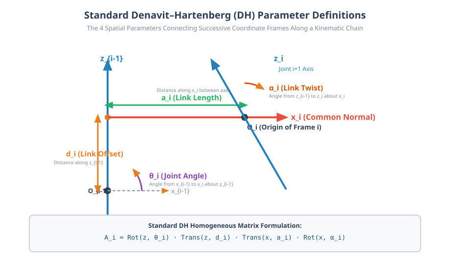

# 05: The Denavit–Hartenberg (DH) Convention

## 1. Learning Objectives
By completing this chapter, you will be able to:
- Explain why the Denavit–Hartenberg (DH) convention uses only 4 parameters instead of 6 to represent spatial links.
- Define each of the four standard DH parameters: $\theta_i, d_i, a_i, \alpha_i$.
- Execute the systematic 8-step algorithm for placing coordinate frames on serial manipulators.
- Derive the standard $4 \times 4$ DH transformation matrix $\mathbf{A}_i$.
- Contrast the **Standard DH convention** with the **Modified DH (Craig) convention**.

---

## 2. Intuitive Explanation
A general 3D rigid body transformation requires **6 parameters**: 3 translations $(x, y, z)$ and 3 rotation angles.
For a 6-joint robot arm, that would mean keeping track of $6 \times 6 = 36$ parameters!

In 1955, Jacques Denavit and Richard Hartenberg showed that because every joint in a serial robot is constrained to rotate or translate along a fixed physical axis ($z_{i-1}$), we have freedom in how we attach coordinate frames to each link. By imposing **two specific geometric conditions** on Frame $\{i\}$ relative to Frame $\{i-1\}$:

1. **Condition 1 (Perpendicularity):** The axis $x_i$ must be perpendicular to axis $z_{i-1}$ ($x_i \perp z_{i-1}$, so $x_i \cdot z_{i-1} = 0$).
2. **Condition 2 (Intersection):** The axis $x_i$ must intersect the axis $z_{i-1}$.

These two constraints eliminate two degrees of freedom (preventing any translation or rotation along the intermediate $y$-axis). Consequently, the relative transformation between successive link frames is completely and uniquely described by **exactly four parameters** ($\theta_i, d_i, a_i, \alpha_i$) instead of six!




---

## 3. The Four Standard DH Parameters

For each link $i$ connecting Joint $i$ to Joint $i+1$:

| Parameter | Name | Description | Axis of Action | Variable for: |
| :--- | :--- | :--- | :--- | :--- |
| **$\theta_i$** | **Joint Angle** | Angle from $x_{i-1}$ to $x_i$ measured about $z_{i-1}$ | $z_{i-1}$ (Rotation) | Revolute Joint |
| **$d_i$** | **Link Offset** | Distance from origin $O_{i-1}$ to the intersection of $x_i$ with $z_{i-1}$ along $z_{i-1}$ | $z_{i-1}$ (Translation) | Prismatic Joint |
| **$a_i$** | **Link Length** | Distance along $x_i$ from $z_{i-1}$ to $z_i$ (length of the common normal) | $x_i$ (Translation) | Constant Link Property |
| **$\alpha_i$** | **Link Twist** | Angle from $z_{i-1}$ to $z_i$ measured about $x_i$ | $x_i$ (Rotation) | Constant Link Property |

---

## 4. Derivation of the Standard DH Transformation Matrix $\mathbf{A}_i$

The transformation from frame $\{i-1\}$ to frame $\{i\}$ is decomposed into four sequential elementary transformations:

$$\mathbf{A}_i = \text{Rot}(z, \theta_i) \; \text{Trans}(z, d_i) \; \text{Trans}(x, a_i) \; \text{Rot}(x, \alpha_i)$$

### Step 1: Screw displacement along $z_{i-1}$
$$\text{Rot}(z, \theta_i) \; \text{Trans}(z, d_i) = \begin{bmatrix}
\cos\theta_i & -\sin\theta_i & 0 & 0 \\
\sin\theta_i & \cos\theta_i & 0 & 0 \\
0 & 0 & 1 & d_i \\
0 & 0 & 0 & 1
\end{bmatrix}$$

### Step 2: Screw displacement along $x_i$
$$\text{Trans}(x, a_i) \; \text{Rot}(x, \alpha_i) = \begin{bmatrix}
1 & 0 & 0 & a_i \\
0 & \cos\alpha_i & -\sin\alpha_i & 0 \\
0 & \sin\alpha_i & \cos\alpha_i & 0 \\
0 & 0 & 0 & 1
\end{bmatrix}$$

### Step 3: Compute the Matrix Product
Multiplying the two matrices:

$$\mathbf{A}_i = \begin{bmatrix}
\cos(\theta_i) & -\sin(\theta_i)\cos(\alpha_i) & \sin(\theta_i)\sin(\alpha_i) & a_i \cos(\theta_i) \\
\sin(\theta_i) & \cos(\theta_i)\cos(\alpha_i) & -\cos(\theta_i)\sin(\alpha_i) & a_i \sin(\theta_i) \\
0 & \sin(\alpha_i) & \cos(\alpha_i) & d_i \\
0 & 0 & 0 & 1
\end{bmatrix}$$

> [!IMPORTANT]
> Verify the dimensions and entries carefully:
> - Row 1, Col 4: $a_i \cos(\theta_i)$
> - Row 2, Col 4: $a_i \sin(\theta_i)$
> - Row 3, Col 4: $d_i$
> - Row 4: $[0, 0, 0, 1]$

---

## 5. Systematic 8-Step Frame Assignment Algorithm

Follow these rules in exact order:
1. **Identify Joint Axes:** Draw a line along the axis of motion for each joint $i = 1, \dots, n$.
2. **Assign $z_i$ Axes:** Set unit vector $z_{i-1}$ along the axis of motion of Joint $i$.
3. **Establish Base Frame $\{0\}$:** Choose origin $O_0$ anywhere along $z_0$. Choose $x_0$ perpendicular to $z_0$.
4. **Locate Link Origins $O_i$ ($i = 1 \dots n-1$):**
   - If $z_{i-1}$ and $z_i$ are **skew (non-intersecting and non-parallel)**: $O_i$ is at the intersection of $z_i$ with the common normal between $z_{i-1}$ and $z_i$.
   - If $z_{i-1}$ and $z_i$ **intersect**: $O_i$ is at their intersection point (so $a_i = 0$).
   - If $z_{i-1}$ and $z_i$ are **parallel**: Choose $O_i$ along $z_i$ such that $d_i = 0$ if possible.
5. **Assign $x_i$ Axes:** Set $x_i$ along the common normal pointing from $z_{i-1}$ to $z_i$. If axes intersect, $x_i$ is perpendicular to the plane formed by $z_{i-1}$ and $z_i$.
6. **Assign $y_i$ Axes:** Complete the right-handed frame: $y_i = z_i \times x_i$.
7. **Assign End-Effector Frame $\{n\}$:** Align $z_n$ along tool approach direction; set $x_n$ normal to $z_{n-1}$.
8. **Fill the DH Table:** Measure $\theta_i, d_i, a_i, \alpha_i$ for every link.

---

## 6. Standard DH vs Modified DH (Craig Convention)

Different robotics textbooks use slightly different DH conventions:

| Convention | Order of Operations | Frame $i$ Attached To: | Used In: |
| :--- | :--- | :--- | :--- |
| **Standard DH (Denavit-Hartenberg)** | $\text{Rot}_z(\theta_i) \to \text{Trans}_z(d_i) \to \text{Trans}_x(a_i) \to \text{Rot}_x(\alpha_i)$ | Frame $\{i\}$ on Link $i$ at Joint $i+1$ | Paul, Spong, Siciliano, MATLAB Robotics Toolbox |
| **Modified DH (Craig)** | $\text{Rot}_x(\alpha_{i-1}) \to \text{Trans}_x(a_{i-1}) \to \text{Rot}_z(\theta_i) \to \text{Trans}_z(d_i)$ | Frame $\{i\}$ on Link $i$ at Joint $i$ | John Craig, KUKA native controller |

In this repository and course, we use the **Standard DH Convention**.

---

## 7. Fully Worked Numerical Example

Consider Link 1 of an industrial arm:
- Parameter values: $\theta_1 = 45^\circ$ ($\pi/4\,\text{rad}$), $d_1 = 0.40\,\text{m}$, $a_1 = 0.0\,\text{m}$, $\alpha_1 = +90^\circ$ ($+\pi/2\,\text{rad}$).

1. **Calculate trigonometric components:**
   - $\cos(\theta_1) = \sin(\theta_1) = \frac{\sqrt{2}}{2} \approx 0.7071$
   - $\cos(\alpha_1) = \cos(90^\circ) = 0$
   - $\sin(\alpha_1) = \sin(90^\circ) = 1.0$
2. **Substitute into standard DH matrix:**
   $$\mathbf{A}_1 = \begin{bmatrix}
   0.7071 & -(0.7071)(0) & (0.7071)(1.0) & 0(0.7071) \\
   0.7071 & (0.7071)(0) & -(0.7071)(1.0) & 0(0.7071) \\
   0 & 1.0 & 0 & 0.40 \\
   0 & 0 & 0 & 1
   \end{bmatrix} = \begin{bmatrix}
   0.7071 & 0 & 0.7071 & 0.0 \\
   0.7071 & 0 & -0.7071 & 0.0 \\
   0.0 & 1.0 & 0.0 & 0.40 \\
   0 & 0 & 0 & 1
   \end{bmatrix}$$
3. **Verify Rotation Determinant:**
   $$\det(\mathbf{R}_1) = 0.7071[0 - (-0.7071)] + 0.7071[0.7071 - 0] = 0.7071(0.7071) + 0.7071(0.7071) = 0.50 + 0.50 = +1.0$$

---

## 8. Python Demonstration

Tested using `04-python-robotics/dh_transform.py`:

```python
import numpy as np
from dh_transform import dh_matrix, extract_pose

A1 = dh_matrix(theta=45.0, d=0.40, a=0.0, alpha=90.0, in_degrees=True)

pos, rot = extract_pose(A1)
print("Standard DH Matrix A1:\n", np.round(A1, 4))
print("Position:", pos)
print("det(R):", np.linalg.det(rot))
```

---

## 9. Common Mistakes & Debugging Tips
1. **Measuring $\alpha_i$ Around the Wrong Axis:**
   $\alpha_i$ is ALWAYS measured around the **$x_i$ axis**, not $z$!
2. **Confusing Standard DH with Modified DH:**
   Mixing $a_i$ with $a_{i-1}$ from Craig's book will shift all link positions by one index.
3. **Sign Errors in $\alpha$:**
   Use the right-hand grip rule about $+x_i$: curl your fingers from $z_{i-1}$ toward $z_i$. If your thumb points along $+x_i$, the angle is positive.

---

## 10. Exercises

### Beginner
1. What are the names and physical units of the 4 Denavit–Hartenberg parameters?
2. Which parameter is the variable for a revolute joint? Which for a prismatic joint?

### Intermediate
3. Two consecutive joint axes $z_{i-1}$ and $z_i$ intersect at a right angle ($90^\circ$). What are the numerical values of $a_i$ and $\alpha_i$?
4. Build the complete DH table for a 2-link planar arm moving in the $X$-$Y$ plane with link lengths $l_1 = 0.5\,\text{m}$ and $l_2 = 0.4\,\text{m}$.

### Advanced
5. Prove algebraically that the bottom row of the product of two standard DH transformation matrices $\mathbf{A}_1 \mathbf{A}_2$ is always identically $[0, 0, 0, 1]$.

---

## 11. Summary & Next Steps
- The DH convention reduces 6 spatial parameters to 4 systematic parameters per link.
- Next, chain these matrices together to compute total robot reach in [**06: Forward Kinematics**](06-forward-kinematics.md).
