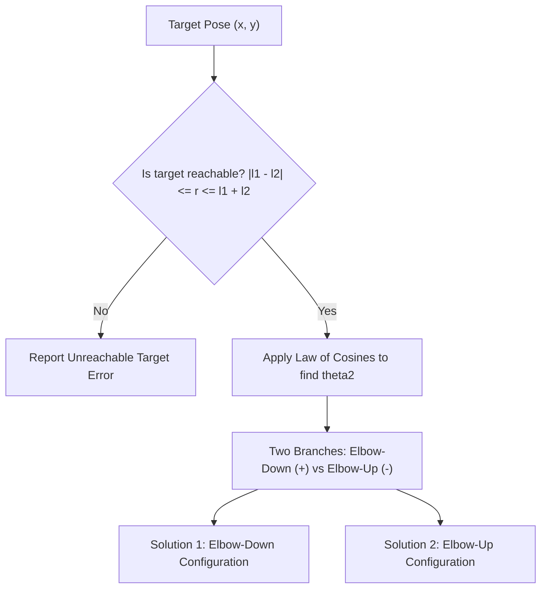
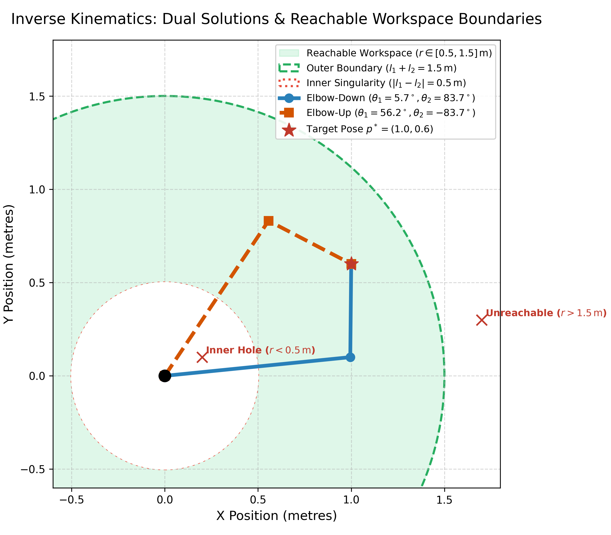

# 07: Inverse Kinematics Fundamentals

## 1. Learning Objectives
By completing this chapter, you will be able to:
- Contrast analytical (closed-form) and numerical inverse kinematics approaches.
- Derive the complete analytical inverse kinematics for a 2-link planar arm using the Law of Cosines.
- Compute both **Elbow-Up** and **Elbow-Down** configurations.
- Formulate reachability boundary checks to detect unreachable targets.
- Solve 3-link planar inverse kinematics using kinematic decoupling.
- Implement numerical inverse kinematics using the Jacobian and Damped Least Squares.

---

## 2. Intuitive Explanation
In robotics programming, you rarely command joint angles directly; you tell the robot:
*"Pick up the circuit board at coordinate $(X=0.45, Y=0.20, Z=0.10)$."*

To move the physical motors, the robot controller must solve **Inverse Kinematics (IK)**:
calculating the joint motor angles $\mathbf{q} = [\theta_1, \dots, \theta_n]^T$ that place the gripper at that exact coordinate.

Unlike forward kinematics, IK is challenging because:
1. **Multiple Solutions:** Just as you can touch your nose with your elbow pointing up or your elbow pointing down, a robot can achieve the same target with different configurations.
2. **Unreachable Targets:** If the object is too far away or inside the inner deadzone, no physical solution exists.






---

## 3. Analytical Inverse Kinematics: Planar 2-Link Arm

Consider a 2-link arm with link lengths $l_1$ and $l_2$, and target end-effector coordinates $(x, y)$.

### Step 1: Reachability Check
Compute the Euclidean distance $r$ from the base to the target:
$$r = \sqrt{x^2 + y^2}$$

A valid physical solution exists if and only if:
$$|l_1 - l_2| \le r \le l_1 + l_2$$
- If $r > l_1 + l_2$: Target is beyond the outer reach boundary.
- If $r < |l_1 - l_2|$: Target is inside the inner joint-limit hole.

---

### Step 2: Solve for Elbow Angle $\theta_2$ (Law of Cosines)
In the triangle formed by $l_1, l_2,$ and hypotenuse $r$:
$$r^2 = l_1^2 + l_2^2 - 2 l_1 l_2 \cos(180^\circ - \theta_2) = l_1^2 + l_2^2 + 2 l_1 l_2 \cos(\theta_2)$$

Solving for $\cos(\theta_2)$:
$$\cos(\theta_2) = \frac{x^2 + y^2 - l_1^2 - l_2^2}{2 l_1 l_2}$$

Because $\sin(\theta_2) = \pm \sqrt{1 - \cos^2(\theta_2)}$, there are **two distinct solutions**:
1. **Elbow-Down (Right-arm):** $\theta_2 = +\arccos(\cos\theta_2)$
2. **Elbow-Up (Left-arm):** $\theta_2 = -\arccos(\cos\theta_2)$

---

### Step 3: Solve for Shoulder Angle $\theta_1$
Using angle difference trigonometry:
$$\theta_1 = \text{atan2}(y, x) - \text{atan2}\left(l_2 \sin(\theta_2), \; l_1 + l_2 \cos(\theta_2)\right)$$

Where:
- $\text{atan2}(y, x)$ is the angle from the $X$-axis to the target vector.
- $\text{atan2}(l_2 \sin\theta_2, l_1 + l_2 \cos\theta_2)$ is the internal angle inside the kinematic triangle.

---

## 4. 3-Link Planar Arm via Decoupling

Suppose a 3-link arm must reach $(x, y)$ with a specified tool orientation $\phi$:
The 3rd link of length $l_3$ ends at $(x, y)$ at angle $\phi$.
Therefore, the **wrist position** $(x_w, y_w)$ at the end of Link 2 is:
$$x_w = x - l_3 \cos(\phi)$$
$$y_w = y - l_3 \sin(\phi)$$

Now, simply solve the standard 2-link IK for $(x_w, y_w)$ to obtain $(\theta_1, \theta_2)$!
Once $(\theta_1, \theta_2)$ are known, the remaining wrist angle is trivially:
$$\theta_3 = \phi - (\theta_1 + \theta_2)$$

This is the planar version of **Kinematic Decoupling**!

---

## 5. Fully Worked Numerical Example

Consider a 2-link arm with $l_1 = 1.0\,\text{m}, l_2 = 0.8\,\text{m}$.
Target coordinate: $(x = 1.20\,\text{m}, y = 0.60\,\text{m})$.

### Step 1: Distance and Reachability
$$r^2 = 1.2^2 + 0.6^2 = 1.44 + 0.36 = 1.80 \implies r = \sqrt{1.80} \approx 1.3416\,\text{m}$$
Bounds:
- Max reach: $1.0 + 0.8 = 1.80\,\text{m}$.
- Min reach: $|1.0 - 0.8| = 0.20\,\text{m}$.
Since $0.20 \le 1.3416 \le 1.80$, the target is reachable!

### Step 2: Compute $\theta_2$
$$\cos(\theta_2) = \frac{1.80 - 1.0^2 - 0.8^2}{2(1.0)(0.8)} = \frac{1.80 - 1.00 - 0.64}{1.60} = \frac{0.16}{1.60} = 0.1000$$
$$\theta_2 = \pm \arccos(0.1000) \approx \pm 84.26^\circ \; (\pm 1.4706\,\text{rad})$$

### Step 3: Compute $\theta_1$
- $\text{atan2}(y, x) = \text{atan2}(0.60, 1.20) \approx 26.57^\circ \; (0.4636\,\text{rad})$.

**Case A: Elbow-Down ($\theta_2 = +84.26^\circ$):**
- $\sin(\theta_2) = \sin(84.26^\circ) \approx 0.9950$
- $l_1 + l_2 \cos(\theta_2) = 1.0 + 0.8(0.10) = 1.0800$
- $l_2 \sin(\theta_2) = 0.8(0.9950) = 0.7960$
- $\beta = \text{atan2}(0.7960, 1.0800) \approx 36.39^\circ$
- $\theta_1 = 26.57^\circ - 36.39^\circ = -9.82^\circ \; (-0.1714\,\text{rad})$

**Case B: Elbow-Up ($\theta_2 = -84.26^\circ$):**
- $\beta = \text{atan2}(-0.7960, 1.0800) \approx -36.39^\circ$
- $\theta_1 = 26.57^\circ - (-36.39^\circ) = +62.96^\circ \; (+1.0988\,\text{rad})$

### Step 4: Verification via Forward Kinematics
Plugging Case B into FK:
$$x = 1.0 \cos(62.96^\circ) + 0.8 \cos(62.96^\circ - 84.26^\circ) = 1.0(0.4546) + 0.8 \cos(-21.30^\circ) = 0.4546 + 0.8(0.9317) = 1.200\,\text{m}$$
$$y = 1.0 \sin(62.96^\circ) + 0.8 \sin(62.96^\circ - 84.26^\circ) = 1.0(0.8907) + 0.8 \sin(-21.30^\circ) = 0.8907 - 0.2906 = 0.600\,\text{m}$$
Matches target $(1.20, 0.60)$ exactly!

---

## 6. Python Implementation

Tested using `04-python-robotics/inverse_kinematics_2d.py`:

```python
import numpy as np
from inverse_kinematics_2d import ik_2link_planar
from forward_kinematics_2d import fk_2link_planar

l1, l2 = 1.0, 0.8
target_x, target_y = 1.20, 0.60

solutions = ik_2link_planar(l1, l2, target_x, target_y)

for name, sol in solutions.items():
    th1, th2 = sol
    print(f"\nConfiguration {name.upper()}:")
    print(f"  th1: {np.rad2deg(th1):.2f} deg, th2: {np.rad2deg(th2):.2f} deg")
    
    # Re-verify via FK
    pose, _ = fk_2link_planar(l1, l2, th1, th2)
    err = np.linalg.norm(pose[:2] - np.array([target_x, target_y]))
    print(f"  FK Re-verification Error: {err:.2e} m")
```

---

## 7. Common Mistakes & Debugging Tips
1. **Passing Values Outside $[-1, 1]$ to `arccos`:**
   Always clamp: `cos_th2 = np.clip(cos_th2, -1.0, 1.0)`.
2. **Selecting the Wrong Solution Branch:**
   In pick-and-place trajectories, flipping randomly between elbow-up and elbow-down configurations mid-motion will cause the robot arm to whip around violently. Motion planners enforce **configuration continuity**.
3. **Failing to Differentiate Unreachable from Singular:**
   An unreachable target has no solution because it is outside the workspace. A singularity is a reachable point where motion in certain directions is momentarily impossible.

---

## 8. Exercises

### Beginner
1. For link lengths $l_1 = 0.6\,\text{m}, l_2 = 0.4\,\text{m}$, is the target $(0.8, 0.7)$ reachable? Justify by computing the distance $r$.
2. What happens to the two solutions (elbow-up and elbow-down) when the arm is fully extended at $r = l_1 + l_2$?

### Intermediate
3. Compute by hand both IK solutions for a 2-link planar arm with $l_1 = 1.0\,\text{m}, l_2 = 1.0\,\text{m}$ reaching target $(x = 1.0, y = 1.0)$.
4. A 2-link robot has physical joint limits: $\theta_1 \in [0^\circ, 90^\circ]$ and $\theta_2 \in [0^\circ, 150^\circ]$. Determine whether target $(-0.5, 0.8)$ can be reached within these limits.

### Advanced
5. Derive the Jacobian-based Newton-Raphson update step for planar inverse kinematics. Explain why the iteration fails when the initial guess places the arm at a singular configuration ($q_2 = 0$).

---

## 9. Summary & Next Steps
- Analytical IK solves closed-form equations directly using the Law of Cosines.
- Kinematic decoupling breaks complex chains into independent sub-problems.
- Now apply these techniques to full 3D spatial arms in [**08: 6-DOF Arm Kinematics Case Study**](08-six-dof-arm.md).
