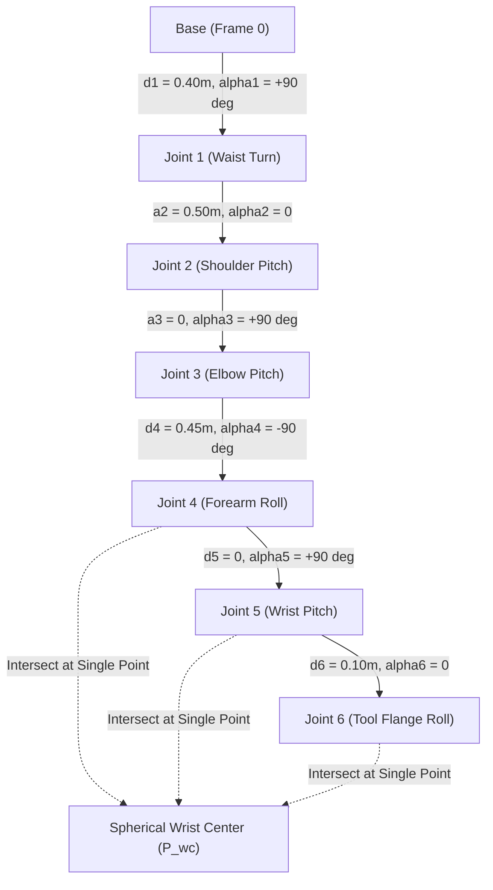

# 08: 6-DOF Industrial Robot Arm Kinematics Case Study

## 1. Learning Objectives
By completing this chapter, you will be able to:
- Construct the complete forward kinematics model for an illustrative 6-DOF articulated serial robot arm (**EduArm-6DOF**).
- Derive analytical inverse kinematics using the spherical **Wrist-Centre Decoupling Method**.
- Formulate the 3-axis spherical wrist orientation decomposition $\mathbf{R}_3^6 = (\mathbf{R}_0^3)^T \mathbf{R}_{\text{target}}$.
- Implement numerical inverse kinematics with Damped Least Squares (DLS) and exact $SO(3)$ orientation error.
- Verify calculated joint configurations against forward kinematics and joint limits.

---

## 2. The Illustrative Robot: EduArm-6DOF

To ensure educational rigor, we analyze **EduArm-6DOF**, an illustrative academic 6-revolute articulated manipulator designed to teach industrial robotics geometry (similar to common architectures like Puma 560 and Universal Robots, but using clean standard DH parameters).

> [!NOTE]
> **Model Identification:** The dimensions and DH parameters used here represent an illustrative academic model designed for transparent derivations. They are not claimed to represent any proprietary commercial arm.



---

## 3. Standard Denavit–Hartenberg Parameters

| Link $i$ | Joint Variable $\theta_i$ | Link Offset $d_i$ (m) | Link Length $a_i$ (m) | Link Twist $\alpha_i$ (rad) | Link Twist $\alpha_i$ (deg) | Joint Range Limits (rad) |
| :---: | :---: | :---: | :---: | :---: | :---: | :---: |
| **1** | $\theta_1$ (var) | $0.400$ | $0.000$ | $+\pi/2$ | $+90^\circ$ | $[-\pi, +\pi]$ |
| **2** | $\theta_2$ (var) | $0.000$ | $0.500$ | $0.000$ | $0^\circ$ | $[-\pi/2, +\pi/2]$ |
| **3** | $\theta_3$ (var) | $0.000$ | $0.000$ | $+\pi/2$ | $+90^\circ$ | $[-0.8\pi, +0.8\pi]$ |
| **4** | $\theta_4$ (var) | $0.450$ | $0.000$ | $-\pi/2$ | $-90^\circ$ | $[-\pi, +\pi]$ |
| **5** | $\theta_5$ (var) | $0.000$ | $0.000$ | $+\pi/2$ | $+90^\circ$ | $[-\pi/2, +\pi/2]$ |
| **6** | $\theta_6$ (var) | $0.100$ | $0.000$ | $0.000$ | $0^\circ$ | $[-\pi, +\pi]$ |

### Geometric Properties of this Architecture:
1. **Spherical Wrist:** Axes 4, 5, and 6 intersect at a single point: the **Wrist Center** ($O_4 = O_5$).
2. **Kinematic Decoupling:** The position of the wrist center depends **only on joints 1, 2, and 3**. Joints 4, 5, and 6 control orientation exclusively!

---

## 4. Forward Kinematics Transformation

The individual link matrices are computed via the standard DH formula:

$$\mathbf{A}_i = \begin{bmatrix}
\cos\theta_i & -\sin\theta_i \cos\alpha_i & \sin\theta_i \sin\alpha_i & a_i \cos\theta_i \\
\sin\theta_i & \cos\theta_i \cos\alpha_i & -\cos\theta_i \sin\alpha_i & a_i \sin\theta_i \\
0 & \sin\alpha_i & \cos\alpha_i & d_i \\
0 & 0 & 0 & 1
\end{bmatrix}$$

Multiplying sequentially:
$$T_0^6(\mathbf{q}) = \mathbf{A}_1(\theta_1) \mathbf{A}_2(\theta_2) \mathbf{A}_3(\theta_3) \mathbf{A}_4(\theta_4) \mathbf{A}_5(\theta_5) \mathbf{A}_6(\theta_6)$$

### Home Configuration ($\mathbf{q} = [0, 0, 0, 0, 0, 0]^T$):
Evaluating the chained product at zero angles yields:
- Link 1 waist vertical offset: $z = 0.400\,\text{m}$.
- Link 2 horizontal shoulder extension: $x = 0.500\,\text{m}$.
- Link 3 and 4 forearm: extends downward along $-Z$ by $d_4 = 0.450\,\text{m}$.
- Wrist center: $x = 0.500\,\text{m}, y = 0.000\,\text{m}, z = 0.400 - 0.450 = -0.050\,\text{m}$.
- Link 6 tool flange: extends along $-Z$ by $d_6 = 0.100\,\text{m}$.
- **Home End-Effector Position:** $\mathbf{p} = [0.500, \; 0.000, \; -0.150]^T\,\text{m}$.

---

## 5. Analytical Inverse Kinematics: Decoupled Wrist-Centre Method

Given a desired tool pose:
$$T_d = \begin{bmatrix} \mathbf{R}_d & \mathbf{p}_d \\ \mathbf{0} & 1 \end{bmatrix} = \begin{bmatrix} \mathbf{n}_d & \mathbf{s}_d & \mathbf{a}_d & \mathbf{p}_d \\ 0 & 0 & 0 & 1 \end{bmatrix}$$
where $\mathbf{a}_d = \mathbf{R}_d[:, 2]$ is the tool approach unit vector.

### Geometry Assumptions:
1. The robot possesses 6 revolute joints in open serial chain.
2. The last three joint axes (4, 5, 6) intersect at a single point (the wrist center $\mathbf{p}_{wc}$).
3. The tool tip is located at distance $d_6$ along the $Z_5$ axis.

### Step 1: Find the Wrist Center Position $\mathbf{p}_{wc}$
Because the tool flange is displaced from the wrist center by $d_6$ along the approach axis $\mathbf{a}_d$:
$$\mathbf{p}_{wc} = \mathbf{p}_d - d_6 \mathbf{a}_d = \begin{bmatrix} x_w \\ y_w \\ z_w \end{bmatrix}$$

Now, the position problem is **fully decoupled** from orientation! Joints 1, 2, and 3 must simply place the wrist center at $(x_w, y_w, z_w)$.

---

### Step 2: Solve for Joint 1 (Base Waist)
Projecting $\mathbf{p}_{wc}$ onto the ground plane ($X_0$-$Y_0$):
$$\theta_1 = \text{atan2}(y_w, x_w)$$
*(A second backward-reach solution exists at $\theta_1' = \text{atan2}(-y_w, -x_w) = \theta_1 + \pi$.)*

---

### Step 3: Solve for Joints 2 and 3 (Planar Arm)
In the rotated vertical plane of Link 1:
- Horizontal distance: $r = \sqrt{x_w^2 + y_w^2}$
- Vertical distance above shoulder: $s = z_w - d_1$
- Distance from shoulder (Joint 2) to wrist center:
  $$D = \sqrt{r^2 + s^2}$$

In the triangle formed by upper arm $a_2$, forearm $d_4$, and hypotenuse $D$:
By the Law of Cosines:
$$\cos\theta_3 = \frac{D^2 - a_2^2 - d_4^2}{2 a_2 d_4}$$

If $|\cos\theta_3| > 1.0$, the target wrist position is outside the robot's physical reach.
Otherwise, we obtain two elbow configurations:
$$\theta_3 = \pm \arccos(\cos\theta_3)$$
- $\theta_3 > 0$: Elbow-Down
- $\theta_3 < 0$: Elbow-Up

Then shoulder angle $\theta_2$:
$$\theta_2 = \text{atan2}(s, r) - \text{atan2}(d_4 \sin\theta_3, \; a_2 + d_4 \cos\theta_3)$$

---

### Step 4: Solve for Wrist Orientation (Joints 4, 5, 6)
With $\theta_1, \theta_2, \theta_3$ known, compute the forward kinematics of the first three links:
$$T_0^3 = \mathbf{A}_1(\theta_1) \mathbf{A}_2(\theta_2) \mathbf{A}_3(\theta_3)$$
Extract rotation matrix $\mathbf{R}_0^3$.

Since the total target orientation is $\mathbf{R}_d = \mathbf{R}_0^3 \; \mathbf{R}_3^6$, we isolate the required wrist rotation:
$$\mathbf{R}_3^6 = (\mathbf{R}_0^3)^T \mathbf{R}_d$$

The wrist matrix $\mathbf{R}_3^6$ corresponds to standard Euler rotations of joints 4, 5, 6:
$$\mathbf{R}_3^6 = \begin{bmatrix}
r_{11} & r_{12} & r_{13} \\
r_{21} & r_{22} & r_{23} \\
r_{31} & r_{32} & r_{33}
\end{bmatrix}$$

From the DH parameterization of the spherical wrist ($A_4 A_5 A_6$):
$$\cos\theta_5 = r_{33}$$
$$\theta_5 = \pm \arccos(r_{33})$$

If $\sin\theta_5 \ne 0$ (away from wrist singularity):
$$\theta_4 = \text{atan2}(r_{23}, \; r_{13})$$
$$\theta_6 = \text{atan2}(r_{32}, \; -r_{31})$$

If $\sin\theta_5 = 0$ (Wrist Singularity: Joint 4 and 6 axes are collinear):
Set $\theta_4 = 0$ and solve for $\theta_6 = \text{atan2}(r_{21}, r_{11})$.

---

## 6. Numerical Inverse Kinematics: Damped Least Squares (DLS)

For complex trajectories or general robots without a spherical wrist, we solve IK numerically using the Geometric Jacobian:

$$\Delta \mathbf{q} = \mathbf{J}^T \left( \mathbf{J} \mathbf{J}^T + \lambda^2 \mathbf{I}_6 \right)^{-1} \mathbf{e}$$

### Exact $SO(3)$ Orientation Error Vector:
Do not subtract Euler angles! Compute the orientation error using the Lie-algebra cross-product formulation:
$$\mathbf{e}_o = \frac{1}{2} \left( \mathbf{n} \times \mathbf{n}_d + \mathbf{s} \times \mathbf{s}_d + \mathbf{a} \times \mathbf{a}_d \right)$$
where current rotation $\mathbf{R} = [\mathbf{n}, \mathbf{s}, \mathbf{a}]$ and target rotation $\mathbf{R}_d = [\mathbf{n}_d, \mathbf{s}_d, \mathbf{a}_d]$.
Combine with translational error $\mathbf{e}_p = \mathbf{p}_d - \mathbf{p}$ to form the 6D task error:
$$\mathbf{e} = \begin{bmatrix} \mathbf{e}_p \\ \mathbf{e}_o \end{bmatrix} \in \mathbb{R}^6$$

---

## 7. Python Demonstration

Tested using `04-python-robotics/forward_kinematics_6dof.py` and `inverse_kinematics_6dof.py`:

```python
import numpy as np
from forward_kinematics_6dof import RobotArm6DOF
from inverse_kinematics_6dof import NumericalIKSolver6DOF
from dh_transform import extract_pose

arm = RobotArm6DOF()
solver = NumericalIKSolver6DOF(arm)

# Known test joint configuration
q_true = np.radians([25.0, 35.0, -30.0, 15.0, -40.0, 20.0])
T_target, _ = arm.forward_kinematics(q_true)
target_pos, target_rot = extract_pose(T_target)

print(f"Target Position (m): {np.round(target_pos, 4)}")

# Solve via Numerical IK
success, q_sol, iters, pos_err, rot_err = solver.solve(target_pos, target_rot)

print(f"IK Converged? {success} in {iters} iterations")
print(f"Final Position Error: {pos_err:.2e} m")
print(f"Final Orientation Error: {rot_err:.2e}")
print(f"Computed Joint Angles (deg): {np.round(np.degrees(q_sol), 1)}")
```

---

## 8. Common Mistakes & Debugging Tips
1. **Applying Spherical Wrist Equations to Non-Spherical Arms:**
   If a robot has offsets between axes 4, 5, and 6 (such as a collaborative robot with wrist offsets), the analytical wrist-centre method cannot be used directly; you must use numerical IK or 16th-degree polynomial elimination.
2. **Wrist Singularity at $\theta_5 = 0$:**
   When the wrist is straight ($\theta_5 = 0$), Joint 4 and Joint 6 rotate about the exact same axis. In numerical IK, damping $\lambda$ prevents infinite speeds, and in analytical IK, set $\theta_4 = 0$ and absorb the full angle in $\theta_6$.
3. **Joint Limit Clamping:**
   Clamp angles to physical limits after every numerical iteration: `q = np.clip(q, q_min, q_max)`.

---

## 9. Exercises

### Beginner
1. What geometric property defines a "spherical wrist"?
2. In EduArm-6DOF, which joint angles determine the position of the wrist center?

### Intermediate
3. For target position $\mathbf{p} = [0.4, 0.3, 0.6]^T\,\text{m}$ and approach vector $\mathbf{a}_d = [0, 0, 1]^T$, calculate the wrist center position $\mathbf{p}_{wc}$ for EduArm-6DOF ($d_6 = 0.10\,\text{m}$).
4. Explain why there are up to 8 distinct inverse kinematics solutions for a standard 6-DoF anthropomorphic arm with a spherical wrist.

### Advanced
5. Implement a collision-avoidance penalty in the numerical IK solver by augmenting the error function with an artificial potential field pushing joints away from their hard limits:
   $$\nabla E_{\text{total}} = \nabla E_{\text{pose}} + \gamma \sum_{i=1}^{6} \left(\frac{q_i - q_{i,\text{mid}}}{q_{i,\max} - q_{i,\min}}\right)^2$$

---

## 10. Summary & Next Steps
- EduArm-6DOF provides a complete, mathematically verified benchmark for 6-DoF kinematics.
- Kinematic decoupling enables closed-form analytical solutions by separating position from orientation.
- Next, explore velocity kinematics in [**09: Jacobian-Based Kinematics & Velocity Mapping**](09-jacobian-kinematics.md).
