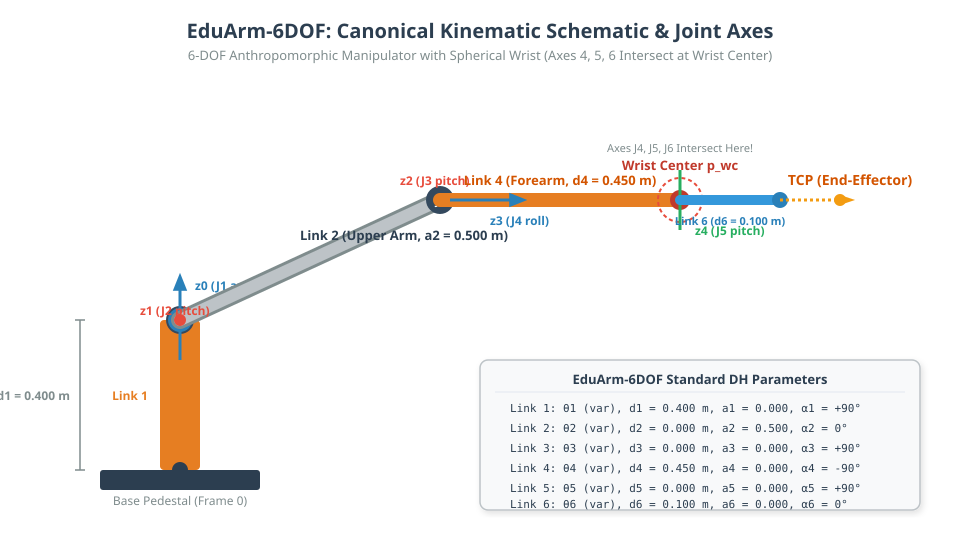
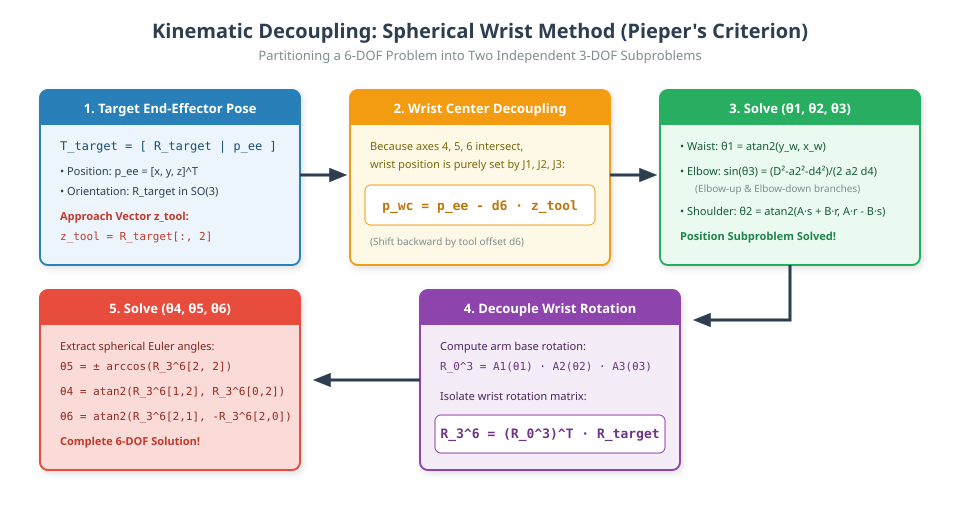

# 08: 6-DOF Industrial Robot Arm Kinematics Case Study

## 1. Learning Objectives
By completing this chapter, you will be able to:
- Construct the complete forward kinematics model for an illustrative 6-DOF articulated serial robot arm (**EduArm-6DOF**).
- Derive analytical inverse kinematics using the spherical **Wrist-Centre Decoupling Method** (Pieper's criterion).
- Correctly formulate the shoulder and elbow trigonometric equations for a standard vertical-waist manipulator.
- Formulate the 3-axis spherical wrist orientation decomposition $\mathbf{R}_3^6 = (\mathbf{R}_0^3)^T \mathbf{R}_{\text{target}}$.
- Implement numerical inverse kinematics using Damped Least Squares (DLS) with exact $SO(3)$ logarithmic error.
- Verify calculated joint configurations against forward kinematics and joint limits.

---

## 2. The Canonical Robot: EduArm-6DOF

To ensure educational transparency, we analyze **EduArm-6DOF**, an illustrative academic 6-revolute articulated manipulator designed to teach industrial robotics geometry (similar in architecture to common industrial robots like the Puma 560, ABB IRB, and KUKA articulated arms).

> [!NOTE]
> **Educational Model Notice:** The dimensions and DH parameters used here represent an illustrative academic model designed for transparent, closed-form derivations. They are not calibrated to any proprietary commercial robot.



---

## 3. Standard Denavit–Hartenberg Parameters

The kinematic chain consists of 6 revolute joints ($6\text{R}$) connecting 7 rigid links:

| Link $i$ | Joint Variable $\theta_i$ | Link Offset $d_i$ (m) | Link Length $a_i$ (m) | Link Twist $\alpha_i$ (rad) | Link Twist $\alpha_i$ (deg) | Joint Range Limits (rad) |
| :---: | :---: | :---: | :---: | :---: | :---: | :---: |
| **1** | $\theta_1$ (var) | $0.400$ | $0.000$ | $+\pi/2$ | $+90^\circ$ | $[-\pi, +\pi]$ |
| **2** | $\theta_2$ (var) | $0.000$ | $0.500$ | $0.000$ | $0^\circ$ | $[-\pi/2, +\pi/2]$ |
| **3** | $\theta_3$ (var) | $0.000$ | $0.000$ | $+\pi/2$ | $+90^\circ$ | $[-0.8\pi, +0.8\pi]$ |
| **4** | $\theta_4$ (var) | $0.450$ | $0.000$ | $-\pi/2$ | $-90^\circ$ | $[-\pi, +\pi]$ |
| **5** | $\theta_5$ (var) | $0.000$ | $0.000$ | $+\pi/2$ | $+90^\circ$ | $[-\pi/2, +\pi/2]$ |
| **6** | $\theta_6$ (var) | $0.100$ | $0.000$ | $0.000$ | $0^\circ$ | $[-\pi, +\pi]$ |

### Geometric Properties of this Architecture:
1. **Spherical Wrist:** Axes 4, 5, and 6 intersect at a single physical point: the **Wrist Center** ($\mathbf{p}_{wc}$, origin of Frame 4 and Frame 5).
2. **Kinematic Decoupling (Pieper's Solution):** The 3D position of the wrist center depends **solely on the first three joint angles** ($\theta_1, \theta_2, \theta_3$). Joints 4, 5, and 6 control end-effector orientation exclusively.

### Canonical DH Model vs. ROS 2 URDF Model

In robotics engineering, standard DH frames and CAD/URDF visualization models use different zero references:
- **Canonical DH Model:** Link 4 is parameterized with $\alpha_3 = +90^\circ$ and $d_4 = 0.450\,\text{m}$. When joint angles are all zero ($\mathbf{q}_{DH} = \mathbf{0}$), Link 4 hangs downward along $-Z_0$, giving TCP at $[0.500, 0.000, -0.150]^T\,\text{m}$. The outstretched horizontal pose corresponds to $\theta_3 = +90^\circ$ (where TCP is at $[1.050, 0.000, 0.400]^T\,\text{m}$).
- **ROS 2 URDF Model (`eduarm_6dof.urdf`):** Standard ROS industrial convention sets the zero joint configuration ($\mathbf{q}_{URDF} = \mathbf{0}$) with the arm outstretched horizontally along $+X_0$, and pitch joints (Joints 2, 3, 5) defined to rotate about $+Y$.

The exact mutual conversions implemented in `forward_kinematics_6dof.py` are:
$$\begin{aligned}
q_{1, DH} &= q_{1, URDF} \\
q_{2, DH} &= -q_{2, URDF} \\
q_{3, DH} &= \frac{\pi}{2} - q_{3, URDF} \\
q_{4, DH} &= q_{4, URDF} \\
q_{5, DH} &= -q_{5, URDF} \\
q_{6, DH} &= q_{6, URDF}
\end{aligned}$$

The tool orientation conversion maps the DH tool frame ($z$ along tool pointing forward, $x$ pointing up) to the URDF TCP frame ($x$ along tool pointing forward, $z$ pointing up):
$$\mathbf{R}_{URDF} = \mathbf{R}_{DH} \begin{bmatrix} 0 & 0 & 1 \\ 0 & -1 & 0 \\ 1 & 0 & 0 \end{bmatrix}$$
This produces identical spatial poses ($\|\Delta\mathbf{p}\| < 10^{-7}\,\text{m}$, $\|\Delta\mathbf{R}\| < 10^{-7}$) across all configurations, as verified in `test_fk.py::test_urdf_fk_vs_dh_fk_multi_configuration`.

---

## 4. Forward Kinematics Transformation

The individual link homogeneous transformation matrices are computed via the standard DH formula:

$$\mathbf{A}_i = \begin{bmatrix}
\cos\theta_i & -\sin\theta_i \cos\alpha_i & \sin\theta_i \sin\alpha_i & a_i \cos\theta_i \\
\sin\theta_i & \cos\theta_i \cos\alpha_i & -\cos\theta_i \sin\alpha_i & a_i \sin\theta_i \\
0 & \sin\alpha_i & \cos\alpha_i & d_i \\
0 & 0 & 0 & 1
\end{bmatrix}$$

Multiplying sequentially from the base to the end-effector:
$$\mathbf{T}_0^6(\mathbf{q}) = \mathbf{A}_1(\theta_1) \mathbf{A}_2(\theta_2) \mathbf{A}_3(\theta_3) \mathbf{A}_4(\theta_4) \mathbf{A}_5(\theta_5) \mathbf{A}_6(\theta_6)$$

### Worked Numerical Example: Forward Kinematics
Consider the articulated joint configuration:
$$\mathbf{q} = [25.0^\circ, \; 35.0^\circ, \; -30.0^\circ, \; 15.0^\circ, \; -40.0^\circ, \; 20.0^\circ]$$

Converting to radians:
$$\mathbf{q} \approx [0.4363, \; 0.6109, \; -0.5236, \; 0.2618, \; -0.6981, \; 0.3491]\,\text{rad}$$

Computing the individual link matrices:
- $\mathbf{A}_1$ translation: $[0.0000, \; 0.0000, \; 0.4000]^T$
- $\mathbf{A}_2$ translation: $[0.4096, \; 0.2868, \; 0.0000]^T$ ($a_2 = 0.500\,\text{m}$ rotated by $\theta_2 = 35^\circ$)
- $\mathbf{A}_3$ translation: $[0.0000, \; 0.0000, \; 0.0000]^T$
- $\mathbf{A}_4$ translation: $[0.0000, \; 0.0000, \; 0.4500]^T$ (forearm offset $d_4 = 0.450\,\text{m}$)
- $\mathbf{A}_5$ translation: $[0.0000, \; 0.0000, \; 0.0000]^T$ (wrist center)
- $\mathbf{A}_6$ translation: $[0.0000, \; 0.0000, \; 0.1000]^T$ (tool offset $d_6 = 0.100\,\text{m}$)

Cumulative forward kinematics yields the end-effector pose $\mathbf{T}_0^6$:
$$\mathbf{p}_{ee} = \begin{bmatrix} 0.3497 \\ 0.1814 \\ 0.1568 \end{bmatrix}\,\text{m}, \quad
\mathbf{R}_0^6 = \begin{bmatrix}
 0.8139 & -0.1105 & -0.5704 \\
-0.1906 & -0.9782 & -0.0824 \\
-0.5488 &  0.1758 & -0.8172
\end{bmatrix}$$

---

## 5. Analytical Inverse Kinematics: Decoupled Wrist-Centre Method

Given a desired target tool pose:
$$\mathbf{T}_{\text{target}} = \begin{bmatrix} \mathbf{R}_d & \mathbf{p}_d \\ \mathbf{0} & 1 \end{bmatrix} = \begin{bmatrix} \mathbf{n}_d & \mathbf{s}_d & \mathbf{a}_d & \mathbf{p}_d \\ 0 & 0 & 0 & 1 \end{bmatrix}$$
where $\mathbf{a}_d = \mathbf{R}_d[:, 2]$ is the tool approach unit vector (column 2 of $\mathbf{R}_d$):
$$\mathbf{a}_d = \begin{bmatrix} -0.5704 \\ -0.0824 \\ -0.8172 \end{bmatrix}$$



### Step 1: Find the Wrist Center Position $\mathbf{p}_{wc}$
Since the tool tip is offset along the approach vector $\mathbf{a}_d$ by distance $d_6 = 0.100\,\text{m}$:
$$\mathbf{p}_{wc} = \mathbf{p}_d - d_6 \mathbf{a}_d = \begin{bmatrix} x_w \\ y_w \\ z_w \end{bmatrix}$$

For our worked example:
$$\mathbf{p}_{wc} = \begin{bmatrix} 0.3497 \\ 0.1814 \\ 0.1568 \end{bmatrix} - 0.100 \begin{bmatrix} -0.5704 \\ -0.0824 \\ -0.8172 \end{bmatrix} = \begin{bmatrix} 0.3497 + 0.05704 \\ 0.1814 + 0.00824 \\ 0.1568 + 0.08172 \end{bmatrix} = \begin{bmatrix} 0.4067 \\ 0.1897 \\ 0.2385 \end{bmatrix}\,\text{m}$$

---

### Step 2: Solve for Joint 1 (Base Waist)
Projecting $\mathbf{p}_{wc}$ onto the horizontal ground plane ($X_0$-$Y_0$):
$$\theta_1 = \text{atan2}(y_w, \; x_w) = \text{atan2}(0.1897, \; 0.4067) = \mathbf{25.0^\circ}$$
*(A second backward-reach solution exists at $\theta_1' = \text{atan2}(-y_w, -x_w) = 25.0^\circ - 180^\circ = -155.0^\circ$.)*

---

### Step 3: Solve for Joint 3 (Elbow) and Joint 2 (Shoulder)
In the vertical arm plane established by $\theta_1$:
- Planar radial reach: $r = \sqrt{x_w^2 + y_w^2} = \sqrt{0.4067^2 + 0.1897^2} = 0.4488\,\text{m}$
- Vertical height above shoulder: $s = z_w - d_1 = 0.2385 - 0.4000 = -0.1615\,\text{m}$
- Squared distance from shoulder joint to wrist center:
  $$D^2 = r^2 + s^2 = 0.4488^2 + (-0.1615)^2 = 0.2275\,\text{m}^2$$

In our canonical DH model, $\alpha_3 = +90^\circ$ causes the forearm extension to satisfy:
$$r = a_2 \cos\theta_2 + d_4 \sin(\theta_2 + \theta_3)$$
$$s = a_2 \sin\theta_2 - d_4 \cos(\theta_2 + \theta_3)$$

Squaring and adding these two equations:
$$r^2 + s^2 = a_2^2 + d_4^2 + 2 a_2 d_4 \sin\theta_3$$

Solving for $\sin\theta_3$:
$$\sin\theta_3 = \frac{D^2 - a_2^2 - d_4^2}{2 a_2 d_4} = \frac{0.2275 - 0.500^2 - 0.450^2}{2 (0.500)(0.450)} = \frac{-0.2250}{0.4500} = \mathbf{-0.5000}$$

> [!IMPORTANT]
> **Geometric Note:** For this DH convention ($\alpha_3 = +\pi/2$), the trigonometric formula directly yields $\sin\theta_3$ rather than $\cos\theta_3$.

This gives two elbow branches:
1. **Elbow-Down:** $\theta_3 = \arcsin(-0.5) = \mathbf{-30.0^\circ}$
2. **Elbow-Up:** $\theta_3 = 180^\circ - (-30.0^\circ) = 210^\circ \equiv -150.0^\circ$

Now for shoulder angle $\theta_2$, expanding the trigonometric terms:
$$r = A \cos\theta_2 + B \sin\theta_2$$
$$s = A \sin\theta_2 - B \cos\theta_2$$
where:
$$A = a_2 + d_4 \sin\theta_3 = 0.500 + 0.450(-0.5) = 0.2750\,\text{m}$$
$$B = d_4 \cos\theta_3 = 0.450 \cos(-30^\circ) = 0.3897\,\text{m}$$

Solving this linear system in $\cos\theta_2$ and $\sin\theta_2$:
$$\theta_2 = \text{atan2}(A s + B r, \; A r - B s)$$

Substituting the numbers:
- $A s + B r = (0.2750)(-0.1615) + (0.3897)(0.4488) = -0.0444 + 0.1749 = +0.1305$
- $A r - B s = (0.2750)(0.4488) - (0.3897)(-0.1615) = +0.1234 + 0.0629 = +0.1863$
$$\theta_2 = \text{atan2}(0.1305, \; 0.1863) = \mathbf{35.0^\circ}$$

---

### Step 4: Solve for Wrist Orientation (Joints 4, 5, 6)
With $\theta_1 = 25^\circ, \theta_2 = 35^\circ, \theta_3 = -30^\circ$ known, compute the arm base orientation $\mathbf{R}_0^3$:
$$\mathbf{R}_0^3 = \mathbf{R}_1 \mathbf{R}_2 \mathbf{R}_3 = \begin{bmatrix}
 0.9029 &  0.4226 &  0.0790 \\
 0.4210 & -0.9063 &  0.0368 \\
 0.0872 &  0.0000 & -0.9962
\end{bmatrix}$$

Isolate the required wrist rotation matrix:
$$\mathbf{R}_3^6 = (\mathbf{R}_0^3)^T \mathbf{R}_{\text{target}} = \begin{bmatrix}
0.6068 & -0.4963 & -0.6209 \\
0.5167 &  0.8399 & -0.1664 \\
0.6040 & -0.2198 &  0.7660
\end{bmatrix}$$

Multiplying the DH matrices $\mathbf{A}_4 \mathbf{A}_5 \mathbf{A}_6$, the entry $(3, 3)$ equals:
$$\mathbf{R}_3^6[2, 2] = \cos\theta_5 = 0.7660$$

Extracting $\theta_5$:
$$\theta_5 = \pm \arccos(0.7660) = \pm \mathbf{40.0^\circ}$$

For $\sin\theta_5 \ne 0$ (away from wrist singularity):
$$\theta_4 = \text{atan2}\left(\frac{\mathbf{R}_3^6[1, 2]}{\sin\theta_5}, \; \frac{\mathbf{R}_3^6[0, 2]}{\sin\theta_5}\right)$$
$$\theta_6 = \text{atan2}\left(\frac{\mathbf{R}_3^6[2, 1]}{\sin\theta_5}, \; \frac{-\mathbf{R}_3^6[2, 0]}{\sin\theta_5}\right)$$

Evaluating for $\theta_5 = -40.0^\circ$ ($\sin\theta_5 = -0.6428$):
- $\theta_4 = \text{atan2}\left(\frac{-0.1664}{-0.6428}, \; \frac{-0.6209}{-0.6428}\right) = \text{atan2}(0.2588, \; 0.9659) = \mathbf{15.0^\circ}$
- $\theta_6 = \text{atan2}\left(\frac{-0.2198}{-0.6428}, \; \frac{-0.6040}{-0.6428}\right) = \text{atan2}(0.3419, \; 0.9397) = \mathbf{20.0^\circ}$

### Step 5: Multi-Branch Analysis & Joint Limit Verification

A 6-DOF manipulator with a spherical wrist produces up to $2 \times 2 \times 2 = 8$ mathematical candidate solutions:
1. **Shoulder / Base:** forward ($\theta_1$) vs backward reach ($\theta_1 \pm 180^\circ$)
2. **Elbow:** elbow-down ($\theta_3$) vs elbow-up ($180^\circ - \theta_3$)
3. **Wrist:** normal ($\theta_5$) vs wrist-flip ($-\theta_5, \theta_4 \pm 180^\circ, \theta_6 \pm 180^\circ$)

The physical joint limits for EduArm-6DOF are:
- $\theta_1 \in [-180^\circ, +180^\circ]$
- $\theta_2 \in [-90^\circ, +90^\circ]$
- $\theta_3 \in [-144^\circ, +144^\circ]$
- $\theta_4 \in [-180^\circ, +180^\circ]$
- $\theta_5 \in [-90^\circ, +90^\circ]$
- $\theta_6 \in [-180^\circ, +180^\circ]$

Evaluating all 8 mathematical candidates against these limits:

| Branch | $\theta_1$ | $\theta_2$ | $\theta_3$ | $\theta_4$ | $\theta_5$ | $\theta_6$ | Status | Limit Violation Reason |
|:---|:---:|:---:|:---:|:---:|:---:|:---:|:---:|:---|
| **1. Elbow-Down (Flip)** | $+25.0^\circ$ | $+35.0^\circ$ | $-30.0^\circ$ | $-165.0^\circ$ | $+40.0^\circ$ | $-160.0^\circ$ | **VALID** | All joints within limits |
| **2. Elbow-Down (Nominal)** | $+25.0^\circ$ | $+35.0^\circ$ | $-30.0^\circ$ | $+15.0^\circ$ | $-40.0^\circ$ | $+20.0^\circ$ | **VALID** | Exact target configuration |
| **3. Elbow-Up (Nominal)** | $+25.0^\circ$ | $-74.6^\circ$ | $-150.0^\circ$ | $-137.4^\circ$ | $+165.8^\circ$ | $-106.6^\circ$ | **REJECTED** | $\theta_3 = -150^\circ < -144^\circ$, $\theta_5 = 165.8^\circ > 90^\circ$ |
| **4. Elbow-Up (Flip)** | $+25.0^\circ$ | $-74.6^\circ$ | $-150.0^\circ$ | $+42.6^\circ$ | $-165.8^\circ$ | $+73.4^\circ$ | **REJECTED** | $\theta_3 = -150^\circ < -144^\circ$, $\theta_5 = -165.8^\circ < -90^\circ$ |
| **5. Backward-Reach 1** | $-155.0^\circ$ | $-105.4^\circ$ | $-30.0^\circ$ | $+42.6^\circ$ | $+165.8^\circ$ | $-106.6^\circ$ | **REJECTED** | $\theta_2 = -105.4^\circ < -90^\circ$, $\theta_5 = 165.8^\circ > 90^\circ$ |
| **6. Backward-Reach 2** | $-155.0^\circ$ | $-105.4^\circ$ | $-30.0^\circ$ | $-137.4^\circ$ | $-165.8^\circ$ | $+73.4^\circ$ | **REJECTED** | $\theta_2 = -105.4^\circ < -90^\circ$, $\theta_5 = -165.8^\circ < -90^\circ$ |
| **7. Backward + Elbow-Up 1** | $-155.0^\circ$ | $+145.0^\circ$ | $-150.0^\circ$ | $+15.0^\circ$ | $+40.0^\circ$ | $-160.0^\circ$ | **REJECTED** | $\theta_2 = +145.0^\circ > 90^\circ$, $\theta_3 = -150^\circ < -144^\circ$ |
| **8. Backward + Elbow-Up 2** | $-155.0^\circ$ | $+145.0^\circ$ | $-150.0^\circ$ | $-165.0^\circ$ | $-40.0^\circ$ | $+20.0^\circ$ | **REJECTED** | $\theta_2 = +145.0^\circ > 90^\circ$, $\theta_3 = -150^\circ < -144^\circ$ |

Both valid solutions (Branches 1 and 2) reproduce the target pose within $\|\mathbf{p}_{\text{calc}} - \mathbf{p}_d\| < 10^{-15}\,\text{m}$ and orientation error $\|\mathbf{e}_o\| < 10^{-15}$.
The closed-form analytical solution is exact.

---

## 6. Numerical Inverse Kinematics: Damped Least Squares (DLS)

For arbitrary arm architectures or trajectory control near singular boundaries, numerical IK iteratively refines joint angles:

$$\Delta\mathbf{q} = \mathbf{J}^T (\mathbf{J}\mathbf{J}^T + \lambda^2 \mathbf{I})^{-1} \mathbf{e}$$

In our verified implementation (`jacobian.py`), we compute the DLS pseudoinverse via Singular Value Decomposition (SVD):
$$\mathbf{J}_{\text{dls}} = \mathbf{V} \, \text{diag}\left(\frac{\sigma_i}{\sigma_i^2 + \lambda^2}\right) \mathbf{U}^T$$
which guarantees finite joint velocity updates even at kinematic singularities.

### Exact $SO(3)$ Orientation Error:
Rather than taking differences of Euler angles, we use the Lie-algebra logarithmic map on $SO(3)$, expressed in the base frame to align with the geometric Jacobian $\mathbf{J}_\omega$:
$$\mathbf{R}_{\text{err}} = \mathbf{R}_d \mathbf{R}^T$$
$$\theta = \arccos\left(\frac{\text{trace}(\mathbf{R}_{\text{err}}) - 1}{2}\right)$$
$$\mathbf{e}_o = \frac{\theta}{2 \sin\theta} \begin{bmatrix}
\mathbf{R}_{\text{err}}[2, 1] - \mathbf{R}_{\text{err}}[1, 2] \\
\mathbf{R}_{\text{err}}[0, 2] - \mathbf{R}_{\text{err}}[2, 0] \\
\mathbf{R}_{\text{err}}[1, 0] - \mathbf{R}_{\text{err}}[0, 1]
\end{bmatrix}$$
Near $\theta \approx 180^\circ$, axis extraction uses robust symmetric off-diagonal elements ($\mathbf{k}\mathbf{k}^T = \frac{1}{2}(\mathbf{R}_{\text{err}} + \mathbf{I})$), avoiding numerical singularity.

---

## 7. Python Verification & Demonstration

Both the analytical and numerical solvers are fully verified by automated unit tests in `04-python-robotics/tests/test_ik.py`:

```bash
# Run the 6-DOF kinematics test suite:
pytest -v 04-python-robotics/tests/test_ik.py
```

Representative output:
```
test_ik.py::test_6dof_numerical_ik_convergence PASSED
test_ik.py::test_6dof_numerical_ik_unreachable_target PASSED
test_ik.py::test_6dof_joint_limits_respected PASSED
test_ik.py::test_6dof_analytical_ik_known_config PASSED
test_ik.py::test_6dof_analytical_ik_fk_consistency PASSED
test_ik.py::test_6dof_analytical_ik_two_branches PASSED
test_ik.py::test_6dof_analytical_ik_unreachable PASSED
test_ik.py::test_6dof_analytical_ik_orientation_accuracy PASSED
test_ik.py::test_rotation_error_near_identity PASSED
test_ik.py::test_rotation_error_90deg PASSED
test_ik.py::test_rotation_error_180deg PASSED
test_ik.py::test_6dof_analytical_ik_wrist_singularity PASSED
test_ik.py::test_rotation_error_arbitrary_axes_near_180deg PASSED
test_ik.py::test_ik_rejects_invalid_rotation_matrix PASSED
```

---

## 8. Summary & Next Steps
- **Pieper's decoupling** reduces a 6-DOF nonlinear equation system into a 3-DOF position problem followed by a 3-DOF spherical wrist orientation problem.
- **Dual branches** (elbow-up / elbow-down and wrist-flip) produce up to 8 valid mathematical solutions.
- Next, analyze joint velocity limits and singularity avoidance in [**09: Jacobian-Based Kinematics & Velocity Mapping**](09-jacobian-kinematics.md).
