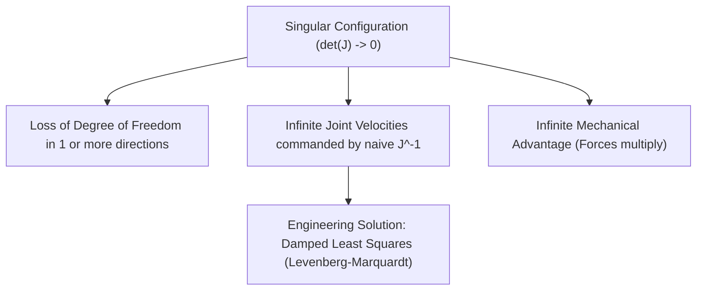
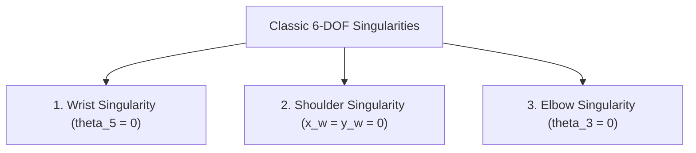

# 10: Singularities, Manipulability, and Joint Limits

## 1. Learning Objectives
By completing this chapter, you will be able to:
- Define a kinematic singularity mathematically as a loss of rank in the Jacobian matrix ($\det(\mathbf{J}) = 0$).
- Differentiate between **boundary singularities** (workspace limits) and **internal singularities** (joint alignment).
- Identify and avoid the three classic 6-DOF singularities: **Wrist**, **Shoulder**, and **Elbow**.
- Compute Yoshikawa's Manipulability Measure $w = \sqrt{\det(\mathbf{J}\mathbf{J}^T)}$.
- Visualize and interpret Velocity Manipulability Ellipsoids.
- Enforce mechanical joint limits in numerical inverse kinematics.

---

## 2. Intuitive Explanation
Have you ever tried locking your knee or elbow completely straight?
When your arm is stretched 100% straight:
- You cannot move your hand any further forward—no matter how fast your shoulder or elbow motors turn!
- In mathematical terms, the robot has **lost a degree of freedom**.
- If a trajectory controller blindly attempts to command motion in that impossible direction using $\mathbf{\dot{q}} = \mathbf{J}^{-1} \mathbf{v}$, the required joint speed calculation divides by zero, commanding **infinite motor speed**!

This dangerous geometric condition is called a **Kinematic Singularity**.



---

## 3. Mathematical Classification of Singularities

A configuration $\mathbf{q}$ is singular if the $m \times n$ Jacobian matrix loses rank:

$$\text{rank}(\mathbf{J}(\mathbf{q})) < \min(m, n)$$

For a square $6 \times 6$ Jacobian:
$$\det(\mathbf{J}(\mathbf{q})) = 0$$

### 3.1 Boundary Singularities
Occur when the arm is stretched out to its maximum physical reach ($r = r_{\max}$) or folded in on itself ($r = r_{\min}$).
The robot cannot move outward radially.

### 3.2 Internal Singularities
Occur *inside* the reachable workspace when two or more joint axes line up parallel or collinear.

---

## 4. The Three Classic 6-DOF Robot Arm Singularities

For an anthropomorphic 6-DOF robot with a spherical wrist (like EduArm-6DOF):



### 1. The Wrist Singularity ($\theta_5 = 0$)
- **Geometry:** Occurs when the wrist pitch joint $\theta_5$ is zero, causing the axis of Joint 4 (forearm roll) and Joint 6 (tool roll) to become **collinear**.
- **Consequence:** Both joints rotate about the exact same physical line. The robot cannot instantaneously rotate about the normal to that line. In path planning, moving through $\theta_5 = 0$ causes Joint 4 and 6 to spin $180^\circ$ at extreme speeds.

### 2. The Shoulder Singularity ($x_w = 0, y_w = 0$)
- **Geometry:** Occurs when the wrist center $\mathbf{p}_{wc}$ passes directly over the vertical axis of Joint 1 ($Z_0$).
- **Consequence:** The base angle $\theta_1 = \text{atan2}(y_w, x_w) = \text{atan2}(0, 0)$ is mathematically undefined. Small Cartesian sideways movements require Joint 1 to rotate infinitely fast.

### 3. The Elbow Singularity ($\theta_3 = 0$ or $\theta_3 = \pm 180^\circ$)
- **Geometry:** The elbow joint locks Link 2 and Link 3 into a single straight line.
- **Consequence:** The robot loses the ability to extend or retract radially in the arm plane.

---

## 5. Quantitative Manipulability Measures

How close is the robot to a singularity? We evaluate three metrics:

### 5.1 Yoshikawa's Manipulability Index ($w$)
$$w(\mathbf{q}) = \sqrt{\det(\mathbf{J}(\mathbf{q}) \mathbf{J}^T(\mathbf{q}))} = \sigma_1 \sigma_2 \dots \sigma_m$$
where $\sigma_i$ are the singular values of $\mathbf{J}$.
- When far from singularities, $w > 0$ is maximized (high agility).
- Exactly at a singularity, $w = 0$.

### 5.2 Condition Number ($\kappa$)
$$\kappa(\mathbf{J}) = \frac{\sigma_{\max}}{\sigma_{\min}} \ge 1.0$$
- $\kappa = 1.0$: Perfectly isotropic (the robot moves equally easily in all directions).
- $\kappa \to \infty$: The robot is at a singularity.

### 5.3 Manipulability Ellipsoid
The mapping of a unit sphere of joint velocities $\|\mathbf{\dot{q}}\| \le 1$ into Cartesian velocity space:
$$\mathbf{v}^T (\mathbf{J} \mathbf{J}^T)^{-1} \mathbf{v} \le 1$$
forms the **Velocity Manipulability Ellipsoid**:
- The directions of the principal axes are given by the eigenvectors of $\mathbf{J} \mathbf{J}^T$.
- The lengths of the principal semi-axes are equal to the singular values $\sigma_i$.
- Near a singularity, the ellipsoid flattens into a thin pancake, showing visually that motion perpendicular to the pancake is impossible!

---

## 6. Fully Worked Numerical Example: 2-Link Arm Singularity

Consider a 2-link planar arm with $l_1 = 1.0\,\text{m}, l_2 = 1.0\,\text{m}$:
$$\mathbf{J}(q_1, q_2) = \begin{bmatrix}
-l_1 \sin(q_1) - l_2 \sin(q_1 + q_2) & -l_2 \sin(q_1 + q_2) \\
l_1 \cos(q_1) + l_2 \cos(q_1 + q_2) & l_2 \cos(q_1 + q_2)
\end{bmatrix}$$

1. **Calculate the determinant:**
   $$\det(\mathbf{J}) = (-l_1 s_1 - l_2 s_{12})(l_2 c_{12}) - (-l_2 s_{12})(l_1 c_1 + l_2 c_{12})$$
   $$\det(\mathbf{J}) = -l_1 l_2 s_1 c_{12} - l_2^2 s_{12} c_{12} + l_1 l_2 s_{12} c_1 + l_2^2 s_{12} c_{12}$$
   The $l_2^2$ terms cancel:
   $$\det(\mathbf{J}) = l_1 l_2 (s_{12} c_1 - c_{12} s_1) = l_1 l_2 \sin((q_1 + q_2) - q_1) = l_1 l_2 \sin(q_2)$$

2. **Find Singularity Conditions:**
   $$\det(\mathbf{J}) = 0 \implies \sin(q_2) = 0 \implies q_2 = 0^\circ \quad \text{or} \quad q_2 = \pm 180^\circ$$

3. **Physical Interpretation:**
   - At $q_2 = 0^\circ$: The elbow is locked completely straight ($r = l_1 + l_2 = 2.0\,\text{m}$, boundary singularity).
   - At $q_2 = 180^\circ$: The elbow is folded completely back onto Link 1 ($r = |l_1 - l_2| = 0.0\,\text{m}$, inner singularity).
   - At $q_2 = 90^\circ$: $\det(\mathbf{J}) = l_1 l_2 (1.0) = 1.0$ (maximum manipulability!).

---

## 7. Python Demonstration

Tested using `04-python-robotics/jacobian.py`:

```python
import numpy as np
from forward_kinematics_6dof import RobotArm6DOF
from jacobian import geometric_jacobian_6dof, manipulability_index

arm = RobotArm6DOF()

# 1. Stretched / Singular pose (q = 0)
q_singular = np.zeros(6)
J_sing = geometric_jacobian_6dof(arm, q_singular)
w_sing = manipulability_index(J_sing)
cond_sing = np.linalg.cond(J_sing)

print("1. Singular Configuration (q=0):")
print(f"   Manipulability w: {w_sing:.2e} (Near zero!)")
print(f"   Condition Number: {cond_sing:.2e} (Extremely ill-conditioned)")

# 2. Well-conditioned Dexterous Pose
q_dex = np.radians([20.0, 40.0, -30.0, 20.0, -40.0, 10.0])
J_dex = geometric_jacobian_6dof(arm, q_dex)
w_dex = manipulability_index(J_dex)
cond_dex = np.linalg.cond(J_dex)

print("\n2. Dexterous Configuration:")
print(f"   Manipulability w: {w_dex:.4f} (High dexterity)")
print(f"   Condition Number: {cond_dex:.2f} (Well-conditioned)")
```

---

## 8. Common Mistakes & Debugging Tips
1. **Planning Linear Cartesian Trajectories Near Singularities:**
   In industrial welding, if a programmed linear weld path passes within $5\,\text{mm}$ of the shoulder or wrist singularity, the robot controller will trip a `Joint Speed Exceeded` fault. Plan trajectories through dexterous regions.
2. **Ignoring Joint Limits During Numerical Inverse Kinematics:**
   Without hard-limit clamping (`np.clip`), the numerical solver may produce mathematically valid configurations where Joint 2 is bent backwards through the robot's own cast-iron pedestal!
3. **Using Standard Inversion in Real-Time Loops:**
   Always use Damped Least Squares (`damped_least_squares_inverse`). Setting damping $\lambda = 0.05$ guarantees the solver executes without numerical crashes even directly on a singularity.

---

## 9. Exercises

### Beginner
1. What is the value of $\det(\mathbf{J})$ when a robot is in a kinematic singularity?
2. Name the three classic geometric singularities of an articulated 6-DOF arm.

### Intermediate
3. For a 2-link planar arm with $l_1 = 1.0\,\text{m}, l_2 = 0.6\,\text{m}$, at what elbow angle $q_2$ is the manipulability index $w$ maximized?
4. Explain what physical event occurs when an industrial robot encounters a **Wrist Singularity** while moving in Cartesian tool mode.

### Advanced
5. Prove that the singular values $\sigma_i$ of a matrix $\mathbf{J}$ satisfy $\sigma_i = \sqrt{\lambda_i}$, where $\lambda_i$ are the eigenvalues of $\mathbf{J}\mathbf{J}^T$. Explain how this connects the condition number $\kappa(\mathbf{J})$ to the aspect ratio of the manipulability ellipsoid.

---

## 10. Summary & Next Steps
- Singularities represent geometric configurations where the robot loses rank and degrees of freedom.
- The Yoshikawa index $w$ and condition number $\kappa$ provide real-time warning indicators.
- Damped Least Squares protects trajectory controllers from velocity blowups.
- Test your full kinematics comprehension in [**Module 03 Exercises**](exercises.md).
