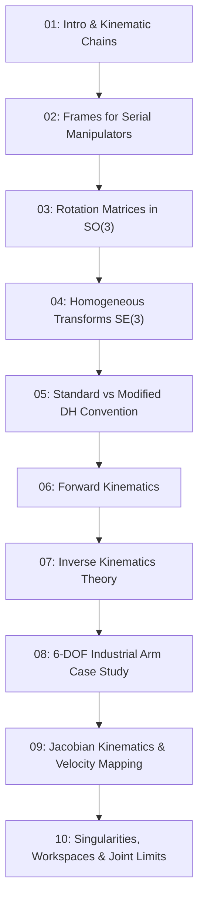

# 03: Robot Kinematics — Serial Manipulators & 6-DOF Arms

Welcome to the **Robot Kinematics** module. Here, the geometric and mathematical foundations developed in Modules 53 and 54 are applied to serial multi-degree-of-freedom robotic arms.

---

## Curriculum & Scope Overview

> [!NOTE]
> **Source Curriculum vs Extension Scope:**
> - **Source Curriculum Core:** Forward kinematics, coordinate frame transformations, standard Denavit–Hartenberg conventions, and 2D/3D kinematic modeling.
> - **Extension Scope (Added for Engineering Depth):** Complete 6-DoF industrial arm kinematics, decoupled analytical inverse kinematics (wrist-centre method), numerical Jacobian-based inverse kinematics with Damped Least Squares (DLS), singularity manipulability ellipsoids, and joint limit constraints.

### Chapter Index
1. [**01: Introduction to Manipulator Kinematics**](01-introduction.md): Open kinematic chains, joint types (Revolute vs Prismatic), workspace topology, and forward vs inverse problems.
2. [**02: Coordinate Frames for Serial Chains**](02-coordinate-frames.md): Base frame $\{0\}$, joint frames $\{i\}$, wrist center $\{4, 5\}$, mechanical flange frame, and tool frame $\{T\}$.
3. [**03: 3D Rotation Matrices & Parameterizations**](03-rotation-matrices.md): $SO(3)$, Euler angles, Axis-Angle (Rodrigues), and Quaternions.
4. [**04: Homogeneous Transformations in Robotics**](04-homogeneous-transformations.md): $4 \times 4$ matrices in serial chaining and rigid tool mounting offsets.
5. [**05: Denavit–Hartenberg (DH) Convention**](05-denavit-hartenberg.md): Rigorous definition of $\theta_i, d_i, a_i, \alpha_i$; Standard vs Modified Craig convention; systematic 8-step frame assignment algorithm.
6. [**06: Forward Kinematics**](06-forward-kinematics.md): Analytic derivation of $T_0^n = A_1 A_2 \dots A_n$, position extraction, and rotation matrix orthogonality validation.
7. [**07: Inverse Kinematics Fundamentals**](07-inverse-kinematics.md): Closed-form algebraic solutions, geometric law of cosines, multiple solutions (elbow-up/down), and Pieper's criterion.
8. [**08: 6-DOF Arm Kinematics Case Study**](08-six-dof-arm.md): Complete forward and analytical inverse kinematics for an illustrative anthropomorphic 6-DOF robot arm (**EduArm-6DOF**).
9. [**09: Jacobian-Based Kinematics & Velocity Mapping**](09-jacobian-kinematics.md): Geometric Jacobian derivation, linear/angular velocity mapping, and force/torque duality.
10. [**10: Singularities, Manipulability & Joint Limits**](10-singularities-and-joint-limits.md): Boundary vs internal singularities, Yoshikawa manipulability index, condition numbers, and numerical DLS damping.
11. [**Exercises**](exercises.md) & [**Solutions**](solutions.md): Comprehensive theoretical, numerical, and coding exercises with complete answer keys.

---

## Accompanying Tested Python Software
All algorithms and kinematic models are fully executable and verified via automated pytest suites in [`04-python-robotics/`](../04-python-robotics/):
- `forward_kinematics_6dof.py`
- `inverse_kinematics_6dof.py`
- `jacobian.py`
- `visualise_robot_arm.py`
