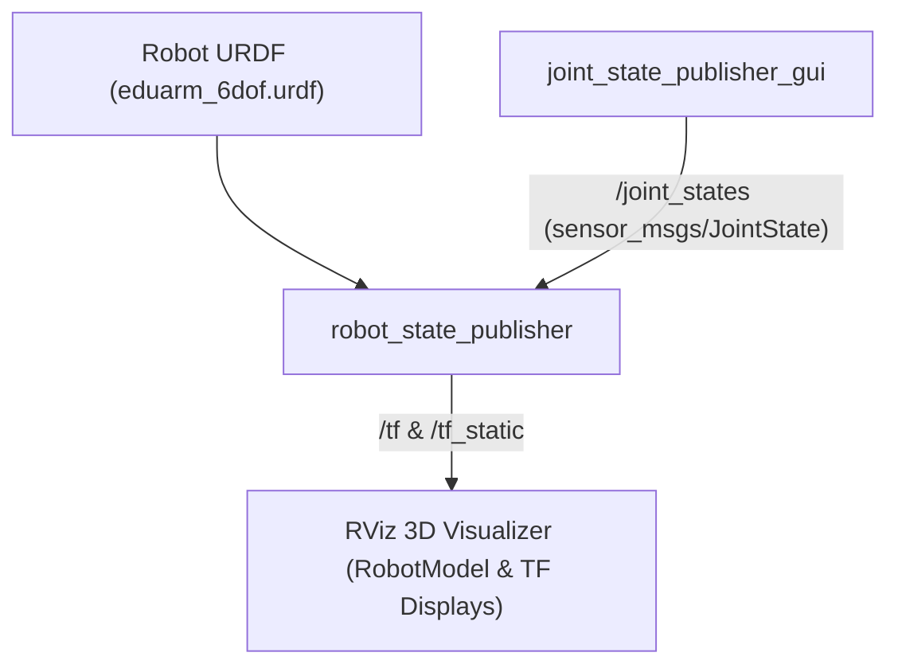

# 05: ROS 2 Practical Integration — URDF & Robot State Publisher

Welcome to **05: ROS 2 Practical Integration**. In previous modules, we developed kinematics equations and standalone Python algorithms. In this module, we connect those kinematic models to the **Robot Operating System (ROS 2)** ecosystem.

---

## Architecture Overview

### Chapter Index
1. [**TF2 Practical Deep-Dive**](tf2-practical.md): How TF2 powers the ROS 2 computational graph, transform lookups in callbacks, and message filters.
2. [**The Robot State Publisher**](robot-state-publisher.md): Role of `robot_state_publisher`, kinematic tree parsing from URDF, and conversion of `sensor_msgs/msg/JointState` into 3D TF frames.
3. [**RViz Visualisation Guide**](rviz-visualization.md): Step-by-step setup of `RobotModel`, TF axes, joint sliders, fixed frame selection, and mesh visual/collision debugging.
4. [**URDF Model of the 6-DOF Robot Arm**](urdf-robot-arm.md): Complete, functional URDF specification for **EduArm-6DOF**, link definitions, revolute joint limits, materials, and origin offsets matching our standard DH table.
5. [**URDF File**](urdf/eduarm_6dof.urdf): The raw, ready-to-load URDF file.

---

## Important Distinction: Kinematic Visualization vs Dynamic Simulation

> [!CAUTION]
> **Visualization $\ne$ Physical Simulation!**
> Visualizing a robot in RViz using `robot_state_publisher` and `joint_state_publisher_gui` is a **purely kinematic visualization**.
> - It does NOT calculate gravity, motor torques, inertia matrices, friction, or physical collisions.
> - For full physics simulation, you need a dynamics engine like **Gazebo** (Ignition/Gazebo Sim) with `<transmission>`, `<inertia>`, and ROS 2 control plugins (`ros2_control`).
