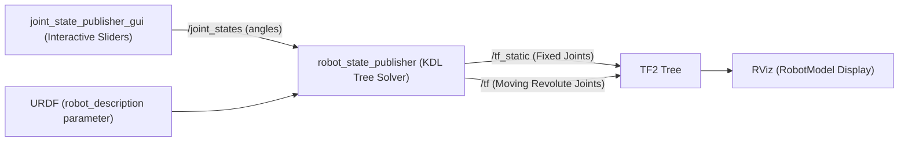
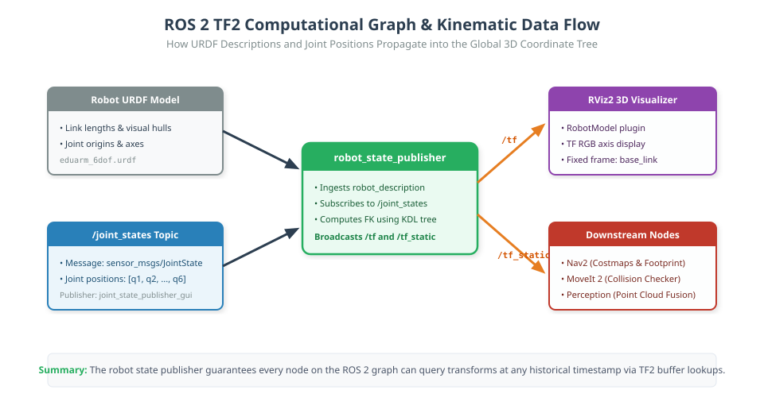

# The Robot State Publisher & Joint State Pipeline

## 1. Learning Objectives
By completing this chapter, you will be able to:
- Explain the responsibilities of `robot_state_publisher` in the ROS 2 computational graph.
- Decode and publish `sensor_msgs/msg/JointState` messages.
- Launch the complete visualization pipeline: URDF $\to$ `joint_state_publisher_gui` $\to$ `robot_state_publisher` $\to$ RViz.
- Understand how forward kinematics is computed automatically in real-time by the KDL tree inside `robot_state_publisher`.

---

## 2. System Architecture






---

## 3. How `robot_state_publisher` Works

1. **URDF Ingestion:** At startup, `robot_state_publisher` reads the robot's URDF XML text from the `robot_description` topic or node parameter.
2. **KDL Tree Construction:** It parses the links and joints into an internal kinematic tree (using Orocos KDL).
3. **Static Joints:** All joints with `type="fixed"` are published **once** to `/tf_static` with Transient Local QoS.
4. **Moving Joints:** When a `sensor_msgs/msg/JointState` message arrives on `/joint_states`:
   - It matches joint names (e.g. `joint_1`, `joint_2`).
   - It plugs the angle values into the internal kinematic chain.
   - It computes the 3D position and orientation of every link.
   - It publishes the updated transforms to `/tf` with the timestamp from the `JointState` header!

---

## 4. The `sensor_msgs/msg/JointState` Message

```text
std_msgs/Header header
  stamp: {sec: ..., nanosec: ...}
  frame_id: ""
string[] name         # e.g. ['joint_1', 'joint_2', 'joint_3', 'joint_4', 'joint_5', 'joint_6']
float64[] position    # e.g. [0.0, 0.523, -1.047, 0.0, 0.785, 0.0] (in radians!)
float64[] velocity    # optional [rad/s]
float64[] effort      # optional [Nm torque]
```

> [!IMPORTANT]
> The arrays `name`, `position`, `velocity`, and `effort` must have matching lengths, and angles must strictly be in **radians**.

---

## 5. Complete Python Launch File: `view_arm.launch.py`

Create this launch file in your ROS 2 package:

```python
from launch import LaunchDescription
from launch_ros.actions import Node
from launch.substitutions import Command, PathJoinSubstitution
from launch_ros.substitutions import FindPackageShare

def generate_launch_description():
    # 1. Path to URDF
    urdf_path = PathJoinSubstitution([
        FindPackageShare("eduarm_description"), "urdf", "eduarm_6dof.urdf"
    ])

    return LaunchDescription([
        # Node 1: Robot State Publisher
        Node(
            package="robot_state_publisher",
            executable="robot_state_publisher",
            name="robot_state_publisher",
            output="screen",
            parameters=[{"robot_description": Command(["cat ", urdf_path])}]
        ),

        # Node 2: Joint State Publisher GUI (slider widget)
        Node(
            package="joint_state_publisher_gui",
            executable="joint_state_publisher_gui",
            name="joint_state_publisher_gui",
            output="screen"
        ),

        # Node 3: RViz2
        Node(
            package="rviz2",
            executable="rviz2",
            name="rviz2",
            output="screen"
        )
    ])
```

---

## 6. Verification Steps
Execute:
```bash
ros2 launch eduarm_description view_arm.launch.py
```
A GUI window appears with 6 sliders. As you drag each slider:
- `joint_state_publisher_gui` publishes `/joint_states`.
- `robot_state_publisher` computes forward kinematics and publishes to `/tf`.
- RViz dynamically articulates the 3D robot model in real-time!
