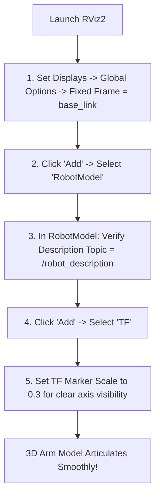

# RViz 3D Visualisation & RobotModel Configuration

## 1. Learning Objectives
By completing this chapter, you will be able to:
- Configure the RViz2 environment to display articulated robot arms and TF coordinate frames.
- Configure the `RobotModel` display plugin.
- Switch between Visual and Collision geometry displays to verify bounding boxes.
- Troubleshoot common RViz rendering and transform errors.

---

## 2. RViz Setup Walkthrough

---

## 3. RobotModel Display Settings

| Property | Recommended Value | Purpose |
| :--- | :--- | :--- |
| **Description Source** | Topic | Ingests URDF published as a parameter/topic |
| **Description Topic** | `/robot_description` | Standard ROS 2 robot model topic |
| **Visual Enabled** | True | Renders CAD shapes, cylinders, and colors |
| **Collision Enabled** | False (Toggle to True when testing) | Renders simplified collision bounding hulls |
| **Alpha** | 1.0 (or 0.6 for transparency) | Opacity of the 3D model |

---

## 4. Visual vs Collision Geometry

In URDF, links contain two distinct geometric tags:
1. `<visual>`: High-detail mesh or primitive geometry used for human rendering in RViz.
2. `<collision>`: Coarse primitives (cylinders, spheres, boxes) used by physics engines and collision checkers (MoveIt 2).

> [!TIP]
> In RViz, expand the `RobotModel` display and check **Collision Enabled** while turning **Visual Enabled** off. You will see the simplified bounding hulls used by real-time obstacle avoidance algorithms.

---

## 5. Troubleshooting RViz Display Faults

1. **"Fixed Frame [base_link] does not exist":**
   - Check if `robot_state_publisher` is running: `ros2 node list`.
   - Check if `/tf` has messages: `ros2 topic echo /tf --once`.
2. **Robot links clumped together in white at origin (0, 0, 0):**
   - Cause: `robot_state_publisher` is not receiving `/joint_states`.
   - Solution: Ensure `joint_state_publisher_gui` is running: `ros2 topic echo /joint_states --once`.
3. **Robot parts are completely black:**
   - Cause: No light source or missing `<material>` tags in URDF.
   - Solution: In RViz, click **Add** $\to$ add an ambient light or check material colors in the URDF.
