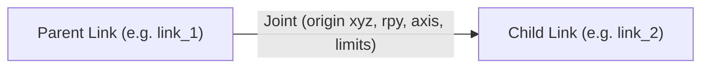

# URDF Specification for Serial Robot Arms

## 1. Learning Objectives
By completing this chapter, you will be able to:
- Write well-structured Unified Robot Description Format (URDF) XML files.
- Map Denavit–Hartenberg link lengths and offsets directly into URDF `<origin xyz="..." rpy="...">` tags.
- Define revolute joints with realistic hardware limits (`lower`, `upper`, `effort`, `velocity`).
- Attach an end-effector and create a virtual Tool Center Point (`tool_center_point`) fixed joint.

---

## 2. URDF Anatomy: Links vs Joints

In URDF, a robot is modeled as a tree of rigid **`<link>`** elements connected by **`<joint>`** elements:



### The 4 Joint Types in Manipulators:
1. **`revolute`**: Rotates about an axis with hard mechanical limits: `lower` and `upper` (in radians).
2. **`continuous`**: Rotates indefinitely without hard limits (e.g., continuous tool spindles or wheels).
3. **`prismatic`**: Slides linearly along an axis with distance limits in metres.
4. **`fixed`**: Rigid mechanical joint with zero degrees of freedom (used for sensor mounts and TCPs).

---

## 3. Mapping DH Parameters to URDF Origins

In standard DH, transformation $\mathbf{A}_i = \text{Rot}_z(\theta_i) \text{Trans}_z(d_i) \text{Trans}_x(a_i) \text{Rot}_x(\alpha_i)$.
In URDF:
- The joint's rest position and orientation relative to its parent link is specified in the `<origin>` tag:
  ```xml
  <origin xyz="x y z" rpy="roll pitch yaw"/>
  ```
- The axis of motion is defined by `<axis xyz="..."/>`.
  - For rotation about $Z$: `<axis xyz="0 0 1"/>`
  - For rotation about $Y$: `<axis xyz="0 1 0"/>`
  - For rotation about $X$: `<axis xyz="1 0 0"/>`

### Example: Shoulder Joint (Joint 2)
In EduArm-6DOF:
- Waist height: $d_1 = 0.400\,\text{m}$ along $Z$.
- Joint 1 rotates about $Z$:
  ```xml
  <joint name="joint_1" type="revolute">
    <parent link="base_link"/>
    <child link="link_1"/>
    <origin xyz="0 0 0.400" rpy="0 0 0"/>
    <axis xyz="0 0 1"/>
    <limit lower="-3.14159" upper="3.14159" effort="150.0" velocity="2.5"/>
  </joint>
  ```
- Joint 2 rotates about $Y$ (pitch) with upper arm length $a_2 = 0.500\,\text{m}$:
  ```xml
  <joint name="joint_2" type="revolute">
    <parent link="link_1"/>
    <child link="link_2"/>
    <origin xyz="0 0 0" rpy="0 0 0"/>
    <axis xyz="0 1 0"/>
    <limit lower="-1.5708" upper="1.5708" effort="200.0" velocity="2.0"/>
  </joint>
  ```

---

## 4. Crucial Distinction: Standard DH Frames vs. URDF Joint-Reference Conventions

A common source of confusion in robotics software is the difference between **Denavit–Hartenberg mathematical frames** and **URDF CAD coordinate conventions**:

| Feature | Standard DH Model (`RobotArm6DOF`) | URDF Visualization Model (`eduarm_6dof.urdf`) |
| :--- | :--- | :--- |
| **Zero Configuration ($\mathbf{q} = \mathbf{0}$)** | Link 4 hangs straight down along $-Z_0$ (elbow bent $90^\circ$). TCP is at $[0.500, 0.000, -0.150]^T\,\text{m}$. | Arm is fully outstretched horizontally along $+X_0$. TCP is at $[1.050, 0.000, 0.400]^T\,\text{m}$. |
| **Elbow Zero ($\theta_3 = 0$)** | Link 4 is perpendicular to Link 2 ($\alpha_3 = +90^\circ$). | Forearm is collinear with upper arm (straight arm). |
| **Pitch Joint Axes** | DH $z_1, z_2$ point along $-Y_0$ base direction. | URDF joint axes for J2, J3, J5 point along $+Y$. |
| **Tool Flange Frame** | $z_6$ points forward along the tool; $x_6$ points up. | $x$ points forward along tool; $z$ points up (REP 103). |

### Exact Joint Angle Conversions:
To execute kinematics algorithms on a robot visualized in ROS 2, convert joint states using the explicit mappings implemented in [`forward_kinematics_6dof.py`](../04-python-robotics/forward_kinematics_6dof.py):

$$\begin{aligned}
q_{1, DH} &= q_{1, URDF} \\
q_{2, DH} &= -q_{2, URDF} \quad &&\text{(pitch axis sign inversion)} \\
q_{3, DH} &= \frac{\pi}{2} - q_{3, URDF} \quad &&\text{($90^\circ$ elbow offset)} \\
q_{4, DH} &= q_{4, URDF} \\
q_{5, DH} &= -q_{5, URDF} \quad &&\text{(wrist pitch sign inversion)} \\
q_{6, DH} &= q_{6, URDF}
\end{aligned}$$

### Tool Flange Orientation Mapping:
The tool orientation in URDF relates to the DH flange orientation by:
$$\mathbf{R}_{URDF} = \mathbf{R}_{DH} \begin{bmatrix} 0 & 0 & 1 \\ 0 & -1 & 0 \\ 1 & 0 & 0 \end{bmatrix}$$

This guarantees identical Cartesian spatial positions ($\|\Delta\mathbf{p}\| < 10^{-7}\,\text{m}$) and orientations across all configurations, as verified in `test_fk.py::test_urdf_fk_vs_dh_fk_multi_configuration`.

---

## 5. The Tool Center Point (TCP) Fixed Joint

To track the exact tip of a tool without adding a moving degree of freedom, append a **fixed joint** with a massless link:

```xml
<!-- Rigid mechanical attachment of TCP -->
<joint name="tcp_joint" type="fixed">
  <parent link="tool_flange"/>
  <child link="tool_center_point"/>
  <origin xyz="0.100 0 0" rpy="0 0 0"/>
</joint>

<link name="tool_center_point"/>
```

Now, any ROS 2 node can immediately query the transform `map -> tool_center_point` to know the precise 3D location of the tool tip!

---

## 6. Summary & Next Steps
- URDF provides the XML standard for modeling robot links, visuals, collisions, and joint limits.
- The `robot_state_publisher` reads this URDF to publish the TF tree.
- Now test your knowledge in hands-on practical labs in [**Module 06: Labs and Projects**](../06-labs-and-projects/README.md).
