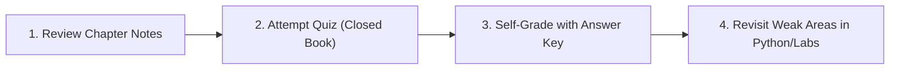

# 07: Assessments, Quizzes & Exam Preparation

Welcome to the assessment and revision section. This directory contains theoretical and numerical quiz problems designed to test your understanding of robotics mathematics, coordinate frames, TF2, forward kinematics, and inverse kinematics.

---

## Recommended Self-Study Workflow

1. **Attempt First:** Open the quiz and write out your derivations and numerical calculations independently before checking solutions.
2. **Verify Numerically:** For kinematics calculations, use the verified Python implementations in [`04-python-robotics/`](../04-python-robotics/README.md) to cross-check intermediate transformation matrices.
3. **Review Solutions:** Consult the master answer key to review alternative derivation paths, common pitfalls, and grading rubrics.

---

## Quizzes & Problem Sets

| Quiz | Focus Area | Questions | Link |
| :--- | :--- | :---: | :--- |
| **Quiz 1: Module 53** | ROS 2 coordinate frames, TF2 tree rules, `/tf` vs `/tf_static` QoS, `map->odom->base_link`, camera optical frames | 5 Questions | [**Start Quiz 1**](quiz-module-53.md) |
| **Quiz 2: Module 54** | Vector dot/cross products, skew-symmetric matrices, $SO(3)$ rotation representations, Jacobians, Gaussian covariance ellipses | 5 Questions | [**Start Quiz 2**](quiz-module-54.md) |
| **Quiz 3: Kinematics** | Standard DH parameters, 2R planar FK/IK, wrist center decoupling, DLS damping, manipulability ellipsoid | 5 Questions | [**Start Quiz 3**](quiz-kinematics.md) |

---

## Solutions & Answer Keys

> [!TIP]
> **Self-Study Honor System:** Try answering all questions before opening the solution key below.

- [**Master Answer Key & Grading Rubrics**](answer-key.md): Complete, step-by-step mathematical solutions, intermediate arithmetic, and grading schemes for all three quizzes.

---

## Note for Instructors & Tutors

If you are using this repository for formal classroom coursework, homework sets, or laboratory exams:
1. The quiz files (`quiz-module-53.md`, `quiz-module-54.md`, `quiz-kinematics.md`) contain standalone problem prompts suitable for assignment sheets or LMS import (Canvas/Blackboard).
2. To create a student-facing assignment without embedded solutions, distribute the quiz files directly or fork the repository and exclude `07-assessments/answer-key.md` until the submission deadline.
