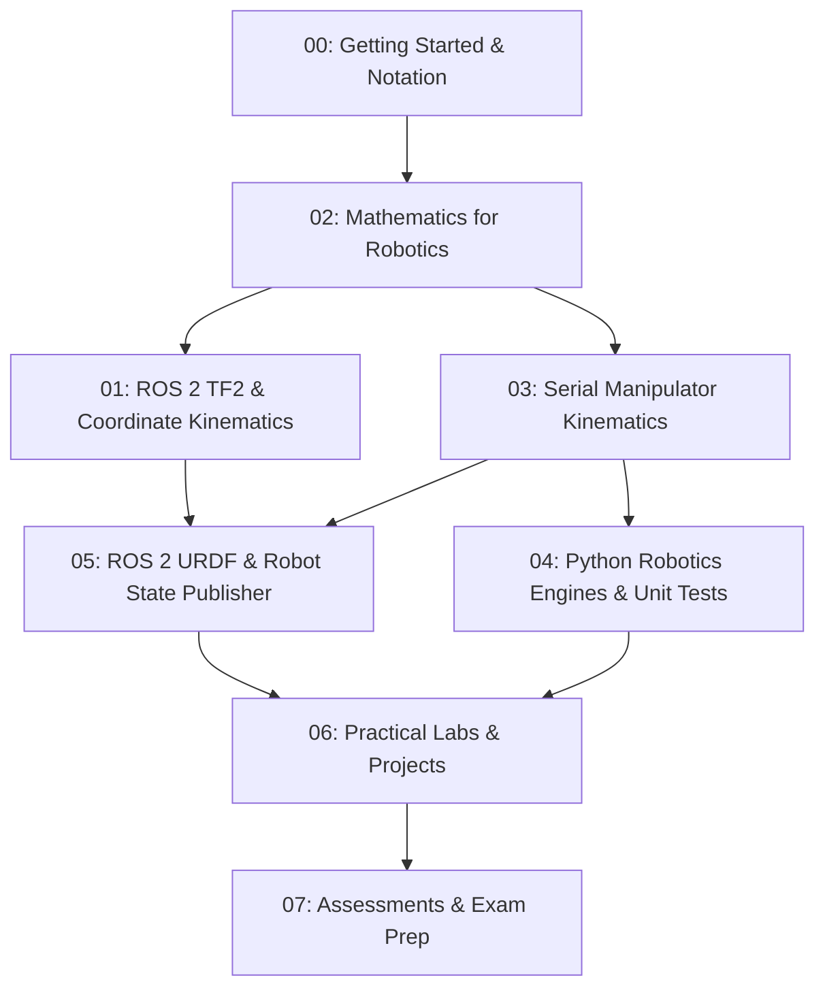
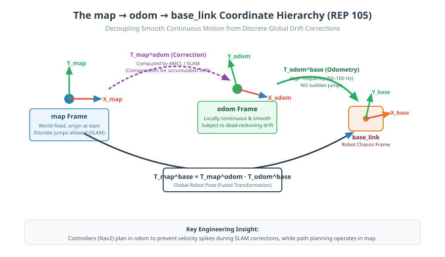

# Robotics & AI Student Notes: Kinematics, TF2 & Robotics Mathematics

[](https://www.python.org/)
[%20%7C%20Humble-green.svg)](https://docs.ros.org/en/jazzy/)
[](04-python-robotics/tests/)
[](https://github.com/JosiahSK/robotics-kinematics-tf2/actions)
[](LICENSE)

An open-source, engineering-grade educational textbook and interactive laboratory repository designed for undergraduate and graduate students in **Robotics, Mechatronics, and Artificial Intelligence**.

This repository contains mathematically verified derivations, working Python kinematics engines, ROS 2 nodes and launch packages, standard URDF descriptions, 3D Matplotlib visualizers, vector diagrams, guided laboratories, and comprehensive exam answer keys.

---

## 1. Intended Audience & Prerequisites

- **Robotics & Mechatronics Students:** Mastering forward/inverse kinematics, Denavit–Hartenberg modeling, and Jacobian velocity control.
- **ROS 2 Engineers:** Demystifying coordinate frames, the TF2 transform buffer, `robot_state_publisher`, and sensor synchronization.
- **AI & Perception Researchers:** Bridging the gap between camera optical frames, 3D point clouds, and mobile robot chassis frames.

### Prerequisites
- **Mathematics:** High-school trigonometry ($\sin, \cos, \text{atan2}$), basic vector algebra, and basic matrix multiplication. (All advanced concepts—Jacobians, Lie algebra $SO(3)$, Taylor series, and Gaussian covariance—are developed step-by-step in Module 02).
- **Software:** Python 3.10+ (pure Python track requires **no ROS installation**).
- **ROS 2 Track (Optional):** **ROS 2 Jazzy Jalisco** (recommended on Ubuntu 24.04 or WSL2) or **Humble Hawksbill** (Ubuntu 22.04).

---

## 2. Pedagogical Learning Roadmap



The recommended learning progression:
$$\text{Mathematical Foundations} \longrightarrow \text{Spatial Transforms} \longrightarrow \text{Forward Kinematics} \longrightarrow \text{Inverse Kinematics} \longrightarrow \text{Jacobians \& Singularities} \longrightarrow \text{ROS 2 Visualisation} \longrightarrow \text{Sensor Fusion}$$

---

## 3. Visual Gallery of Core Concepts

| 6-DOF Robot Kinematics Architecture | Kinematic Decoupling (Pieper's Method) |
| :---: | :---: |
|  |  |
| **TF2 Coordinate Hierarchy (REP 105)** | **Planar 2R Workspace & Dual Solutions** |
|  |  |

---

## 4. Repository Curriculum & Table of Contents

### [00 - Getting Started](00-getting-started/README.md)
Foundational standards, coordinate frames, right-handed conventions (ISO 8855 / REP 103), and mathematical prerequisites.
- [Robotics Fundamentals](00-getting-started/robotics-fundamentals.md): Sense-Plan-Act paradigm, degrees of freedom, Grübler's mobility criterion.
- [Mathematical Prerequisites](00-getting-started/mathematical-prerequisites.md): Four-quadrant `atan2`, Law of Cosines, Taylor expansion, covariance intuition.

### [01 - Module 53: TF2 & Kinematics Core](01-module-53-tf2-kinematics/README.md)
ROS 2 spatial coordinate tracking, static vs dynamic broadcasters, odometry drift compensation, and sensor fusion.
- [01: Coordinate Frames & The TF Tree](01-module-53-tf2-kinematics/01-coordinate-frames.md) (REP 103 standards)
- [02: Static & Dynamic Transforms (`/tf` vs `/tf_static`)](01-module-53-tf2-kinematics/02-static-and-dynamic-transforms.md)
- [03: The `map -> odom -> base_link` Hierarchy](01-module-53-tf2-kinematics/03-map-odom-base-link.md) (REP 105 navigation decoupling)
- [04: Robot Pose, Quaternions & Timestamps](01-module-53-tf2-kinematics/04-robot-pose.md)
- [05: TF2 CLI Tools & RViz Visualisation](01-module-53-tf2-kinematics/05-tf2-tools-and-rviz.md)
- [06: Sensor Data Transformations](01-module-53-tf2-kinematics/06-sensor-transformations.md) (Camera optical vs body frames)
- [07: ROS 2 Practical Lab](01-module-53-tf2-kinematics/07-ros2-practical-lab.md)
- [Module 53 Exercises](01-module-53-tf2-kinematics/exercises.md) & [Solutions](01-module-53-tf2-kinematics/solutions.md)

### [02 - Module 54: Mathematics for Robotics](02-module-54-mathematics/README.md)
Engineering mathematics for kinematic solvers, state estimation, and sensor fusion.
- [01: Vectors & Coordinate Bases](02-module-54-mathematics/01-vectors.md)
- [02: Matrices, Determinants & Inverses](02-module-54-mathematics/02-matrices.md)
- [03: Dot & Cross Products](02-module-54-mathematics/03-dot-and-cross-products.md) (Skew-symmetric cross-product matrices)
- [04: Homogeneous Transformations & $SE(3)$](02-module-54-mathematics/04-homogeneous-transformations.md)
- [05: Derivatives & Calculus for Robotics](02-module-54-mathematics/05-derivatives-and-calculus.md)
- [06: Jacobians & Gradient Descent](02-module-54-mathematics/06-jacobians.md)
- [07: Probability & Bayes' Theorem](02-module-54-mathematics/07-probability.md)
- [08: Continuous Distributions & Gaussians](02-module-54-mathematics/08-gaussian-distributions.md)
- [09: Covariance Matrices & Sensor Fusion](02-module-54-mathematics/09-covariance-matrices.md) (Eigenvector confidence ellipses)
- [Module 54 Exercises](02-module-54-mathematics/exercises.md) & [Solutions](02-module-54-mathematics/solutions.md)

### [03 - Robot Kinematics: Serial & 6-DOF Manipulators](03-robot-kinematics/README.md)
Rigorous kinematic modeling from 2R planar links up to full 6-DOF industrial anthropomorphic arms.
- [01: Introduction to Serial Kinematics](03-robot-kinematics/01-introduction.md)
- [02: Coordinate Frames for Serial Chains](03-robot-kinematics/02-coordinate-frames.md)
- [03: 3D Rotation Matrices & Spatial Representations](03-robot-kinematics/03-rotation-matrices.md)
- [04: Homogeneous Transformations in Robotics](03-robot-kinematics/04-homogeneous-transformations.md)
- [05: The Denavit–Hartenberg (DH) Convention](03-robot-kinematics/05-denavit-hartenberg.md) (Geometric constraints and 4 parameters)
- [06: Forward Kinematics](03-robot-kinematics/06-forward-kinematics.md) (Planar 2R and 3D chains)
- [07: Inverse Kinematics Fundamentals](03-robot-kinematics/07-inverse-kinematics.md) (Law of Cosines and dual branches)
- [08: 6-DOF Industrial Arm Case Study (**EduArm-6DOF**)](03-robot-kinematics/08-six-dof-arm.md) (Spherical wrist analytical decoupling)
- [09: Manipulator Jacobian & Velocity Kinematics](03-robot-kinematics/09-jacobian-kinematics.md)
- [10: Singularities, Manipulability & Joint Limits](03-robot-kinematics/10-singularities-and-joint-limits.md)
- [Kinematics Exercises](03-robot-kinematics/exercises.md) & [Solutions](03-robot-kinematics/solutions.md)

### [04 - Python Robotics Mathematics & Testing](04-python-robotics/README.md)
Executable Python reference algorithms and automated test suites.
- [`vectors_matrices.py`](04-python-robotics/vectors_matrices.py): Vector norms, cross products, skew matrices.
- [`rotation_matrices.py`](04-python-robotics/rotation_matrices.py): $SO(3)$, Euler angles, Rodrigues formula, Quaternions.
- [`dh_transform.py`](04-python-robotics/dh_transform.py): Standard DH transform builder and analytical matrix inverters.
- [`forward_kinematics_2d.py`](04-python-robotics/forward_kinematics_2d.py): Planar 2R & 3R kinematics.
- [`inverse_kinematics_2d.py`](04-python-robotics/inverse_kinematics_2d.py): Analytical Law of Cosines IK with reachability checks.
- [`forward_kinematics_6dof.py`](04-python-robotics/forward_kinematics_6dof.py): 6-DOF industrial arm forward kinematics.
- [`inverse_kinematics_6dof.py`](04-python-robotics/inverse_kinematics_6dof.py): Closed-form analytical decoupling and SVD-damped numerical IK.
- [`jacobian.py`](04-python-robotics/jacobian.py): Geometric Jacobian, SVD DLS pseudoinverse, Yoshikawa manipulability.
- [`visualise_robot_arm.py`](04-python-robotics/visualise_robot_arm.py): 3D Matplotlib visualizer rendering joints, links, and RGB axes.
- [`tests/`](04-python-robotics/tests/): **34 automated unit tests** validating all algorithms across configurations.

### [05 - ROS 2 Practical Integration](05-ros2-practical/README.md)
URDF specification and the `eduarm_description` ROS 2 package.
- [TF2 Practical Architecture](05-ros2-practical/tf2-practical.md)
- [The Robot State Publisher](05-ros2-practical/robot-state-publisher.md)
- [RViz 3D Visualisation Guide](05-ros2-practical/rviz-visualization.md)
- [URDF Specification Guide](05-ros2-practical/urdf-robot-arm.md)
- [`eduarm_description/`](eduarm_description/): Real ROS 2 package containing `package.xml`, `CMakeLists.txt`, `launch/view_arm.launch.py`, and RViz configuration.

### [06 - Practical Labs & Guided Projects](06-labs-and-projects/README.md)
Step-by-step engineering lab sheets with objectives, code, and reflection questions.
- [Lab 01: TF2 Tree Inspection & RViz Setup](06-labs-and-projects/lab-01-tf2-visualization.md)
- [Lab 02: Sensor Coordinate Transformations](06-labs-and-projects/lab-02-coordinate-transformations.md)
- [Lab 03: Forward Kinematics Implementation](06-labs-and-projects/lab-03-forward-kinematics.md)
- [Lab 04: Planar Inverse Kinematics](06-labs-and-projects/lab-04-inverse-kinematics.md)
- [Lab 05: 6-DOF Industrial Arm Decoupling](06-labs-and-projects/lab-05-six-dof-arm.md)
- [Lab 06: Jacobian Inverse Kinematics & Singularities](06-labs-and-projects/lab-06-jacobian-ik.md)

### [07 - Assessments & Quizzes](07-assessments/answer-key.md)
Graded assessment questions with complete, step-by-step verified answer keys.
- [Quiz: Module 53 (TF2 & Kinematics)](07-assessments/quiz-module-53.md)
- [Quiz: Module 54 (Mathematics for Robotics)](07-assessments/quiz-module-54.md)
- [Quiz: Robot Kinematics (Serial Manipulators)](07-assessments/quiz-kinematics.md)
- [Master Answer Key & Grading Rubrics](07-assessments/answer-key.md)

---

## 5. Quickstart: Python Track (No ROS Required)

You can run and study all kinematics algorithms, 3D visualizations, and unit tests on **Windows, macOS, or Linux** without installing ROS:

1. **Clone the Repository:**
   ```bash
   git clone https://github.com/JosiahSK/robotics-kinematics-tf2.git
   cd robotics-kinematics-tf2
   ```

2. **Create a Virtual Environment:**
   ```bash
   python -m venv venv
   # On Linux/macOS:
   source venv/bin/activate
   # On Windows (PowerShell):
   .\venv\Scripts\Activate.ps1
   ```

3. **Install Dependencies:**
   ```bash
   pip install -r requirements.txt
   ```

4. **Run the Automated Test Suite (34 tests):**
   ```bash
   pytest -v 04-python-robotics/tests/
   ```

5. **Interact with the 3D Robot Visualizer:**
   ```bash
   python 04-python-robotics/visualise_robot_arm.py --angles 25 35 -30 15 -40 20
   ```

---

## 6. Quickstart: ROS 2 Track (Jazzy / Humble)

> [!NOTE]
> The ROS 2 description package requires an active ROS 2 installation on **Ubuntu Linux (24.04 for Jazzy, 22.04 for Humble)**, WSL2, or a ROS 2 Docker container. Windows users can follow the Python track above or run ROS 2 under WSL2.

To visualize the robot arm in RViz with interactive joint sliders:

```bash
# 1. Source ROS 2 environment (example: ROS 2 Jazzy on Ubuntu 24.04)
source /opt/ros/jazzy/setup.bash

# 2. In your colcon workspace src directory:
mkdir -p ~/ros2_ws/src
cd ~/ros2_ws/src
git clone https://github.com/JosiahSK/robotics-kinematics-tf2.git

# 3. Build the description package
cd ~/ros2_ws
colcon build --packages-select eduarm_description --symlink-install
source install/setup.bash

# 4. Launch RViz with joint slider controls:
ros2 launch eduarm_description view_arm.launch.py
```

---

## 7. Model Transparency & Limitations

1. **Academic Reference Architecture:** The **EduArm-6DOF** model is an illustrative academic manipulator designed for mathematical transparency, closed-form inverse kinematics, and intuitive visualization. It is not calibrated to any commercial robot's physical tolerances.
2. **Kinematics vs Dynamics:** This course focuses on **kinematics** (geometry, transforms, coordinate frames, and velocity Jacobians). Rigid-body dynamics (torques, Coriolis forces, inertia matrices $\mathbf{M}(\mathbf{q})\mathbf{\ddot{q}} + \mathbf{C}(\mathbf{q}, \mathbf{\dot{q}})\mathbf{\dot{q}} + \mathbf{g}(\mathbf{q}) = \boldsymbol{\tau}$) will be addressed in future coursework.
3. **Visualization vs Physics Simulation:** RViz provides kinematic visualization via `robot_state_publisher`. Physical contact physics, friction, and gravity require physics simulation environments like **Gazebo** or **Isaac Sim**.

---

## 8. Contributing

Contributions to educational explanations, worked examples, and diagrams are welcome! Please review [`CONTRIBUTING.md`](CONTRIBUTING.md) for code styling and pull request conventions.

---

## 9. License

This educational repository is distributed under the open-source [MIT License](LICENSE). You are free to use, modify, and distribute this material in academic courses and professional robotics projects.
