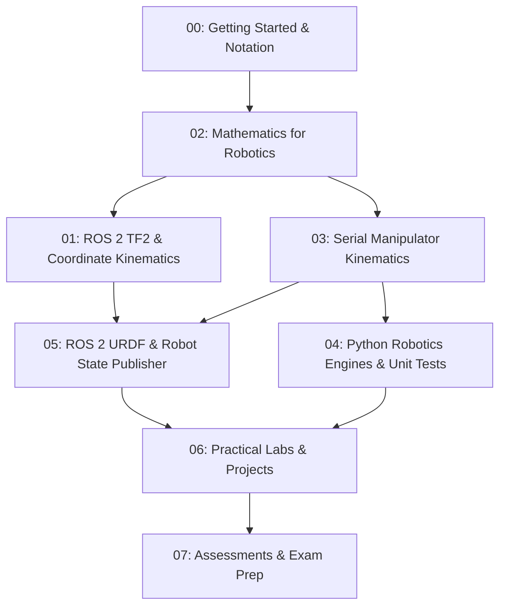

# Robotics & AI Student Notes: Kinematics, TF2 & Robotics Mathematics

[](https://www.python.org/)
[](https://docs.ros.org/en/jazzy/)
[](04-python-robotics/tests/)
[](LICENSE)

An open-source, engineering-grade educational repository and textbook designed for undergraduate and graduate students in **Robotics, Mechatronics, and Artificial Intelligence**.

This repository contains mathematically verified derivations, working Python programs, ROS 2 nodes, URDF specifications, step-by-step practical laboratories, 3D visualizations, exercises, and complete answer keys.

---

## Intended Audience

- **Engineering Students:** Studying robotics kinematics, coordinate frames, and multi-variable sensor fusion.
- **ROS 2 Developers:** Seeking clear explanations of TF2 coordinate trees, `robot_state_publisher`, and sensor synchronization.
- **AI & Perception Researchers:** Bridging the gap between computer vision optical frames, point clouds, and physical robot chassis frames.

---

## Pedagogical Learning Roadmap



The recommended learning sequence:
$$\text{Mathematical Foundations} \longrightarrow \text{Coordinate Transformations} \longrightarrow \text{Forward Kinematics} \longrightarrow \text{Inverse Kinematics} \longrightarrow \text{Jacobians \& Singularities} \longrightarrow \text{ROS 2 Visualisation} \longrightarrow \text{Sensor Fusion}$$

---

## Repository Table of Contents

### [00 - Getting Started](00-getting-started/README.md)
Foundational concepts, right-handed coordinate standards (ISO 8855 / REP 103), and mathematical prerequisites.
- [Robotics Fundamentals](00-getting-started/robotics-fundamentals.md) (Sense-Plan-Act, Grübler mobility criterion)
- [Mathematical Prerequisites](00-getting-started/mathematical-prerequisites.md) (`atan2`, Law of Cosines, Taylor linearisation, covariance)

### [01 - Module 53: TF2 & Kinematics Core](01-module-53-tf2-kinematics/README.md)
ROS 2 spatial coordinate tracking, static vs dynamic transforms, odometry drift, and perception pipelines.
- [01: Coordinate Frames & The TF Tree](01-module-53-tf2-kinematics/01-coordinate-frames.md)
- [02: Static & Dynamic Transforms (`/tf` vs `/tf_static`)](01-module-53-tf2-kinematics/02-static-and-dynamic-transforms.md)
- [03: The `map -> odom -> base_link` Hierarchy (REP 105)](01-module-53-tf2-kinematics/03-map-odom-base-link.md)
- [04: Robot Pose, Quaternions & Timestamps](01-module-53-tf2-kinematics/04-robot-pose.md)
- [05: TF2 CLI Tools & RViz Visualisation](01-module-53-tf2-kinematics/05-tf2-tools-and-rviz.md)
- [06: Sensor Data Transformations (PointClouds & Lasers)](01-module-53-tf2-kinematics/06-sensor-transformations.md)
- [07: ROS 2 Practical Lab](01-module-53-tf2-kinematics/07-ros2-practical-lab.md)
- [Module 53 Exercises](01-module-53-tf2-kinematics/exercises.md) & [Solutions](01-module-53-tf2-kinematics/solutions.md)

### [02 - Module 54: Mathematics for Robotics](02-module-54-mathematics/README.md)
Rigorous engineering mathematics for robotics, control, and state estimation.
- [01: Vectors & Coordinate Bases](02-module-54-mathematics/01-vectors.md)
- [02: Matrices, Determinants & Inverses](02-module-54-mathematics/02-matrices.md)
- [03: Dot & Cross Products (Skew-Symmetric Matrices)](02-module-54-mathematics/03-dot-and-cross-products.md)
- [04: Homogeneous Transformations & $SE(3)$](02-module-54-mathematics/04-homogeneous-transformations.md)
- [05: Derivatives, Partial Derivatives & Calculus](02-module-54-mathematics/05-derivatives-and-calculus.md)
- [06: Jacobians & Gradient Descent](02-module-54-mathematics/06-jacobians.md)
- [07: Probability & Bayes' Theorem](02-module-54-mathematics/07-probability.md)
- [08: Continuous Random Variables & Gaussian Distributions](02-module-54-mathematics/08-gaussian-distributions.md)
- [09: Covariance Matrices & Sensor Fusion](02-module-54-mathematics/09-covariance-matrices.md)
- [Module 54 Exercises](02-module-54-mathematics/exercises.md) & [Solutions](02-module-54-mathematics/solutions.md)

### [03 - Robot Kinematics: Serial & 6-DOF Manipulators](03-robot-kinematics/README.md)
Kinematic chains, Denavit–Hartenberg parameters, decoupled analytical IK, and singularity-safe numerical solvers.
- [01: Introduction to Serial Kinematics](03-robot-kinematics/01-introduction.md)
- [02: Coordinate Frames for Serial Chains](03-robot-kinematics/02-coordinate-frames.md)
- [03: 3D Rotation Matrices & Spatial Representations](03-robot-kinematics/03-rotation-matrices.md)
- [04: Homogeneous Transformations in Robotics](03-robot-kinematics/04-homogeneous-transformations.md)
- [05: The Denavit–Hartenberg (DH) Convention](03-robot-kinematics/05-denavit-hartenberg.md)
- [06: Forward Kinematics](03-robot-kinematics/06-forward-kinematics.md)
- [07: Inverse Kinematics Fundamentals](03-robot-kinematics/07-inverse-kinematics.md)
- [08: 6-DOF Industrial Arm Case Study (**EduArm-6DOF**)](03-robot-kinematics/08-six-dof-arm.md)
- [09: Manipulator Jacobian & Velocity Kinematics](03-robot-kinematics/09-jacobian-kinematics.md)
- [10: Singularities, Manipulability & Joint Limits](03-robot-kinematics/10-singularities-and-joint-limits.md)
- [Kinematics Exercises](03-robot-kinematics/exercises.md) & [Solutions](03-robot-kinematics/solutions.md)

### [04 - Python Robotics Mathematics & Testing](04-python-robotics/README.md)
Tested, executable Python programs and automated `pytest` test suites.
- [`vectors_matrices.py`](04-python-robotics/vectors_matrices.py): Vector norm, dot/cross products, skew-symmetric matrices.
- [`rotation_matrices.py`](04-python-robotics/rotation_matrices.py): $SO(3)$, Euler RPY, Rodrigues, and Quaternions.
- [`dh_transform.py`](04-python-robotics/dh_transform.py): Standard Denavit–Hartenberg matrix generator & fast analytical inverter.
- [`forward_kinematics_2d.py`](04-python-robotics/forward_kinematics_2d.py): Planar 2R & 3R forward kinematics.
- [`inverse_kinematics_2d.py`](04-python-robotics/inverse_kinematics_2d.py): Analytical Law of Cosines IK with reachability checks.
- [`forward_kinematics_6dof.py`](04-python-robotics/forward_kinematics_6dof.py): 6-DOF industrial arm forward kinematics.
- [`inverse_kinematics_6dof.py`](04-python-robotics/inverse_kinematics_6dof.py): Analytical spherical wrist decoupling & DLS numerical IK.
- [`jacobian.py`](04-python-robotics/jacobian.py): Geometric Jacobian, central finite differences, SVD, and manipulability.
- [`visualise_robot_arm.py`](04-python-robotics/visualise_robot_arm.py): 3D Matplotlib visualizer rendering joints, links, and RGB axes.
- [`tests/`](04-python-robotics/tests/): 22 automated unit tests validating all algorithms.

### [05 - ROS 2 Practical Integration](05-ros2-practical/README.md)
URDF modeling and visualization of the 6-DOF robot arm.
- [TF2 Practical Architecture](05-ros2-practical/tf2-practical.md)
- [The Robot State Publisher](05-ros2-practical/robot-state-publisher.md)
- [RViz 3D Visualisation Guide](05-ros2-practical/rviz-visualization.md)
- [URDF Specification Guide](05-ros2-practical/urdf-robot-arm.md)
- [URDF File: `eduarm_6dof.urdf`](05-ros2-practical/urdf/eduarm_6dof.urdf)

### [06 - Practical Labs & Projects](06-labs-and-projects/README.md)
Guided, hands-on engineering lab sheets.
- [Lab 01: TF2 Tree Inspection & RViz Setup](06-labs-and-projects/lab-01-tf2-visualization.md)
- [Lab 02: Sensor Coordinate Transformations](06-labs-and-projects/lab-02-coordinate-transformations.md)
- [Lab 03: Forward Kinematics Implementation](06-labs-and-projects/lab-03-forward-kinematics.md)
- [Lab 04: Planar Inverse Kinematics](06-labs-and-projects/lab-04-inverse-kinematics.md)
- [Lab 05: 6-DOF Industrial Arm Decoupling](06-labs-and-projects/lab-05-six-dof-arm.md)
- [Lab 06: Jacobian Inverse Kinematics & Singularities](06-labs-and-projects/lab-06-jacobian-ik.md)

### [07 - Assessments & Quizzes](07-assessments/answer-key.md)
Examinations with full, step-by-step verified answer keys.
- [Quiz: Module 53 (TF2 & Kinematics)](07-assessments/quiz-module-53.md)
- [Quiz: Module 54 (Mathematics for Robotics)](07-assessments/quiz-module-54.md)
- [Quiz: Robot Kinematics (Serial Manipulators)](07-assessments/quiz-kinematics.md)
- [Master Answer Key & Grading Rubrics](07-assessments/answer-key.md)

---

## Quickstart: Python Setup

1. **Clone the Repository:**
   ```bash
   git clone https://github.com/JosiahSK/robotics-kinematics-tf2.git
   cd robotics-kinematics-tf2
   ```

2. **Create a Virtual Environment:**
   ```bash
   python -m venv venv
   # On Linux/macOS:
   source venv/bin/activate
   # On Windows (PowerShell):
   .\venv\Scripts\Activate.ps1
   ```

3. **Install Dependencies:**
   ```bash
   pip install -r requirements.txt
   ```

4. **Run the Automated Test Suite:**
   ```bash
   pytest -v 04-python-robotics/tests/
   ```
   *Expected result: 22 passed.*

5. **Visualize the 6-DOF Robot Arm in 3D:**
   ```bash
   python 04-python-robotics/visualise_robot_arm.py --angles 30 45 -30 20 -45 15
   ```

---

## ROS 2 Setup Reference

The practical sections are validated for **ROS 2 Jazzy Jalisco** (Ubuntu 24.04 / Windows / Docker) and backward-compatible with **Iron Irwini** and **Humble Hawksbill**.

To inspect the 6-DOF robot model in ROS 2:
```bash
# In your ROS 2 workspace:
colcon build --symlink-install
source install/setup.bash

# View robot in RViz with joint slider controls:
ros2 launch eduarm_description view_arm.launch.py
```

---

## Limitations and Scope

1. **Kinematics vs Dynamics:** This repository focuses on **kinematics** (geometry, velocities, and transforms). It does not compute joint motor torques from link inertias ($M(q)\ddot{q} + C(q, \dot{q})\dot{q} + g(q) = \tau$). Rigid-body dynamics will be covered in subsequent modules.
2. **Illustrative Robot Model:** The **EduArm-6DOF** model is designed for educational transparency and mathematical clarity. While representative of common industrial 6R geometries, its DH parameters are illustrative and not intended to calibrate proprietary commercial arms without physical parameter identification.
3. **Simulation Environment:** RViz provides kinematic visualization. Real-time physical physics simulation requires Gazebo or Isaac Sim with appropriate physics friction plugins.

---

## Contributing

We welcome educational contributions! Please read [`CONTRIBUTING.md`](CONTRIBUTING.md) for code conventions, mathematical formatting, and pull request guidelines.

---

## License

This educational repository is distributed under the open-source [MIT License](LICENSE).
You are free to use, modify, and distribute this material in academic courses and commercial robotics projects.
